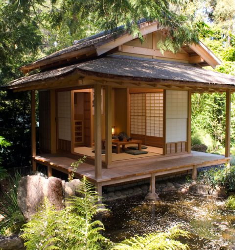

# 20 bin TL’ye 200 metrekare ev istemez misiniz?

**Tarih:** 28/11/2016  
**Orijinal Kaynak:** http://sdmimproje.com/20-bin-tlye-200-metrekare-ev-istemez-misiniz/  
**Arşiv Zaman Damgası:** 20190419131820  
**Etiketler:** Ruhi Kafesçioğlu, Matthieu Pedergnana, Toprak Yapı, Kerpiç, Alker (Alçılı Toprak), Saman Balyası, Geleneksel Ahşap & Hımış, Pasif İklimlendirme, Kendi Evini Yapmak, Depreme Dayanıklı Yapı, Doğal Yapı Rehberi, İstanbul, Datça & Ege, Fas & Mağrip, Mısır & Kahire, Kütahya & Domaniç, Fıtrî Mesken & Ev Felsefesi, Müstakil Yaşam & Hürriyet, Apartman & Dikey Şehirleşme Eleştirisi, Postmodernizm & Tüketim Eleştirisi, Kapitalizm & Çevre, Kırsal Mimari, Köy & Kaçış, Mimarlık Ortamı & Akademi Tenkidi  
**Atlas Düğümleri:** alker_teknigi, dogal_yapi_rehberi, toprak_yapi, geleneksel_ahsap, pasif_iklim, kendieviniyapmak, afet_deprem, sehir_hukuku, kirsal_koy, dogu_bati, hassan_fathy, ev_felsefesi, mustakil_yasam, apartman_elestirisi, goruntu_hakikat, kapitalizm_mulkiyet, mimarlik_egitimi  

---

Kaynak: a haber

Link: [http://www.ahaber.com.tr/ekonomi/2016/09/30/20-bin-tlye-200-metrekare-ev-istemez-misiniz](http://www.ahaber.com.tr/ekonomi/2016/09/30/20-bin-tlye-200-metrekare-ev-istemez-misiniz)

## Fiyatı 10 bin TL’den başlayan fiyatlarla ev yapmak mümkün. Nasıl mı? Saman, toprak, çuval, ağaç gibi malzemelerle… İnanmıyor musunuz? Öyleyse bu haberimizi mutlaka okuyun!..

Meral CANDAN / Para Dergisi

Çoğu** **insanın en büyük derdi barınma. Başımızı sokacak bir eve sahip olmak için ödemesi 15-20 yıl sürecek banka kredilerine boyun eğiyoruz. Çünkü İstanbul’da ev sahibi olabilmek çoğu çalışan için artık erişilmesi çok zor bir lüks. Artan kiralardan bahsetmiyoruz bile. Sahibinden.com ya da Hurriyetemlak. com gibi ev arama sitelerinde yapılacak kısa bir gezinti bu durumu teyit etmeye yeter. Eskilerin dediği gibi, “Bir evim olsun isterse kutudan olsun” lafının “Bir evim olsun maliyeti düşük olsun”a evrildiği günlerdeyiz.

Son yıllarda bazıları bu lafı düstur edinmişçesine evini kendi yapıyor; hatta kerpiç, saman, çuval, ağaç gibi çok da alışık olmadığımız yöntemleri kullanıyor. Bahsettiğimiz malzemelerle yapılmış evlere şehir merkezlerinde rastlayamasak da Datça, Bayramiç, Kaz Dağları, Alakır, Domaniç gibi destinasyonlarda bunların örneklerini görmek mümkün.

**SAMANDAN YAPILAN EVLER**

Ev deyince aklımıza yaşadığımız şehirlerdeki betonarme binalar geliyor ancak bir evin yapımında çimento dışında malzemelerin kullanabileceği ve bu malzemelerin çok uygun maliyetli olabileceğini pek aklımıza getirmiyoruz. Alışageldiğimiz kalıpları yıkmanın tam zamanı. Örneğin Erol Demir, eşi ile birlikte yaptığı Datça’daki evi için samanı tercih etmiş. Bu tercihte samanın hem uygun maliyetli hem de çevre dostu bir malzeme olması etkili olmuş. Bir başka örnek de Çanakkale’den. Bayramiç Yeniköy, çevre dostu yapılara sahip. Hatta bu tarz yapıların kullanımının yaygınlaşması için isteyen herkesin katılımına açık atölyeler de düzenliyorlar. Amaç başka bir evin mümkün olduğunu göstermek.

**TASARIMI UCUZ EVLER**

Ev yapımında alternatif malzemelere yönelenlerin çoğu benzer motivasyonlara sahip. İlk sırada ekolojik ve sağlıklı olması, ikinci sırada ise uygun maliyetli olması geliyor. Ekolojik ve sağlıklı bir eve ulaşmanın mümkün olduğunu da gösteriyor bu örnekler. Sadece saman, kerpiç ve çuval değil; genelde inşaatlarda görmeye alışkın olduğumuz konteyner ya da prefabrikler de dönüşüme uğrayarak ev haline getirilebiliyor. Aklınızda derme çatma örnekler canlanmasın. Biraz mimar eliyle bu malzemelerin nasıl şahane evlere dönüştüğünü gerek ülkemizdeki gerekse de yurtdışındaki örneklerde görebilirsiniz. Ya da Youtube’da oldukça popüler olan Alaska’da çuvaldan ev yapım videosunu izleyerek siz de yapabilirsiniz.

Deneyim elde etmek için yılın farklı zamanlarında düzenlenen sıva yapım ya da samandan ev yapım atölyelerine katılmak da mümkün. Profesyonel bir firmayla hareket etmek isterseniz bu seçenekler de mevcut. Zira ağaç, prefabrik, kerpiç başta olmak üzere bahsi geçen malzemeleri kullanarak anahtar teslim ev yapan firmaların sayısı da hayli fazla.

**AHŞAP MALİYETİ ARTIRIYOR**

Almanya’dan 10 yıl önce eşi ile birlikte Türkiye’ye gelerek Datça’ya yerleşen Erol Demir, kendi evlerini yapmaya karar vermiş. “Kiralık evde oturmak istemedik, kendi evimiz olsun dedik” diye anlatan Demir, bunun için arazi satın aldıklarını belirtiyor. Aslen makine mühendisi olan Demir’in kendi evini inşa etme kararını nasıl aldığını merak ediyoruz. Makine mühendisi olsa da baba mesleğinin inşaat olduğunu anlatarak bu işe çok da yabancı olmadığını söyleyerek söze başlıyor. Samandan ev yapımını öncelikle ekolojik olduğu için tercih ettiklerini söyleyen Demir, inşa ettikleri evin iki katlı olduğunu ve bu nedenle bolca ahşap kullanıldığını kaydediyor. Bu noktanın özellikle altını çiziyor Demir. Zira ev yapım malzemesi için saman oldukça ucuz bir seçenek ancak ahşap için benzer şeyi söylemek zor. Bu nedenle kullanılan ahşap miktarı saman evin maliyetini artırmış. Evin yaklaşık 70 bin TL’ye mal olduğunu söyleyen Demir aynı metrekarede tek katlı bir ev tercih etmeleri durumunda maliyetin yarı yarıya düşeceğini ifade ediyor.

**“SAMANIN ENERJİ VERİMİ YÜKSEK”**

Yüksek Mimar ve Doğal Yapı Ustası Matthieu Pedergnana aynı zamanda tasarım pratikleri ve bilimsel deneyler aracılığıyla doğal yapı malzemeleri üzerinde araştırma ve eğitim yapan Atelir-Metis’in de kurucu ortağı. Bugüne kadar pek çok evin yapımında bulunmuş ve konuyla ilgili atölyelerde eğitmenlik yapmış bir isim. Pedergnana’ya son dönemde samandan ev yapanların sayısında yaşanan artışı hatırlatıp “neden saman” diye soruyoruz. Pedergnana, saman balyasının doğal ve enerji verimliliği olan yapılarda kullanılan en önemli malzemelerden biri olduğunu vurgulayarak samanın özelliklerine işaret ediyor: “Samanın içinde hava bulunduran borumsu yapısı ve balyanın tuğla formunda olması, konvansiyonel yapı malzemelerine göre daha düşük maliyete ve hızlı bir şekilde iyi ısı yalıtımına sahip duvar ve çatı elde edilmesini sağlar” diye konuşan Pedergnana özellikle malzemenin yüksek ısı yalıtımı özelliğinden bahsediyor. Tarım malzemesi olduğundan samanın her sene üretildiğinin altını çizen Pedergnana, bu özelliği sayesinde saman balyasının sürekli ve kolay ulaşılabilir bir malzeme olduğunu söylüyor.

**FARKLI YÖNTEMLERİ VAR**

Bu tür evlerin maliyeti ise en merak edilen konu. Pedergnana maliyette belirleyici olanın saman balyasından ziyade seçilen yapım sistemi ve ahşap malzemenin miktarı olduğunu ifade ediyor. “Saman balyalarının taşıyıcı olarak kullanıldığı sistemler hızlı bir şekilde inşa edilebilir ancak yalnızca küçük ölçekli binalar yapılabiliyor. Saman balyasının dolgu malzemesi olarak kullanıldığı karkas sistemlerde ise daha fazla miktarda malzemeye ihtiyaç duyuluyor ki, bu da yapının toplam maliyetini ve inşaat süresini arttırıyor” diyen Pedergnana uygulanacak sıva kalitesine dikkat çekiyor. Balyaların diziliminin oldukça hızlı yapılabildiğini vurgulayan Pedergnana, dayanıklı ve koruyucu bir doğal sıvanın uygulanmasının ise zaman alabildiğinin altını çiziyor.

**200 METREKARE EV 20 BİN TL**

Samanı her iki yanını kağıtla baskılayarak panel duvar haline getiren ve yılda 750 bin metrekare üretim kapasitesine sahip Epa Yapı da ekolojik bir mimari anlayışı benimsemiş. Saman evlere ilginin arttığını ifade eden Epa Yapı Kurucusu H. Bora Yılmaz, saman evlerin sağlıklı olduğuna vurgu yapıyor. Bu evlerin karbon emisyonunun sıfır olduğunu söyleyen Yılmaz, betonun ömrünün 50, bu evlerin ömrünün ise 250 yıl olduğunu belirtiyor.

200 metrekarelik bir evin samanla 20 bin TL’ye yapılabileceğini kaydeden Yılmaz, saman evin güvenli bir seçenek olduğunu da anlatıyor. Epa Yapı olarak ürettikleri saman panelleri nano teknoloji kullanarak yanmaz bir madde ile kapladıklarını anlatan Yılmaz “samandan ev çabuk yanar” algısına da açıklık getiriyor. Saman evlerin sadece yangına değil depreme de dayanıklı olduğunu belirten Yılmaz, “Bu evler betonarme evlere göre yüzde 80 daha hafif. Bir betonarme duvar metrekare başına binaya ortalama 100-120 kilogram ağırlık bindirir ancak saman panelde bu, 20 kilogramdır. Depremlerde genelde binanın kendi ağırlığıyla yıkıldığını düşünürsek yüzde 80 daha hafif bina yapılıyor demektir” diyor.

**NEM VE RUTUBET YOK**

Saman panellerin pasif yapılar olduğunu belirten Yılmaz, bu yapıların nefes aldığını, beton duvarlar gibi radon gazı salgılamadığını belirtiyor. Nem, rutubet barındırmadığını kaydeden Yılmaz, saman panellerin yazın serin, kışın ise sıcak tutarak ciddi bir enerji tasarrufu sağladığını da sözlerine ekliyor. Bu kısım önemli çünkü geçtiğimiz aylarda medyaya yansıyan bir haber apartman dairesinde ısınamayan bir çiftin samandan ev yapmalarını konu ediniyordu. Buna göre Kütahya’nın Domaniç ilçesinde yaşayan Naim ve Feride Gün çifti, 150 metrekarelik bir evde yaşıyordu ama ısınma sorunu çekiyordu. Dört yıl önce bu sorunlarını oğulları ile paylaşan çiftin sorununa çözüm internetten geldi. Oğulları Mehmet Gün internette yaptığı araştırma ile ısınma sorununu çözecek cevabın samanda olduğunu gördü. Bunun üzerine Uludağ eteklerinde bulunan Muratlı Köyü’ne saman ev yapan çift 160 balya saman kullandı. Evin dış cephesi ise inci taş ve alçıyla sıvandı. Ayrıca evin zemininde laminant parke, çatı içinde şıngıl tercih edildi. Tüm bunların maliyeti ise 7.500 TL oldu. Elbette maliyetin bu kadar düşük olmasında çiftin çiftçi olmasının payı büyük. Ev yapımında kendi ürettikleri saman balyalarını kullanan çift sonuçtan son derece memnun.

**AVRUPA’DA DA ARTIYOR**

Anadolu’daki köylerde bolca örneğini gördüğümüz kerpiç evler de son dönemin yeni trendlerinden. Sebebi çok basit: Hem sağlıklı hem ucuz. Yazın serin kışın ise sıcak hava sağlayan kerpiç evlerin en önemli özelliği saman ev gibi duvarlarının hava alması. Hava alan duvarlar evin içindeki nemi dengeliyor. Kerpicin doğada bulunan malzemelerden elde edilmesi yapının maliyetinin düşük olmasına neden oluyor. Fas ve Anadolu’da kerpiç yapılar inşa eden Sdmim Proje’den Mimar Serkan Duman, kerpicin ‘Toprak Ana’dan elde edilen bir malzeme olduğuna vurgu yapıyor. “Dünyada kullanılmadığı bir coğrafya bulamazsınız. Sadece, bölgeden bölgeye biçimi değişir” diyen Duman, kerpiç yapıların her türlü coğrafi ve iklim koşuluna uyarlanabileceğini söylüyor. Duman, bugün kerpiç ev yapımının hızla arttığını, sanılanın aksine sadece az gelişmiş ülkelerde değil Avrupa’da da bu yapılara olan talebin hız kazandığını kaydediyor.

**BİR AYDA YAP, BİN YIL YAŞASIN**

Kerpiç yapıların ömrünün oldukça uzun olabileceğini belirten Duman, bu konuda Mısır’daki 3400 yıllık Ramesseum tahıl depolarını örnek gösteriyor. Duman, ayrıca yaşlanan kerpiç yapıların küçük dokunuşlarla elden geçirilmesinin onların ömrüne ömür katacağını da sözlerine ekliyor.

Duman’a kerpiç bir evin maliyetini soruyoruz. O da evin içinde kullanılacak malzemeye göre maliyetin değişeceğini dile getirerek, en büyük maliyetin işgücü olduğunu ifade ediyor. Ancak Duman, eş, dost ve akrabadan yardım alınarak yapılacak bir evin maliyetinin aşığa çekilebileceğini söyleyerek şu örneği veriyor: “Yine de yaklaşık bir metrekare fiyatı vermek gerekirse, ortalama 250-400 TL’lik metrekare birim fiyatından bahsedilebilir. Süreye gelince ise 60-70 metrekarelik bir ev sıkı çalışılarak bir ay içinde tamamlanabilir.”

**DOĞAL YAPILAR İÇİN**: SDMIM MİMARLIK [https://www.sdmim.com/](https://www.sdmim.com/)

**KÜÇÜĞÜ 60, BÜYÜĞÜ 300 BİN TL**

Doğaya uyumlu bir diğer bir ev seçeneği de ağaç/kütük evler. Ağaç evlere genelde tatil köylerindeki bungalov tarzı evlerden aşinayız. Ancak bu evler sadece tek odadan oluşmuyor. Talebe göre 70-80-120 metrekarelere, hatta daha da üstüne çıkabiliyor. Elbette evin metrekaresi büyüdükçe fiyatlar da artıyor. Örneğin, konuyla ilgili görüşlerine başvurduğumuz Baneva firmasının internet sitesinde anahtar teslim pek çok ağaç ev seçeneği bulunuyor. Bugün itibariyle 245 metrekarelik ağaç evin fiyatı 300 bin TL. 164 metrekarelik ev ise 230 bin TL. “Küçük olsun, benim olsun” derseniz de 45 metrekarelik evin fiyatı 61 bin 875 TL. Baneva Firma Ortağı Serdar Akın, ahşabın sağlıklı bir malzeme olduğunu vurgulayarak başlıyor konuşmasına. “Bunun yanı sıra beton ev taşınmaz. Ahşap ev yapımı sırasında ortaya çıkan malzemeler geri dönüştürülerek farklı alanlarda kullanılabilir” diye devam eden Akın, dünya üzerindeki kanser vakalarının yüzde 14’ünün radon gazından kaynaklı olduğunu iddia ediyor.

Amerika’da betonarme binalarda radon gazı tahliye aspiratörünün artık bir zorunluluk olduğunu belirten Akın, İsveç gibi bazı Avrupa ülkelerinde de bu uygulamanın olduğunu söylüyor.

**100 YIL GARANTİLİ**

Akıllardaki sorulardan birini soruyoruz: “Ahşap ev her iklim koşuluna uygun mu?” Akın ahşabın her iklim koşuluna uygulanabileceğini kaydederek “Ahşapta iki türlü sıkıntı var. Birincisi böceklenip, kurtlanması ve çürümesi. İkincisi de güneş ve yağmurun etkileri nedeniyle yıpranması… Ama bunların da çözümü var” diye konuşuyor. Emprenye yöntemiyle ahşap yapıların ömrünün 100 yıl garantili olduğunu anlatan Akın, bu işlemin yıllar sonra tekrarlanması halinde yapıya bir yüz yıl daha kattığını belirtiyor.

**“PROFESYONELLERİN İŞİ”**

İstanbul Ahşap Tasarım & Kent Mobilyaları Firma Yetkilisi Metin Ölçer ise, firma olarak yılda 10 ev siparişi aldıklarını belirtiyor. İnsanların genel olarak uygun maliyetli ve çok da büyük olmayan evleri tercih ettiğini söyleyen Ölçer, bunların da maliyetinin ortalama olarak 75 bin -100 bin TL arasında olduğunu söylüyor. 90 gün sonra ahşap eve sahip olmanın mümkün olduğunu kaydeden Ölçer, sipariş vererek değil de kendi ahşap evini yapmak isteyenlere şunları söylüyor: “Bu durum sizin kabiliyetinize kalmış ama bu iş profesyonellerin işidir. Basit bir marangozluk çalışması gibi düşünürseniz yanılırsınız. Zira doğada her şey denge ile yerine oturur. Ahşabın kesim açılarını yerine uygun şekilde yapmadığınızda sağlam bir yapı oluşturamazsınız, eğreti olur. Yapıda hem görsellik hem de sağlamlık olmalı.”

**ŞANTİYEDEN ÇİFTLİĞE**

Çoğunlukla şantiyelerde kullanılan prefabrik ve konteyner malzemelerin harika evlere dönüşebileceğini söylersek inanır mısınız? İnternette yapacağınız kısa bir gezinti bildiğiniz tüm kalıpları yıkacak. Zira üretilmiş bir malzemenin hem yeniden kullanımı yani geri dönüştürülmesi hem de maliyetlerin düşürülmesi söz konusu olan. Çanakkale doğumlu seramik sanatçısı Demet Otur, işi nedeniyle yıllarca İstanbul’da yaşadıktan sonra evlenmiş ve köyüne dönmeye karar vermiş. Seramik işlerine devam ederken daha sakin bir hayatı düşlemiş. Onu da şimdilik bulmuşa benziyor. Zira Kaz Dağları eteklerinde kurulu evini bir çiftliğe dönüştürüp adını da Saman Çiftliği koymuş. Dışardan bakıldığında oldukça sevimli görünen bu evin ana malzemesi aslında bir prefabrik ev. Başlangıçta prefabrik ev akıllarında yokmuş. Tesadüf eseri şantiyeden çıkma, ikinci el bir prefabrik ev bulmuşlar. Fiyatının uygunluğu ve kurulumunun hızlılığı onları cezbetmiş. Otur prefabrik evin maliyeti ile ilgili şu bilgileri veriyor: “Prefabrik evin 100 metrekarelik temeli için 9 bin TL, 60 metrekarelik kapalı alan (çerçeve, kapı, duvar) için 9 bin TL, çatı izolasyonu için 2 bin TL, mutfak yapımı, veranda, banyo malzemeleri için 10 bin-15 bin TL civarı bir harcamamız oldu.”

**KAYNAK İNTERNETTE BOL**

Ancak prefabrik yapıyı tekrar tercih etmeyeceğini söylüyor Otur; neden olarak da bir sonrakinde doğayla daha uyumlu malzeme kullanmak istediğini belirtiyor. Aklında samandan yeni bir ev yapmak var. “İzolasyon konusunda doğal malzeme olarak saman balyasından ya da kerpiçten ev yapımı oldukça mantıklı geliyor. Ayrıca son derece ekonomik” diye konuşan Otur, yaşadığı çevrede kerpiç ustası bulunmaması nedeniyle ibreyi samana çevirmiş. Saman balyasının her açıdan isteklerini karşıladığını anlatan Otur, “Üstelik malzeme olarak istediğimiz şekilde amorf yapıya imkan veriyor. Doğal, estetik, ekonomik” diyor. Kendi evini yapma konusunda tecrübesi olup olmadığını merak ediyoruz. Ancak internette konuyla ilgili oldukça fazla kaynak olduğunu belirtip, daha önce bunu deneyimlemiş arkadaşlarından da yardım alacağını sözlerine ekliyor.

**ÇUVALLARI DOLDUR TOPRAKLA!**

Alternatif malzemelerle uygun fiyatlı ev yapımı aslında yeni bir konu değil. Yıllardır Almanya başta olmak üzere Amerika kıtasındaki ülkelerde de oldukça yaygın bir yöntem. Ancak bunun ülkemize yansımasının kökleri oldukça yeni. Fakat herkesin günün birinde kendi evine sahip olabileceği fikri çok heyecan verici. Hatta isterseniz bu evi ellerinizi çamura bulayarak kendiniz yapabilirsiniz. Saman, kerpiç, ağaç ve konteyner gibi yöntemlere çuvaldan ev yapımını eklemezsek eksik kalır. Zira en büyük maliyetiniz çuval torbaları ve kullandığınız ahşaplardan ibaret. Toprak ise doğada fazlasıyla mevcut. Çuvaldan ev yapımıyla ilgili internette çok fazla bilgi var. Bir gözünüz internetteyken Türkiye’de bu işe gönül verenleri de takip edin deriz. Çünkü bilgi ve deneyim paylaşımı oldukça önemli. Facebook’ta yer alan ‘Earthbag Building Turkey’ sayfası konuyla ilgili bilgiyle dolu.

**ÇEVRE DOSTU **MALZEME

**Matthieu PEDERGNANA / Yüksek **Mimar ve Doğal Yapı Ustası

Alternatif yapı malzemeleri, konvansiyonel olanlara göre daha çevre-dostu olduğu için kullanımlarındaki artış olumlu bir gelişme. Türkiye’deki ilk saman balyası ev 1999’da inşa edildi. Şu anda Türkiye’de sera, depo veya yazlık ev gibi çok çeşitli kullanımlarda 35 adet saman balyasından yapılmış yapı bulunuyor. Ancak sayıdaki artış olumlu da olsa, Türkiye’de her yıl inşa edilen yapı sayısına göre bu rakam çok düşük. Maalesef, uygun inşaat planlamasının ve deneyiminin olmadığı durumlarda, konforsuz ve güvenli olmayan yapılar ortaya çıkıyor. Neyse ki bu konuda uzman mimarlar, mühendisler ve yapım şirketleri, doğal yapı inşaatı süreçlerinin üstesinden gelerek verimli ve estetik yapılar meydana getirebiliyor. Bu tür eksikliklere rağmen, her geçen gün daha fazla insan çevresel ve sağlık ile ilgili nedenlere bağlı olarak alternatif yapı malzemelerini tercih ediyor. Toprak ve saman esaslı malzemelerin gömülü enerjileri düşük ve kolaylıkla doğaya geri dönüşebiliyorlar. Dahası, doğal malzemeler, uygun bir tasarımla yapı içerisindeki nem oranının dengelenmesini ve yaz-kış iç mekânda konforlu bir sıcaklığın oluşmasını sağlayarak yapıdaki enerji tüketimini en aza indiriyor.

**“YÜZDE 30 DAHA **EKONOMİK”

Bora YILMAZ / Epa Yapı Kurucusu

Doğru bir altyapı ile planlandığında Epa Yapı konseptinde ortalama bir saman panelden yapılan 200 metrekare ev her şeyi ile 20 gün gibi kısa bir zamanda bitirilir. Saman ekolojik yapı malzemesidir ancak ekolojik yapı tekniğini de doğru bilmek, doğru kurgulamak gerek. Saman panelden yapılan bir ev, ekolojik yapı demek değildir. Epa Yapı konsepti ile şehirlerin etrafına ekolojik mahalleler yaparak şehirlere nefes aldırabilirsiniz. Bu yaşam mahallerinde sürdürülebilirlilik ilkesi vardır. Ekolojik tarımı da berberinde yapabilirsiniz. Sosyal yaşam açısından ülke ekonomisine ciddi bir katkı sağlayacağı için sosyal sorumluk projesi olarak da düşünmek gerekir. Ayrıca hızlı kurulan bir yapım malzemesidir, klasik inşatlara göre yüzde 30 daha ekonomik ve daha uzun ömürlüdür. Çok kısa bir zamanda kurulduğu için ekonomik getirisi vardır.

**“ENERJİ TASARRUFU **SAĞLIYOR”

Ruhi KAFESÇİOĞLU / Prof. Mimar,** ****Toprak Yapılar Çalışma Yürütme **Kurulu Üyesi

Toprak Yapılar Çalışma Grubu, yıllardır toprak yapıların kullanımının artmasına yönelik çalışmalar yapıyor. Bu grubun üyelerinden biri de Ruhi Kafesçioğlu. Mimar olan ve İTÜ’de uzun yıllar profesör olarak ders veren Kafesçioğlu, ömrünü toprak yapılarla ilgili yanlış bilinenlere ayırmış dersek yanılmış olmayız. Zira kendisi 92 yaşında ancak toprak yapılarla ilgili bilgi almak istediğimizi söylediğimizde bizi kırmadı; heyecanla toprak yapıların hem insan sağlığına hem de çevreye olan faydalarını anlattı. Kafesçioğlu’nun en büyük şikayeti toprak yapıların depreme karşı dayanıksız olduğuna yönelik önyargılar. “Kuralına uygun yapmak önemli” diyor Kafesçioğlu ve “Böyle yapılmadığı sürece betonarme binanın da dayanıklılığı yok” diye konuşuyor. Toprak yapıların betonarme yapılara göre daha uygun maliyetli olmasının ötesinde önemi olduğunu söyleyen Kafesçioğlu, “Yapım sırasında biraz daha ucuz ama asıl olarak toprak yapı, enerji tasarrufu sağlaması ve uzun ömürlü olması ile uzun vadede kazandırıyor” diyor. Toprak yapıları güçlendiren ve direncini artıran “Alker” yöntemini geliştiren Kafesçioğlu’na bırakıyoruz sözü ve gerisini ondan dinliyoruz: “Alker, uygun kerpiç toprağına yüzde 10-20 arasında alçı katılmış bir kerpiç türüdür. Bunun bir örneğini İTÜ’nün Maslak Kampüsü içinde yaptık. Bu binada çeşitli ölçümler ve gözlemler yapıyoruz. Bir süre yuva olarak kullanılan bu binada yaptığımız ölçümlerden biri oldukça önemli sonuçlar verdi. Kışın tahminimizin yarısı kadar ısınmak için enerji harcandı. Yani binanın duvarları içerideki ısıyı dışarıya çıkarmazken dışarıdaki soğuğu da engelledi. Bu yaz için de geçerli. Bu tür yapılarda klimaya ihtiyaç duymazsınız. Dünyada toprak yapılara pek çok örnek var. Amerika’da özellikle üst gelir seviyesindeki bazı kişiler evlerini topraktan yaptırır. Neden? Çünkü sağlıklı ve tasarruflu…” Toprak Yapılar Çalışma Grubu şimdiye kadar çeşitli atölyeler düzenledi. Çoğunlukla mimarlık öğrencilerine yönelik olsa da bu atölyeler toprak yapılara ilgi duyan herkese açık.

**DOĞAL YAPILAR İÇİN**: SDMIM MİMARLIK [https://www.sdmim.com/](https://www.sdmim.com/)
