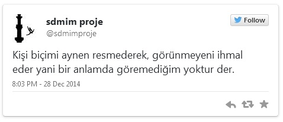

# Görülemeyen yok mudur?

**Tarih:** 28/12/2014  
**Orijinal Kaynak:** /sdmimproje/2240.html  
**Arşiv Zaman Damgası:** 20190102010455  
**Etiketler:** Doğu-Batı Ayrımı, İslam & Medeniyet Tasavvuru  
**Atlas Düğümleri:** dogu_bati, medeniyet  

---

> 

Kişi biçimi aynen resmederek, görünmeyeni ihmal eder yani bir anlamda göremediğim yoktur der.

— sdmim proje (@sdmimproje) [28 Aralık 2014](https://twitter.com/sdmimproje/status/549264453846716416)

**sdmimproje**