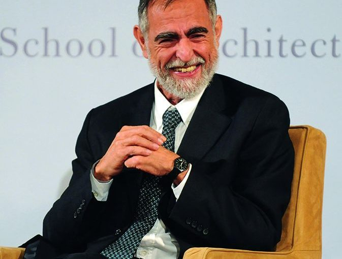

# Abdel-Wahed El-Wakil 2009’da ne dedi?

**Tarih:** 11/09/2014  
**Orijinal Kaynak:** http://sdmimproje.com/abdel-wahed-el-wakil-2009da-ne-dedi/  
**Arşiv Zaman Damgası:** 20220408235526  
**Etiketler:** Abdel-Wahed El-Wakil, Kerpiç, İslam & Medeniyet Tasavvuru  
**Atlas Düğümleri:** cansever, toprak_yapi, medeniyet  

---

> 
In the historic and holy city of Medina in western Saudi Arabia, where the Islamic prophet Muhammad is buried, an architect was in charge of renovating a mosque, which had been clad in a stone plaster material. Despite its widespread use in the Western world, using an imitation stone to renovate such a significant building was plain wrong, according to a Middle Eastern architect who had a particular interest in the subject. That architect, considered by many to be the world’s foremost authority on Islamic architecture, was Abdel-Wahed El-Wakil.

After observing the work at the mosque, El-Wakil had an audience with the prince of Medina and told him that using imitation stone was unacceptable. **“The whole idea of Islamic art is not to imitate nature, but to copy its mode of operation – how it works,”** he says. **“Nature works with geometry, so all of the Islamic patterns are based on geometry and thousands of different interlacing patterns….The architecture was very true. There was nothing forced.”** The prince wondered, however, what they were to do if it proved too expensive to restore the mosque with marble or stone. **“I said, ‘Do it in earth – mud brick,'”** El-Wakil recalls. **“Poverty is not a shame in religion. Material poverty is not a shame. It is spiritual poverty that is a shame, so why be false?”**

By Kim A. O’Connell

Batı Arabistan’da, tarihi ve kutlu şehir Medine’de, Hz. Muhammed’in (S.A.V.) medfun olduğu yerde, bir mimar mescidin yapay taş sıva ile yenilenmesi ile ilgili olarak görevlendirilmişti. Konuyla ilgili bir orta doğulu mimara göre, batı dünyasında oldukça yaygın olarak kullanılmasına rağmen, böylesine önemli bir yapıda yapay taş kullanılması düpedüz hataydı. Bu mimar birçoklarına göre dünyanın önde gelen islam mimarisi otoritelerinden olan Abdel-Wahed El-Wakil’di.

Çalışmaları inceledikten sonra, EL-Wakil Medine prensi ile görüştü ve ona yalancı taş kullanmanın kabul edilemez olduğunu söyledi.** “İslam sanatında bütün düşünce doğayı taklit etmemek, belki çalışma biçimini kopye etmek üzerinedir – nasıl çalışıyorsa,”** ve der ki. **“Doğa geometri ile çalışır, böylece bütün islami motifler geometrinin ve iç içe geçmiş farklı motiflerin üzerine kuruludur… Mimari çok sahiciydi, zorlama birşey yoktu.”** Prens mermer ve taş kullanarak restorasyon yapmanın çok pahalı olması konusunda ne yapmaları gerektiğini merak ediyordu. **“Dedim ki, ‘Toprakla yapın – kerpiçle,'”** El Wakil hatırlattı. **“Yoksulluk dinde utanılacak bir şey değildir. Malzeme yokluğu utanılacak bir durum değildir. Utanılacak olan manevi yoksulluktur. Öyle ise neden yanlış olsun?”**

Kim A. O’Connell

[Yazının devamı](http://www.traditionalbuildingportfolio.com/profiles/commercial/buildingislamic.html)

İlgili mülakatın videosu:

[El-Wakil ve Projeleri Üzerine -1 Evler](/sdmimproje/el-wakil-ve-projeleri-uzerine-1-evler.html)

[Abdel Wahed El Wakil ve Bazı Projeleri](/sdmimproje/el-wakil-ve-projeleri-uzerine-1-evler.html)

**sdmimproje**