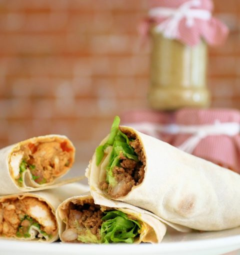

# Adana mı? Tavuk Dürüm mü? Türk Mutfağı DİKKAT: Bilgi ve fikir içerir.

**Tarih:** 12/12/2019  
**Orijinal Kaynak:** /sdmimproje/adana-mi-tavuk-durum-mu-turk-mutfagi-dikkat-bilgi-ve-fikir-icerir.html  
**Arşiv Zaman Damgası:** 20191218023501  
**Etiketler:** İstanbul, Fas & Mağrip, Postmodernizm & Tüketim Eleştirisi, Sinema & Mekân İdrakı, Kapitalizm & Çevre  
**Atlas Düğümleri:** sehir_hukuku, dogu_bati, goruntu_hakikat, kapitalizm_mulkiyet  

---

Mimar Serkan Duman anlatıyor. Neden restoranların büyük bölümü kebapçı? Tavuk döneri bu kadar çok tüketmemizin bir sebebi var mı? Türk mutfağı dünyanın en iyi mutfağı mı? Mutfaktaki çeşitlilik Türkiye’de hayat için de geçerli mi? Kebap ile mimari arasında bir ilişki kurulabilir mi?

…..Patreon’dan bize destek olabilirsiniz: [https://www.patreon.com/sdmimproje](https://www.youtube.com/redirect?v=OKCd4i9PmCA&event=video_description&q=https%3A%2F%2Fwww.patreon.com%2Fsdmimproje&redir_token=OtNcjeIloJyuMxP2zre1Xp_TlGd8MTU3NjIyMTQ2MEAxNTc2MTM1MDYw)

[#yemek](https://www.youtube.com/results?search_query=%23yemek) [#mutfak](https://www.youtube.com/results?search_query=%23mutfak) [#mimari](https://www.youtube.com/results?search_query=%23mimari)

[0:00](https://www.youtube.com/watch?v=OKCd4i9PmCA&t=0s) Açılış [0:10](https://www.youtube.com/watch?v=OKCd4i9PmCA&t=10s) Intro [0:25](https://www.youtube.com/watch?v=OKCd4i9PmCA&t=25s) Tavuk Döner mi Adana dürüm mü yemeli? [0:35](https://www.youtube.com/watch?v=OKCd4i9PmCA&t=35s) Türkiye’de en çok ne yeniyor? [0:56](https://www.youtube.com/watch?v=OKCd4i9PmCA&t=56s) Restoran menüleri [1:17](https://www.youtube.com/watch?v=OKCd4i9PmCA&t=77s) Rick Stein ve Türk yemekleri [1:40](https://www.youtube.com/watch?v=OKCd4i9PmCA&t=100s) Türk Mutfağı en zengin mutfak [1:45](https://www.youtube.com/watch?v=OKCd4i9PmCA&t=105s) Neden en çok kebap yeniyor [2:09](https://www.youtube.com/watch?v=OKCd4i9PmCA&t=129s) Kapitalizm ve yemek kültürü [2:28](https://www.youtube.com/watch?v=OKCd4i9PmCA&t=148s) Neden bu kadar kebapçı var? [3:20](https://www.youtube.com/watch?v=OKCd4i9PmCA&t=200s) Tavuk dönerci ve mekân [4:54](https://www.youtube.com/watch?v=OKCd4i9PmCA&t=294s) Yemek çeşitliliği [5:38](https://www.youtube.com/watch?v=OKCd4i9PmCA&t=338s) Yemek ve mimari arasındaki ilişki [5:54](https://www.youtube.com/watch?v=OKCd4i9PmCA&t=354s) Türkiye’deki çeşitliliği yeniden görmek [6:02](https://www.youtube.com/watch?v=OKCd4i9PmCA&t=362s) Postmodernizm sonrası trendler [6:40](https://www.youtube.com/watch?v=OKCd4i9PmCA&t=400s) Sanat tarihçilerinin alışkanlığı [7:14](https://www.youtube.com/watch?v=OKCd4i9PmCA&t=434s) Yerel mimariye içeriden bakmak [7:28](https://www.youtube.com/watch?v=OKCd4i9PmCA&t=448s) 1890’larda İstanbul kitabı [8:14](https://www.youtube.com/watch?v=OKCd4i9PmCA&t=494s) İstanbul’daki çeşitlilik [8:49](https://www.youtube.com/watch?v=OKCd4i9PmCA&t=529s) Enerjik şehir [9:17](https://www.youtube.com/watch?v=OKCd4i9PmCA&t=557s) Benzersiz köprü Galata [10:00](https://www.youtube.com/watch?v=OKCd4i9PmCA&t=600s) Hint filmleri [11:05](https://www.youtube.com/watch?v=OKCd4i9PmCA&t=665s) Rakı, Şiş Kebap nasıl? [11:28](https://www.youtube.com/watch?v=OKCd4i9PmCA&t=688s) Harem [11:50](https://www.youtube.com/watch?v=OKCd4i9PmCA&t=710s) Süleymaniye’yi konuşmak [12:40](https://www.youtube.com/watch?v=OKCd4i9PmCA&t=760s) Mimariyi abide üzerinden okumak [13:29](https://www.youtube.com/watch?v=OKCd4i9PmCA&t=809s) Sivil yapı stoğu [13:59](https://www.youtube.com/watch?v=OKCd4i9PmCA&t=839s) Türkiye’de mimari üretim neden kısır? [14:15](https://www.youtube.com/watch?v=OKCd4i9PmCA&t=855s) Türkiye’de mimari çeşitlilik [14:50](https://www.youtube.com/watch?v=OKCd4i9PmCA&t=890s) Türk Evi? [15:20](https://www.youtube.com/watch?v=OKCd4i9PmCA&t=920s) Yerel mimari yeniden üretilebilir mi? [15:53](https://www.youtube.com/watch?v=OKCd4i9PmCA&t=953s) Globallik ve yerellik [17:30](https://www.youtube.com/watch?v=OKCd4i9PmCA&t=1050s) Mimaride biçim ve sürdürülebilirlik [18:30](https://www.youtube.com/watch?v=OKCd4i9PmCA&t=1110s) Nasıl bir mimari üretim? [19:12](https://www.youtube.com/watch?v=OKCd4i9PmCA&t=1152s) Türk mimarlığı dünyada nasıl? [19:40](https://www.youtube.com/watch?v=OKCd4i9PmCA&t=1180s) Yaşam kültürü ve mimari [20:38](https://www.youtube.com/watch?v=OKCd4i9PmCA&t=1238s) Fas’taki şehir [22:05](https://www.youtube.com/watch?v=OKCd4i9PmCA&t=1325s) Mimari son aşama
