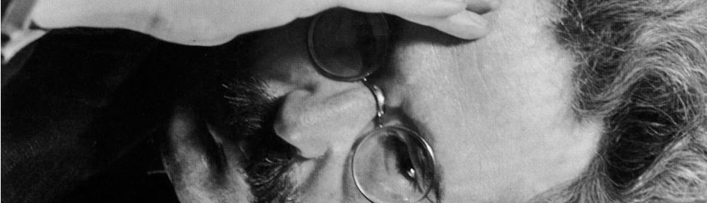

# Ağzına sağlık Benjamin (Konut Hakkında)

**Tarih:** 24/09/2014  
**Orijinal Kaynak:** http://sdmimproje.com/agzina-saglik-benjamin-konut-hakkinda/  
**Arşiv Zaman Damgası:** 20190102052514  
**Etiketler:** Walter Benjamin, Le Corbusier, Datça & Ege, Fıtrî Mesken & Ev Felsefesi, Müstakil Yaşam & Hürriyet  
**Atlas Düğümleri:** apartman_elestirisi, kirsal_koy, ev_felsefesi, mustakil_yasam  

---

[Walter Benjamin,](http://en.wikipedia.org/wiki/Walter_Benjamin) (1892-1940) ünlü düşünür. Konut hakkındaki sözleri takdire şayan. Zira günümüzde pek yapılmayan bir şeyi yapıyor. Önce aklından geçenin ne olduğunu tam manasıyla kavrıyor sonra da düşüncesini çekinmeden açıklıyor. Peki konut hakkında neler söylüyor?

> 
*“*Tüm meskenin ilkel formu bir ev değil, bir kılıftır. Bu kılıf sakinlerinin mührünü taşır. En uç noktaya taşındığında mesken bir kılıfa dönüşür. On dokuzuncu yüzyıl meskene, herhangi bir çağdan çok daha fazla özlem duydu. On dokuzuncu yüzyıl, meskeni bir kutu olarak düşündü ve şimdiye kadar bireyi tüm eşyalarıyla birlikte onun içine öyle bir tıktı ki, genellikle tüm aksesuarları ile birlikte mor renkli kadife kovuklara derinlemesine sokulan pergel takımlarını akla getirir.”

Başka?

> 
“Yüzyılın dönüm noktasında iç mekân, art nouveau ile sarsıldı. Kabul edilmelidir ki, art nouveau ideolojisi sayesinde, iç mekânı mükemmelleştirmiştir münferit insanın başkalaşımı, art nouveau’nun hedefi olarak tezahür ediyor. Bireycilik onun kuramıdır. Van de Velde’de ev, kişiliğin bir ifadesi olarak yol gösterir. İmza, bir tablo için ne anlama geliyorsa, süsleme de Van de Velde’nin evi için o anlama gelir.”

Daha başka?

> 
“Bu çağın ayırt edici özelliği, güvenliğin öncelikli olduğu eski anlamıyla mesken kelimesinin miadını doldurmuş olmasıdır. Giedion, Mendelsohn, Corbusier; insanın daimi mekânlarını, muhtemel her türlü kavranabilir enerjinin, ışık ve hava dalgalarının geçiş alanına çevirdiler. Yaklaşmakta olan zamana saydamlık egemen olacaktır. Sadece odalara değil, Pazar gününü kaldırıp yerine değişebilir tatil günlerini geçirmeyi isteyen Ruslara bakacak olursak şayet haftalara bile”* *

“Sürrealizm” başlıklı denemesinde bir Rus otelinde yaşadığı deneyimi hatırlayan Benjamin’ini, otel müşterilerinin açık bıraktığı oda kapılarının sayısı  şaşkına uğratmıştır. Farkına varır ki:

> 
“Bir cam evde yaşamak, mükemmel devrimci bir erdemdir. Üstelik bu fena halde ihtiyaç duyduğumuz bir mest olma halidir, ahlaki bir sergilemedir. Bir zamanlar aristokrat bir erdem olan, insanın kendi varoluşuna dair ketumluğu, giderek küçük burjuva sonradan görmeliği meselesi haline gelmiştir.”

Cam bir eve yapılan tek göndermesi bu değildir. Bu konuyu Benjamin, “Erfahrung und Armut” ta olduğu gibi Karl Kraus hakkındaki denemesinde de tekrarlar. Benjamin, burada Loos ve Le Corbusier’in gerçekleştirdiği ayarlanabilir esnek cam evler örneğinden bahseder: **

> 
“Camın, yüzeyine hiçbir şeyin tutunamayacağı kadar sert ve pürüzsüz bir malzeme olması hiç de tesadüf değil. Üstelik soğuk ve gösterişsizdir. Camdan yapılan şeylerin ‘aura’sı yoktur. Cam, gizliliğin eşsiz bir düşmanıdır.”

Şimdi dilerseniz Benjamin’in sınırsız özgürlük ve ifşaya olan tutkusunu paylaşanlarla paylaşmayanları farklı iki köşeye alalım… Öyle tahmin ediyoruz ki mahremiyetinin sınırsızca paylaşımını istemeyenlerin sayısı çoğunlukta. Ve bu kişiler günümüzden 122 yıl önce doğmuş bir insandan bu kadar “ilerlemeye” rağmen farklı düşünüyor.

Ancak şunu hatırlatmamız gerekiyor. Benjamin’den farklı düşünmek Benjamin’in arzu ettiği geleceği yaşamadığınız anlamına gelmiyor. Öncelikle konut üretimi tamamen sınırsız cam biçiminde ilerlemekte, (özellikle Türkiye’de) bunun yanında ceplerimizde taşıdığımız ya da üzerinde kamera bulunan aletler ve akıllı ev denerek bütün mekanların kameralarla donatılması diğer “camdan evler”imizde yaşatıyor bizleri.

Son zamanlarda neredeyse hergün bir başka ünlünün anadan doğma görüntülerinin siber korsanlar taradından paylaşılması, bunun yakında sıradan bireylerin de başına geleceğinin bir göstergesi aslında. İşin ilginç yanı ise muhtemelen çıplaklığın tamamen önemsizleşeceği. Benjamin’e göre işte o zaman hepimiz erdemli! birer yaratığa dönüşeceğiz.

Eyvallah… Ne Benjamin’e ne de onunla aynı düşünceyi paylaşanlara bir sözümüz yok. Zira kişinin düşünebilmesi ve düşüncesine göre yaşayabilmesi takdir edilesidir. Ancak mahremiyetlerinin ihlalinden korkanlara bir hatırlatmamız var. Çoğumuzun yaşayış biçimi Benjamin’in “aşmış” dünyasına çıkıyor. Evlerimiz ve kendimizi onlara muhtaç ettiğimiz teknolojik aletler ifşa dünyasının yolunda olduğumuzun bir kanıtı.

Taraf seçmek lazım. Nasıl bir hayat istiyoruz? Zira yaşadığımız yer olan konut ve şehirler buna göre şekillenecek.

# [bkz. Herhangi bir eve her zaman girebilirsin.](/sdmimproje/herhangi-bir-eve-her-zaman-girebilirsin.html)

**[bkz. Tanrım youtube’da bir klip izleyelim.](/sdmimproje/tanrim-youtubeda-bir-klip-izleyelim.html)**

**sdmimproje**
