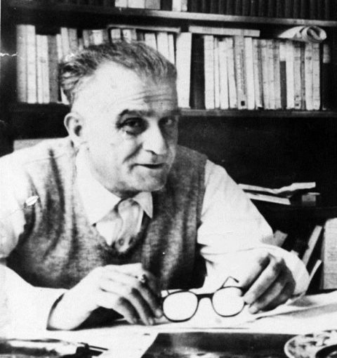

# Ahmet Hamdi Tanpınar “Yaşadığım Gibi”de ne dedi?

**Tarih:** 17/12/2018  
**Orijinal Kaynak:** http://sdmimproje.com/ahmet-hamdi-tanpinar-yasadigim-gibide-ne-dedi/  
**Arşiv Zaman Damgası:** 20190302175403  
**Etiketler:** Ahmet Hamdi Tanpınar, Doğu-Batı Ayrımı, İslam & Medeniyet Tasavvuru  
**Atlas Düğümleri:** felsefe_sanat, dogu_bati, medeniyet  

---

> 
“Garpçılık, 1839’da devlet müesseselerimizi ve bazı hayat şekillerimizi değiştirmekle kalmadı, bizi adeta kulağımızdan tutarak şeyhülislam duası ve ecnebi sefir alkışıyla Avrupa mektebine çıraklığa verdi. Yıkılmış medrese, darmadağın olmuş iktisadî hayat, kapılarını açmış gümrük ve muhafazası güçleşmiş hudutlar, daha derin düşünmeye vakit bırakmıyordu. İki şey yapılabilirdi: Ya eski tamamiyle yıkılarak yerine yenisi kurulurdu, yahut da olduğu gibi, kendi kendine tükenmesi için bırakılan eskinin yanı başında yeninin devri başlardı. Biraz imkansızlık ve biraz da herhangi bir tepki korkusu, Tanzimat’ı yapanlara ikincisini tercih ettirdi ve birden bire memleketin hayatı bir müstemleke şehrinin garip manzarasını aldı. Hayatımız ikiye bölündü.”

**Ahmet Hamdi Tanpınar – Yaşadığım Gibi**
