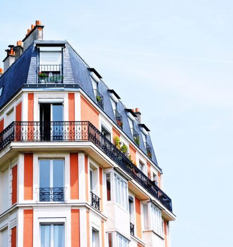

# Apartman – Apartmanın Tarihçesi

**Tarih:** 11/12/2019  
**Orijinal Kaynak:** http://sdmimproje.com/apartman-apartmanin-tarihcesi/  
**Arşiv Zaman Damgası:** 20210731152829  
**Etiketler:** Le Corbusier, Kerpiç, Mısır & Kahire, Paris, Müstakil Yaşam & Hürriyet, Şehir Hukuku & Şehircilik, Apartman & Dikey Şehirleşme Eleştirisi, Sinema & Mekân İdrakı  
**Atlas Düğümleri:** apartman_elestirisi, toprak_yapi, hassan_fathy, cansever, mustakil_yasam, sehir_hukuku, goruntu_hakikat  

---

Mimar Serkan Duman anlatıyor. Apartmanın kökeni nedir? İlk apartman. Apartman neden bu kadar çok inşa ediliyor. Dünya şehirlerinde mimarlık ve şehircilik. Türkiye’de ilk apartmanlar hangileri? Paris, Haussman ve Londra. Çölün Manhattan’ı. Kerpiç gökdelenler. Karl Marx Hof. Hitler’in 3 millik binası. …..Patreon’dan bize destek olabilirsiniz: [https://www.patreon.com/sdmimproje](https://www.youtube.com/redirect?redir_token=x5c4TUz9D35uq4PFl5OtizxHnv18MTU3NjE1Njg2MUAxNTc2MDcwNDYx&q=https%3A%2F%2Fwww.patreon.com%2Fsdmimproje&event=video_description&v=WtNcqOADx00) Doğa, komşuluk, beton ve apartman ilişkisi. Günümüz şehirleri. Avrupa’da apartman. [#kent](https://www.youtube.com/results?search_query=%23kent) [#ev](https://www.youtube.com/results?search_query=%23ev) [#mimari](https://www.youtube.com/results?search_query=%23mimari)

[0:00](https://www.youtube.com/watch?v=WtNcqOADx00&t=0s) Bizimkiler dizisinden bir bölüm [0:28](https://www.youtube.com/watch?v=WtNcqOADx00&t=28s) Intro [0:45](https://www.youtube.com/watch?v=WtNcqOADx00&t=45s) Apartman kelimesi nereden geliyor? [1:06](https://www.youtube.com/watch?v=WtNcqOADx00&t=66s) Tarihte ilk apartman Roma’daki Insula [1:45](https://www.youtube.com/watch?v=WtNcqOADx00&t=105s) Kuzey Amerika’da yaşamış Pueblolar’ın apartmanları [2:06](https://www.youtube.com/watch?v=WtNcqOADx00&t=126s) Kuzey Afrika’daki Kasbahlar [2:24](https://www.youtube.com/watch?v=WtNcqOADx00&t=144s) Mısır El Fustat’taki apartmanlar [2:36](https://www.youtube.com/watch?v=WtNcqOADx00&t=156s) Yemen’deki kerpiç gökdelenler [2:48](https://www.youtube.com/watch?v=WtNcqOADx00&t=168s) Çin’deki apartmanlar Tulou [3:11](https://www.youtube.com/watch?v=WtNcqOADx00&t=191s) Apartman blokları ne zaman ortaya çıktı? [3:44](https://www.youtube.com/watch?v=WtNcqOADx00&t=224s) Paris kent dönüşümü ve apartman [4:08](https://www.youtube.com/watch?v=WtNcqOADx00&t=248s) Paris dünyayı nasıl etkiledi? [5:13](https://www.youtube.com/watch?v=WtNcqOADx00&t=313s) Avrupa’da apartmanlaşma [5:23](https://www.youtube.com/watch?v=WtNcqOADx00&t=323s) Türkiye’de ilk apartmanlar [6:09](https://www.youtube.com/watch?v=WtNcqOADx00&t=369s) Sanayi devrimi ve konut [6:28](https://www.youtube.com/watch?v=WtNcqOADx00&t=388s) Asansör ve merkezi ısıtma apartman ilişkisi [6:50](https://www.youtube.com/watch?v=WtNcqOADx00&t=410s) Sosyalizm Faşizm ve apartman [7:16](https://www.youtube.com/watch?v=WtNcqOADx00&t=436s) Hitler ve 3 millik apartmanı [7:28](https://www.youtube.com/watch?v=WtNcqOADx00&t=448s) Viyana Karl Marx Hof 1 km apartman [7:46](https://www.youtube.com/watch?v=WtNcqOADx00&t=466s) Le Corbusier ve apartmanlaşma [7:54](https://www.youtube.com/watch?v=WtNcqOADx00&t=474s) Apartman neden bu kadar çok inşa ediliyor? [8:28](https://www.youtube.com/watch?v=WtNcqOADx00&t=508s) Avrupa apartmanlaşmayı terk mi etti? [8:43](https://www.youtube.com/watch?v=WtNcqOADx00&t=523s) Bahçeli ev inşa edilebilir mi? [8:59](https://www.youtube.com/watch?v=WtNcqOADx00&t=539s) Türkiye’de neden apartmanlaşma yoğun? [9:30](https://www.youtube.com/watch?v=WtNcqOADx00&t=570s) Apartmana eleştiriler [9:45](https://www.youtube.com/watch?v=WtNcqOADx00&t=585s) Marvellous filmi [9:55](https://www.youtube.com/watch?v=WtNcqOADx00&t=595s) Apartman doğa ilişkisi [10:12](https://www.youtube.com/watch?v=WtNcqOADx00&t=612s) Komşuluk ve apartman [10:43](https://www.youtube.com/watch?v=WtNcqOADx00&t=643s) Kapanış
