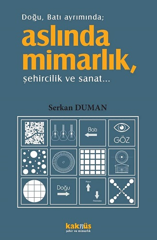

# aslında mimarlık

**Tarih:** 19/03/2016  
**Orijinal Kaynak:** http://sdmimproje.com/aslinda-mimarlik/  
**Arşiv Zaman Damgası:** 20190102003408  
**Etiketler:** Doğu-Batı Ayrımı, Şehir Hukuku & Şehircilik  
**Atlas Düğümleri:** dogu_bati, sehir_hukuku  

---

Doğu-Batı Ayrımında; Aslında Mimarlık, Şehircilik ve Sanat – Serkan Duman

**sdmimproje**
