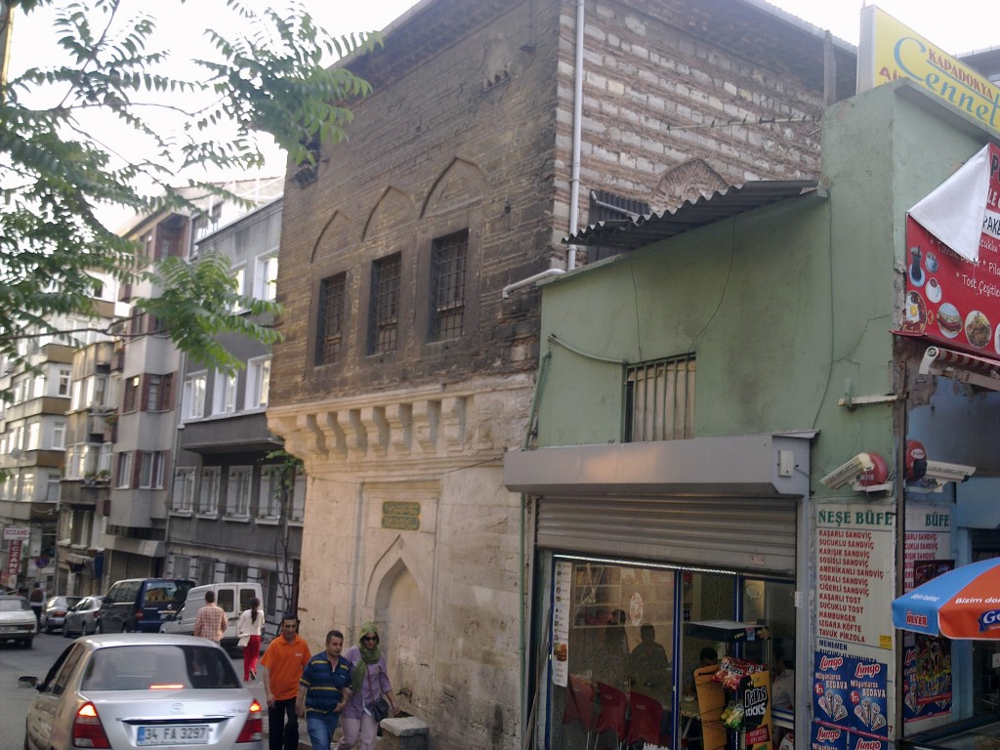

# Atina’da Patina ile Sanatın Tozunu Attırmak üzerinden…

**Tarih:** 23/01/2013  
**Orijinal Kaynak:** /sdmimproje/atinada-patina-ile-sanatin-tozunu-attirmak-uzerinden.html  
**Arşiv Zaman Damgası:** 20190419144400  
**Etiketler:** Mimar Sinan, Dücane Cündioğlu, Gezi Parkı & Taksim, Paris, Atina, Cami Mimarisi & Kubbe, Kapitalizm & Çevre  
**Atlas Düğümleri:** medeniyet, felsefe_sanat, sehir_hukuku, cansever, kapitalizm_mulkiyet  

---

Uğur Tanyeli ile Dücane Cündioğlu bir araya gelip Türkiye’de yapılan restorasyonlar üzerine konuştular mı bilmiyoruz. Ancak biz Uğur Tanyeli’nin *Atina’da Patina* ile Dücane Cündioğlu’nun *Sanatın Tozunu Attrmak* metinleri üzerinden iki düşünürün arasında sanal bir konuşma gerçekleştirdik.

> 
**U.T.:** İTÜ Mimarlık Fakültesi’nde yıllar önce lisans düzeyinde bir restorsyon dersinde öğrencilere “Patina nedir” sorusu sorulmuş. Yanıtlardan biri şöyle: “Patina, Atina’da bir yapıdır.” İlgili anabilim dalını eğlendiren bu yanıtın düşündürttüğüyse, Türkiye’de yapılan restorasyonlarda patinanın dikkate alınması için alınacak yolun en az Atina yolu kadar uzun olduğu. Oysa, tarihsel yapıyı tarihsel yapı kılan sayısız ölçütten biri de kuşkusuz patinası. Yapılar, yapımlarının üzerinden geçen zamanın izlerini taşırlar, yorulur ve kirlenirler. Bazen strüktürel, bünyesel hasarlar da alırlar. Ancak zaman mimarlık ürününe iki karşıt biçimde etkir. Bir yandan, onu varlığını sürdürmesini engelleyecek kadar hırpalayabilir, eskitir, hatta değerden düşürebilir. Öte yandan da, o eskiliğin izleri onun tarihselliğine kanıt olacak biçimde yapıya özgül bir değer katar. Yapı, bir taraftan eskiyip kullanım ömrü tehlikeye girerken, öte taraftan da eskiliği nedeniyle yeni bir anlam kazanır. Patina, yapının dış ve iç yüzeyine söz konusu eskimeyle eklenen katmanın adıdır. Onu hem bir atmosferik kir katmanı ve yaşanmışlık kanıtı olarak örter, hem de aynı katmanın daha derinlere işlemesini engelleyen bir koruyucu kılıf işlevi görür.

Tarihsel bir yapının köhneleşip yok oluşa terk edilmesini engelleyen şey zamanın ona bir “aura”, bir büyü kattığı varsayımıdır. Başka bir deyişle, zaman onun kullanım ömrünü kısalttığı gibi, kattığı özel aura nedeniyle aynı yapının çok daha uzun süre yaşamasına da yol açar. O, aurası yüzünden de korunmaya değer bulunacaktır. Dolayısıyla restorasyon/koruma disiplini patinaya özel bir dikkat gösterir. Yapı yüzeyinin bugün inşa edilmişçesine pırıl pırıl temiz gözükmesinden açık biçimde korkar. Öyle gözüküyorsa, tarihselliğinin kimseyi ikna etmeyeceği endişesi yaşanır. Çünkü bir yapıyı tarihsel diye  nitelemek için, onun bir mimarlık tarihi anlatısı içinde yer tutması gereklidir, ama yeterli değildir. Mimarlığın değişim ve dönüşüm süreçleri içinde o yapının bir konuma sahip olması, bir kitapta sözü edildiği zaman ne denli anlamlı olursa olsun, aynı yapının gerçek mekandaki varlığı bizi bundan başka bir biçimde etkiler. Tarihsel yapı geçen zamanın izlerini üzerinde taşıdığından ötürü de tarihseldir. Hatta, zaman, yapıya yeni bir estetik içerikli kimlik de kazandırır. Eskidiği için güzelleştiğine inanılır. Bazı yapılar ve mekanlar için “ne kadar iyi eskimiş” gibi yargılar verilmesi söz konusu olur. Eski olan eski gözükmelidir. Bu eskilikten kimse rahatsız olmaz da. Örneğin, Venedik’teki sayısız yapının o kente akan turist geliriyle pırıl pırıl badana edilmesi, “yenilenmesi” mümkünken, hemen her yapı özel eskimişlik görüntüsüne dokunulmaksızın korunur.

**D.C.: **Fotoğraf sanatının büyük ustalarından Brassai’i tanır mısınız? Ben tanımazdım o Paris’in gözü diye tanınan adamı.

Gerçek adı: Gyula Halasz. Romanya’nın Brasov şehrinde doğmuş, 11 Temmuz 1984’te Nice’de ölmüş.

Matisse, Picasso, Braque, Dali, Giacometti gibi birçok sanatçının fotoğraf(lar)ını çekmiş. Bazıları hakkında -fotoğraflarıyla birlikte – anılarını da kitaplaştırmış.

“Hep bilirim Brasssai’i , ta çocukluk yıllarımdan beri, fotoğrafa başladığım günlerden beri” diye anlatır Ara Güler. Bense, **Picasso ile Konuşmalar* ***(1939-1962) adlı kitabından tanırım Brassai’i. O kitabı size de tanıtmak isterim. Altını çizdiğim birçok pasajdan sadece birinin yüzüsuyu hürmetine. Ve Picasso’nun hatırına.

Bir de tabii ki tozun toprağın.

Aslımızın.

**BRASSAï: Eysiez’ler vadisinin aşağı Logerie’sinde arkeologlar kazı sırasında, çok yerinde bir fikir taşıyorlardı: Binlerce yıl boyunca birbiri üstüne binen katmanlarıyla, dört beş metrelik bir kesiti korumak…**

**Sanki bin sayfalık bir kitaptı bu!**

**Her katmanda kiracılar kendi kartvizitlerini bırakmışlardı: kemik parçaları, dişler, silex taşından araçlar…**

**Bir bakışla binlerce yıllık bir tarih görülebiliyordu… Çok heyecan verici bir şeydi bu.**

**PİCASSO: Hem de ne sayesinde? Toz sayesinde!**

**Geçmişten bize ulaşan her şeyi, toz, bizim için saklayıp korur. Burada bile şu yığınlara bir bakın, bir kaç haftada kalın bir toz tabakası üzerlerine yığılıveriyor…**

**La Boétie sokağında odalarımın bazılarında -anımsıyorsunuz değil mi onları- eşyalarım tozların altında kalıp çoktan gözden kaybolmaya başlamışlardı…**

**Size bir şey söyleyeyim mi? Eğer atölyemin temizlenmesini, tozunun alınmasını hep yasakladıysam ben, bunun sebebi, sadece eşyalarımın yerlerinin değiştirilmesiyle karıştırılması değildi; her şeyden önce, tozun koruyuculuğuna benim her zaman  güvenmiş olmamdır…**

**Toz benim müttefikimdir… Eşyalarımın üzerinde istediği gibi birikmesinde onu her zaman serbest bırakmışımdır. Çünkü bir koruyucu tabaka gibi bir şeydir o!**

**BRASSAï: ****Bir  metrelik bir katman yaratabilmek için bin yıllık toza gerek vardır. Roma imparatorluğu ancak iki üç metre gömülmüştür yerin altına… Tarih-öncesi katmanlar daha da kalın oluyor. İlk insanlardan bir şeyler biliyorsak -hakkınız var- tozun ‘koruyuculuğu’ sayesinde biliyoruz.**

Bir metrelik bir katman yaratabilmek için bin yıllık toz gerekiyormuş. Kültür hazinesi dediğimiz, **ilim-irfan mirası **diye adlandırdığımız şey, her ne ise, işte o, bu bir metrelik katmanın ta kendisi.

Bin yıllık toz sayesinde en nihayet bir metrelik katman.

Bin yıldır üzerinde oturduğumuz halıyı bir yüzyıl içinde öyle bir silkeledik ki ne tozu kaldı, ne de ancak o tozun koruyacağını umduğumuz geleneksel motifler.

**U.T.: **Ne var ki bütün bunlar konuşma konusu Türkiye olunca gündenmden düşer. Burada tarihsel olanın genellikle bugün inşa edilmiş gibi pırıl pırıl yenilenmesi beklenir. Patina yapının yüzeyinden silinmelidir ki , o yapının restore edildiği anlaşılabilsin. Tarihsel olan değerli olduğu için restore edilmektedir. Ama değerinin gerekçeleri arasında belli ki eskilik görüntüsü ve eskimenin ona kattığı aura yer tutmaz . Öyle olunca da, burada restorasyon adına yapılan sayısız iş öncelikle yapının patinasını siler, temizler ve onu cascavlak bırakır.  Yepyeni, pırıl pırıl bir tarihsel yapı haline getirir. Vakıflar’ın belediyelerin, tekil kişilerin gerçekleştirdiği çoğu restorasyon çalışması sonucunda yüzlerce yıllık yapılar “yenilenir”. Onlara dıştan bakanlar artık kaç yıllık olduğunu hissedemez olurlar. Anlaşılan, bu durmdan pek rahatsızlık da duyulmaz. Burada restorasyon demek, yapının yaşını sıfırlamak, taksimetreyi başa almak demektir. Patina bu sıfırlama ihtiyacının tatminini engellediği için ivedilikle yok edilmelidir.  yok edilen şey patinadan ibaret de kalmaz; sayısız özgün ayrıntı ve teknik iz de ortadan kalkar. Ancak, bunu görenler bir tarihsel yapıyı tahrip edip yeryüzünden sildiklerini düşünmes, aksine onu hakkıyla korduklarına inanırlar.

Sorulması gerken soru şu: Neden İngilizler, İtalyanlar, İspanyollar vs. eskinini eski gözükmesinden rahatsız olmazlar da, Türkler bundan nefret eder ve tarihsel yapıların yepyeni olmasını talep ederler?

Soru yanıtlanırken, Türkiye’deki tarihsellik kavramının farklı inşa edilmiş olduğu gerçeği dikkate alınmalıdır. Besbelli ki, eskime bu ülkede tarihselliğe bir aura katmaz. Aksine onun üzeriden silinip kazınması gereken bir utanç katmanıdır adeta. Tarihsel olan güncel gözükmelidir.

**D.C.:**  Bakınız, peygamber hırkasını bile korumayı beceremedik. İnsafsızca tozlarını silkeledik, sonra da hiç acımadan üzerine ütüyü bastık. Çevremizi toz topraktan arındırdık, herşeyimizi gıcıl gıcıl yaptık, pırıl pırıl.

Şimdi kültür dünyamız cascavlak, parıltılar içinde: Boğaz içi köprüsü gibi rengârenk ışıltılar içinde.

Görgüsüzleşen dindarlık hiçbir değerin tozlanmasına izin vermiyor. Eldekilerin de tozunu attırıyor, sözümona geleneğe hürmet bahanesiyle tarihî mirası yenileyip hepsini gıcıl gıcıl yapıyor, tıpkı peygamber hırkası gibi.

Ört ki ölem!

Sen önce muhafazakârlık tafralarından uzak dur da ey talib, geleneği sahiplenmek iddasındaki zümreye dikkatlice bir bak, hissiyat ve hamaset dışında neleri var? Hani ehliyetleri? Nerede liyakatlar? Rikkat ve nezaketleri?

Ve hani şu bin yıllık toz?

Nerede bir metrelik katman?

Sakın derviş iniltileri duymak için tepelere tırmanma ey talib, deniz kenarına in, sahile. Şemsipaşa’ya. Kuşkonmaz Camii’nin yanıbaşına, Ustamız Sinan’ın.

Bir eser kaldıysa yüz sür tozlarının üszerine!

Küçüklükteki büyüklüğü seyret!

Alçakgönüllülüğü.

Ünsiyeti.

**U.T.:  **Bu tarihsellik kavrayışıyla yapılan her restorasyon gerçekte yapıları tahrip eder. Korumak için yola çıkanlar onlara zamanın verdiğinden çok zarar verirler. Ama bir hizmet yaptıklarına inanmayı da sürdürürler. Ancak, bu yetmez: Tarihsellik kavrayışları temsilde odaklandığından, Süleymaniye’de Disneyland kurar, tarihi kurtardıklarını sanırlar.

foto: sdmimproje, Horhor’da tarihi bir yapının çeşmesinin restororasyonu sonrası…

Alıntılar:

Uğur Tanyeli – Rüya, İnşa, İtiraz : Mimari Eleştiri Metinleri

Dücane Cündioğlu – Mimarlık ve Felsefe

**sdmimproje**
