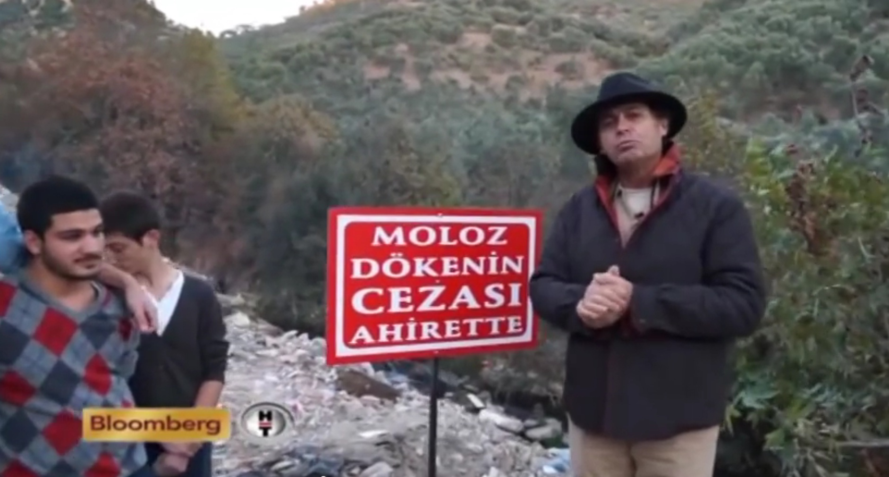

# Ayhan Sicimoğlu Doğru Yaptı

**Tarih:** 09/05/2015  
**Orijinal Kaynak:** /sdmimproje/ayhan-sicimoglu-dogru-yapti.html  
**Arşiv Zaman Damgası:** 20190207074503  
**Etiketler:** Ayhan Sicimoğlu, Depreme Dayanıklı Yapı, Şehir Hukuku & Şehircilik, Cami Mimarisi & Kubbe, Kapitalizm & Çevre  
**Atlas Düğümleri:** felsefe_sanat, afet_deprem, sehir_hukuku, medeniyet, kapitalizm_mulkiyet  

---

Kaz Dağları’nda bir dereye çöp dökenler için Ayhan Sicimoğlu’nun “Moloz Dökenin Cezası Ahirette” levhası dikmesi…

# [İmamın Kayığı Yok ki…](/sdmimproje/imamin-kayigi-yok-ki.html) yazımız:

Bir Cuma vaazı… İmam anlatıyor: *“Cemaatten bir zat geldi. Hocam dedi. Benim televizyonum vardı. Onu izlerken günaha girdiğimi düşünüyordum. Satayım dedim. Ama satarsam sattığım kişi de günaha girecekti. Ne yapsam diye düşünürken şöyle bir fikir geldi aklıma. Atmak… Bir arkadaşımla beraber köprüye gittim ve televizyonumu intihar ettirdim*.” Televizyonunu köprüden aşağı atan kişi birebir aynı kelimeleri kullanmamış dahi olsa, bu manadaki hikayeyi imam efendi güzel bir davranış olarak anlattı cemaate. Bu noktada akıllara gelmeyen çok önemli bir soru vardı. “O televizyonla çevreyi kirlettiğinde kul hakkına girmiş olmuyor musun be kardeşim?”

İşte bu hadise uzun süredir yazmak istediğimiz “din ve hayat” mezusunun yazılacak noktaya gelmesini sağladı… Kaldırıma park edilen arabaların, çevreyi atıklarla kirletmenin ya da gürültü yapmanın kul hakkı olduğu gün gibi açıkken, hemen hergün camilerde, televizyonlarda, radyolarda yapılan vaaz ve nasihatlarda kendine yer bulamayan “çevre bilinci” meselesini din adamları fena halde atlıyorlar.

Dindarların çevre ile olan kusurlu ilişkileri kendisini onların mekan düzenlemelerinde de açığa çıkarıyor. Cemaatlerin toplantılarının bir numaralı misafiri çekyatlar iken geleneksel kıyafetler giyerek geleneğe bağlı olduklarını gösteren tarikatler ise islami mekan algılarının “çarpık arabesk” dekorlar olduğunu göze sokmak için yarışıyorlar adeta.

Biraz ağır mı oldu? Olmadı. Söylediklerimiz aynen doğrudur. Dindarlar çevre, şehircilik ve mimari gibi konularda yıllardır aynı sınıfı tekrar ediyorlar. Mezuniyetleri bir hayal…

Bangır bangır ezanlarımızla kulakları sağır ediyor ama o sesi kalplere indiremiyoruz. Yerler pislik içerisindeyken, yetişen çocukların kendilerine saygısının olmasını umud ediyoruz. Yağmurlu günlerde “beyfendinin” birinin Alamanyalar’dan bir sürü para vererek getirttiği gıcır gıcır arabası, ıslanmadan biran önce evine varmaya çalışan bir anne ve çocuğundan kıymetli olduğundan, kaldırımın ortasında durmayı daha çok hak ediyor. Belki de araba sahibi namaza gitmiştir ne dersiniz?

Tekkeleri restore edip garip dekorasyonlarıyla pavyona döndürüyoruz. Hoş zaten o tekkelerin arazilerini de yıllardır iç ediyorduk kalan binasını da böyle aşağılıyoruz.

İlahiyatçılarımız mimariden o kadar bihaberler ki. İslam-**mimarlık** meselesi en fazla “tuvaletlerin kıbleye dönmemesi lazım” ve “evlerimizin geniş olması gerekiyor” gibi konulara kadar yanaşabiliyor. Genişliğin ise tam olarak ne demek olduğunu bilen de yok bu arada.

Atadan kalma ibadet mekanlarımızı rezil eklerle “Allah rızası için” gece konduya dönüştüren o camilerin cemaatleridir, dindarlardır. Ve bu ve bunun gibi mevzular için kocaman bir “sıfır” almayı hak ediyorlar.

Kul hakkını afetmem diyen bir Allah’a kulluk eden insanların çevre ve mimari meselelerine olan bu uzaklıkları düşündürücüdür.

Açıkcası bu mesele çok su götürür daha ama biz buraya bu kadar yazmış olalım…

**bkz. [Modern dünyada ezan, şehir için bir tasarım öğesi olabilir mi?](/sdmimproje/modern-dunyada-ezan-sehir-icin-bir-tasarim-ogesi-olabilir-mi.html)**

**bkz. [Türkiye’de din kaynaklı şizofreninin yansımaları](/sdmimproje/turkiyede-din-kaynakli-sizofreninin-yansimalari.html)**

**bkz. [Mimari kültürümüz topuklu ayakkabı giymeye müsait mi?](/sdmimproje/mimari-kulturumuz-topuklu-ayakkabi-giymeye-musait-mi.html)**

**sdmimproje**
