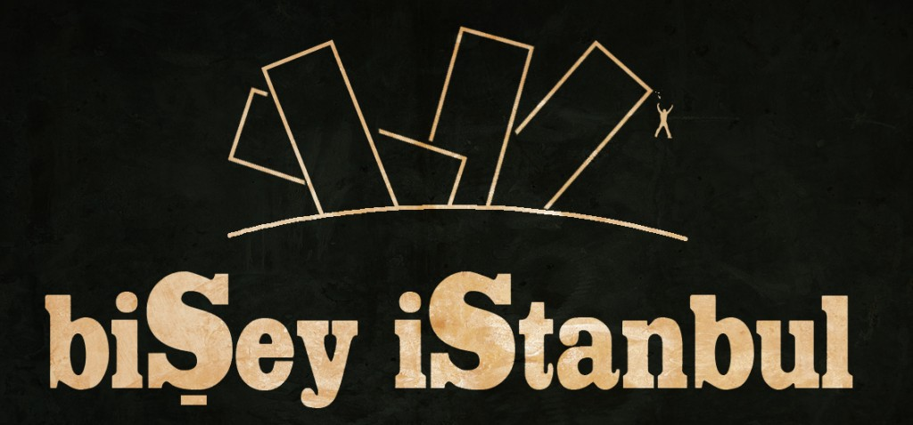

# bakış açını genişlet – 01: biŞey iStanbul

**Tarih:** 2012-05-07T11:12:15+00:00  
**Orijinal Kaynak:** http://sdmimproje.com/bakis-acini-genislet-01-bisey-istanbul/  
**Arşiv Zaman Damgası:** 20120707013601  
**Etiketler:** İstanbul, Postmodernizm & Tüketim Eleştirisi  
**Atlas Düğümleri:** sehir_hukuku, goruntu_hakikat  

---

biŞey iStanbul - Türkiye'nin ve Dünya'nın en ve ilk ve tek bişey projesi. bişeyler inşaat

20 yıllık kazancınla, biŞey iStanbul projesinden konut alan kişi, mutlu musun?

20 yıllık kazancıyla, biŞey iStanbul projenden konut alan kişi mutlu mu?

Arsa al, mümkün olabilen en yoğun şekilde konut üret. Bir yerine avm bir yerine ofis koy. Küçük de olsa bir havuz yap. Sat.

Satamıyorum. Konsept lazım.

Reklam şirektine git konsept bul.

Sat.

“Neden” diye sorabilmek bilgelik değildir ama ona yakın bir şeydir.

Neden sitede oturmak zorundayım?

Neden site inşa etmek zorundayım?

[En İlk Tek ve Simulakr](/sdmimproje/en-ilk-tek-ve-simulakr-2.html)

**sdmimproje**
