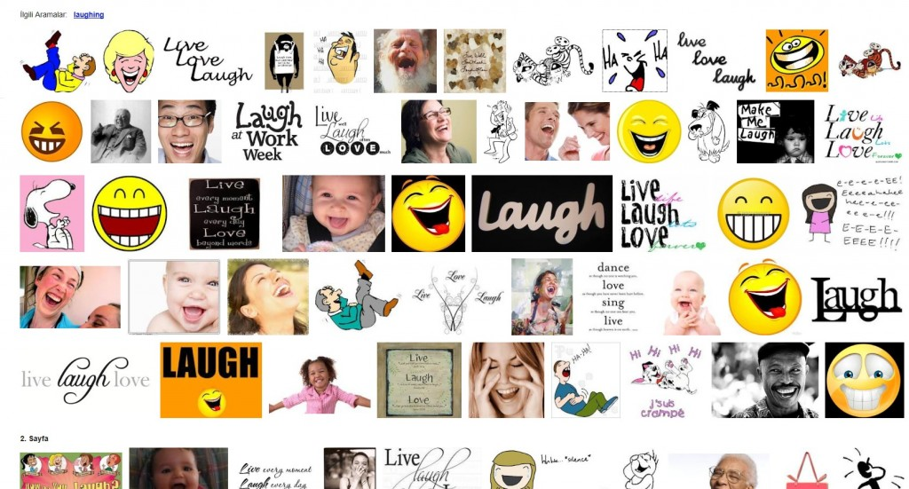

# bakış açını genişlet – 03: beyaz gömlek + gazete kağıdı mürekkebi ≠ 0

**Tarih:** 2012-09-19T17:52:45+00:00  
**Orijinal Kaynak:** /sdmimproje/bakis-acini-genislet-03-beyaz-gomlek-gazete-kagidi-murekkebi-%e2%89%a0-0.html  
**Arşiv Zaman Damgası:** 20140106161333  
**Etiketler:** Doğu-Batı Ayrımı, İslam & Medeniyet Tasavvuru  
**Atlas Düğümleri:** dogu_bati, medeniyet  

---

gazete + tecrübesiz muhabir + inşaat yatırımcısı / mimar / müteahhit + olduğundan iyi görünmek + para + ilk + tek + en  ≠ **haber**

Yazılı basında inşaat ile ilgili bir çok haber bulunur. Ancak bunların çoğu reklam içeriklidir. Tv’de başlayan – bu bir reklamdır- ibaresi ne yazık ki hala gazetelere uğramamıştır.

Beyaz gömleği ve de büyük kol saati ile bir fotoğraf çektiren yatırımcı kişisi, genelde ya çok ciddi ya da çok rahat görünmeye çalışır. Eğer haber (reklam) yeni yapılacak bir inşaat yatırımı ile ilgiliyse genelde ciddi tip takınılır. Ancak satışları başlamış bir yer ise, satılacak konut ya da ofislerin sayısı azıcık! kaldığından rahat bir ifade seçilir.

Baştan başlayacak olursak bu olayı şöyle özetleyebiliriz: Gazetenin biri ile anlaşılır. Gazete tarafından tecrübesiz bir muhabir habermiş gibi gösterilecek mülakat için görüşmeye gönderilir. Muhabirin tecrübeli olmasına gerek yoktur çünkü sorulacak sorular bellidir ve yanıtların araştırılmaya ihtiyacı yoktur.

Kendi ilişkili olduğu inşaat yatırımı için daha önce yapılmış yüzlercesine benzeyen bir mülakat verecek kişinin sözlerinin içeriği genelde yaptıkları işin Türkiye ve dünya için ne kadar değerli olduğu, projenin mimarının dünyaca ünlü olduğu! ve ödüller kazandığı, projelerinin mutlaka bir şeyde “ilk” olduğu ve yeni başlayacakları projelerin nasıl da önemli olduğu olur.

Konuşmacı önceden belirlediği cümleleri büyük bir heyecanla söyler. Bunların çoğu “büyük” ve iddialı şeylerdir.

Mülakattan doğan haberin sunuluş biçimi de oldukça enteresandır. Konuşmada geçen iddialı laflar ana başlık ve ara başlıklar olarak yazıya serpiştirilir. Ve ne yazık ki okuyucu bunları çok önemli ve yurdunun nasıl da geliştiğini düşünerek gururla okur.

Her proje muhteşem, her proje çok satılan, her proje en, ilk ve tek olamaz. Galiba  .

Bahsettiğimiz ara ve ana başlıklardan işte bazıları:

**Ekime kadar 3 bini buluruz**

**Yapı sektörü sınıf atlayacak**

**Yatırımcı da Ataşehir de kazanacak**

**“Standart yükseltecek”**

**‘Türkiye’yi de tanıtacağız’**

**Yatırımcısına kazandırıyor**

**Üç bin kişilik istihdam sağlayacak**

**Alanında en büyük olacak**

**Herkes kazanacak**

**Mimarı ödüllü**

****

** sdmimproje**
