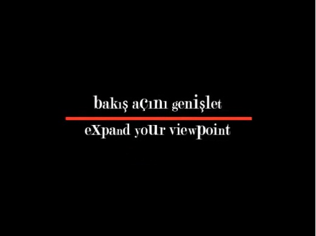

# bakış açını genişlet – 04: uyan

**Tarih:** 21/09/2012  
**Orijinal Kaynak:** http://sdmimproje.com/bakis-acini-genislet-04-uyan/  
**Arşiv Zaman Damgası:** 20190101230744  
**Etiketler:** İstanbul, Postmodernizm & Tüketim Eleştirisi  
**Atlas Düğümleri:** sehir_hukuku, goruntu_hakikat  

---

[uyan](http://vimeo.com/49913504) from [sdmim](http://vimeo.com/user9386317) on [Vimeo](http://vimeo.com).

[sdmimproje.com/en-ilk-tek-ve-simulakr-2/](/sdmimproje/en-ilk-tek-ve-simulakr-2.html)

[http://sdmimproje.com/bakis-acini-genislet-03-beyaz-gomlek-gazete-kagidi-murekkebi-%e2%89%a0-0/](/sdmimproje/bakis-acini-genislet-03-beyaz-gomlek-gazete-kagidi-murekkebi-%e2%89%a0-0.html)

[http://sdmimproje.com/bakis-acini-genislet-02-heykelde-yasayamamak/](/sdmimproje/bakis-acini-genislet-02-heykelde-yasayamamak.html)

[http://sdmimproje.com/bakis-acini-genislet-01-bisey-istanbul/](/sdmimproje/bakis-acini-genislet-01-bisey-istanbul.html)