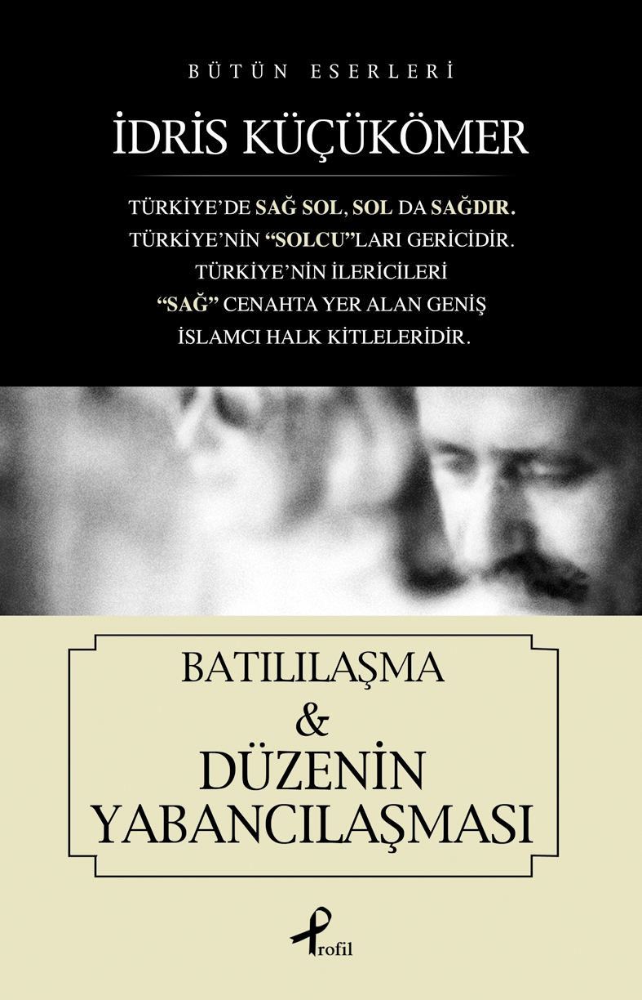

# Batılılaşma & Düzenin Yabancılaşması

**Tarih:** 2014-12-11T14:39:25+00:00  
**Orijinal Kaynak:** /sdmimproje/batililasma-duzenin-yabancilasmasi.html  
**Arşiv Zaman Damgası:** 20150220172038  
**Etiketler:** Doğu-Batı Ayrımı, Doğu-Batı Ayrımı, İslam & Medeniyet Tasavvuru  
**Atlas Düğümleri:** dogu_bati, dogu_bati, medeniyet  

---

İdris Küçükömer – Batılılaşma & Düzenin Yabancılaşması

**sdmimproje**
