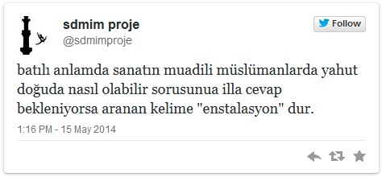

# bir kelime bir sanat

- **Tarih:** 15/05/2014
- **Kategori:** Sanat, Sinema ve Postmodernizm
- **Orijinal URL:** /sdmimproje/1794.html
- **Etiketler:** Enstalasyon & Mekân Sanatı, İslam & Medeniyet Tasavvuru

---

> 
batılı anlamda sanatın muadili müslümanlarda yahut doğuda nasıl olabilir sorusunua illa cevap bekleniyorsa aranan kelime “enstalasyon” dur.

— sdmim proje (@sdmimproje) [15 Mayıs 2014](https://twitter.com/sdmimproje/statuses/466884788553396224)

.