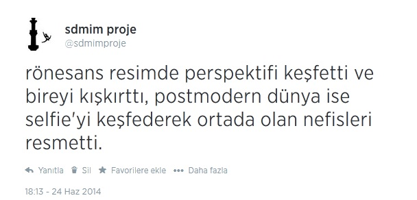

# birey mi nefis mi

**Tarih:** 24/06/2014  
**Orijinal Kaynak:** /sdmimproje/birey-mi-nefis-mi.html  
**Arşiv Zaman Damgası:** 20190102012443  
**Etiketler:** Postmodernizm & Tüketim Eleştirisi, Doğu-Batı Ayrımı, İslam & Medeniyet Tasavvuru  
**Atlas Düğümleri:** goruntu_hakikat, dogu_bati, medeniyet  

---

> 
rönesans resimde perspektifi keşfetti ve bireyi kışkırttı, postmodern dünya ise selfie’yi keşfederek ortada olan nefisleri resmetti.

— sdmim proje (@sdmimproje) [24 Haziran 2014](https://twitter.com/sdmimproje/statuses/481455049638699008)

