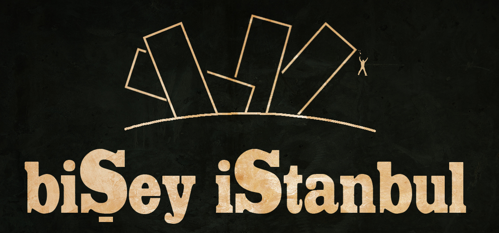

# bişey istanbul: uçurumun hemen kenarında, cehenneme 5 dakika

**Tarih:** 30/05/2014  
**Orijinal Kaynak:** /sdmimproje/bisey-istanbul-ucurumun-hemen-kenarinda-cehenneme-5-dakika.html  
**Arşiv Zaman Damgası:** 20190419123018  
**Etiketler:** Turgut Cansever, İstanbul, Çamlıca, Meksika, Şehir Hukuku & Şehircilik, Apartman & Dikey Şehirleşme Eleştirisi, Cami Mimarisi & Kubbe, Postmodernizm & Tüketim Eleştirisi, Kapitalizm & Çevre, Kırsal Mimari, Köy & Kaçış  
**Atlas Düğümleri:** cansever, sehir_hukuku, medeniyet, dogu_bati, apartman_elestirisi, goruntu_hakikat, kapitalizm_mulkiyet, kirsal_koy  

---

-bişeyler inşaat-

# [bakış açını genişlet – 02: heykelde yaşayamamak](/sdmimproje/bakis-acini-genislet-02-heykelde-yasayamamak.html)

# [insanları burada hayvan barınakları bekliyor; cümlesinin düşündüremedikleri](/sdmimproje/insanlari-burada-hayvan-barinaklari-bekliyor-cumlesinin-dusunduremedikleri.html)

# [bakış açını genişlet – 01: biŞey iStanbul](/sdmimproje/bakis-acini-genislet-01-bisey-istanbul.html)

# [kaçacak bir yer – 03: Turgut Cansever 1994′te ne dedi?](/sdmimproje/kacacak-bir-yer-03-turgut-cansever-1994te-ne-dedi.html)

# [En, İlk, Tek ve Simulakr.](/sdmimproje/en-ilk-tek-ve-simulakr-2.html)

# [inanmıyorum! çiğnemeden 300 lahmacun yiyen adam yeni yapılacak Çamlıca Camisi’nde 5×5 vakit namaz kılabilir mi?](/sdmimproje/inanmiyorum-cignemeden-300-lahmacun-yiyen-adam-yeni-yapilacak-camlica-camisinde-5x5-vakit-namaz-kilabilir-mi.html)

# [Türkiye’nin geleceğine öğretmenler değil müteahhitler karar veriyor.](/sdmimproje.html?filter=T%C3%BCrkiye%E2%80%99nin)

# [TOKİ’ye matematik bilmeyen giremez.](/sdmimproje.html?filter=TOK%C4%B0%E2%80%99ye)

# [Türkiye’de Konut Alırken Dikkat Edemeyeceğiniz Şeyler](/sdmimproje/turkiyede-konut-alirken-dikkat-edemeyeceginiz-seyler.html)

# [mehter marşı haydi ya allah](/sdmimproje/mehter-marsi-haydi-ya-allah.html)

# [bakış açını genişlet – 03: beyaz gömlek + gazete kağıdı mürekkebi ≠ 0](/sdmimproje/bakis-acini-genislet-03-beyaz-gomlek-gazete-kagidi-murekkebi-%e2%89%a0-0.html)

# [sdmim proje’den T.C. Çevre Ve Şehircilik Bakanlığı’na açık mektup](/sdmimproje/sdmim-projeden-t-c-cevre-ve-sehircilik-bakanligina-acik-mektup.html)

# [sdmim proje’den T.C. Çevre Ve Şehircilik Bakanlığı’na kapalı mektup](/sdmimproje/sdmim-projeden-t-c-cevre-ve-sehircilik-bakanligina-kapali-mektup.html)

# [kaçacak bir yer 04: güzel bir evde oturmak için meksika’ya kaçmaya gerek yok](/sdmimproje/kacacak-bir-yer-04-guzel-bir-evde-oturmak-icin-meksikaya-kacmaya-gerek-yok.html)

# [Kat Karşılığı İnsanlar](/sdmimproje.html?filter=Kat+Kar%C5%9F%C4%B1l%C4%B1%C4%9F%C4%B1+%C4%B0nsanlar)

# [Hakan Şükür Gökdelenden Ev Almış](/sdmimproje/hakan-sukur-gokdelenden-ev-almis.html)

# [fenerbahçeliler sitesi, cemaatçiler konakları, ulusalcılar blokları, entellektüeller plazası, manas destanı sitesi, vur patlasın çal oynasın evleri](/sdmimproje/fenerbahceliler-sitesi-cemaatciler-konaklari-ulusalcilar-bloklari-entellektueller-plazasi-manas-destani-sitesi-vur-patlasin-cal-oynasin-evleri.html)

# [“Başarının İlk Kuralı Evde Mutlu Olmaktır.” Peki Sonra?](/sdmimproje/basarinin-ilk-kurali-evde-mutlu-olmaktir-peki-sonra.html)

# [bakış açını genişlet – 04: uyan](/sdmimproje/bakis-acini-genislet-04-uyan.html)
