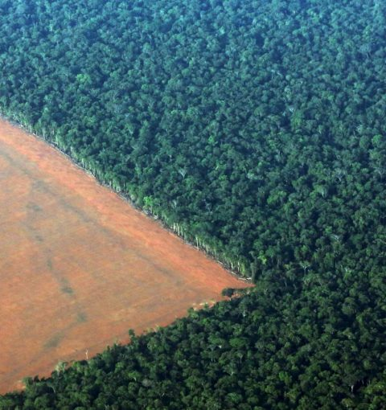

# Bu da o tipik çevreci yazılardan biri.

**Tarih:** 23/10/2018  
**Orijinal Kaynak:** http://sdmimproje.com/bu-da-o-tipik-cevreci-yazilardan-biri/  
**Arşiv Zaman Damgası:** 20190107120735  
**Etiketler:** Datça & Ege, İslam & Medeniyet Tasavvuru, Postmodernizm & Tüketim Eleştirisi, Kapitalizm & Çevre  
**Atlas Düğümleri:** kirsal_koy, medeniyet, goruntu_hakikat, kapitalizm_mulkiyet  

---

> 
*“2006 da Konya’da aşırı su kullanımı ile ilgili bir program çektim.Yeraltı su seviyesi 10m den 60m düşmüştü.10 bin kaçak kuyu vardı. Bugün su seviyesi 160 m ye inmiş.100 bin kaçak kuyudan bahsediliyor. Bu fotoğrafı 3 gün önce çektim.101bininci Kuyu açılıyor. Dibi görmeye az kaldı.”*

Şehirler kalabalıklaşmaya devam ediyor. Ve bu kent kalabalıkları, birbirlerinin karmaşıklaşmış ihtiyaçlarını karşılamak için her sabah işe gidip, akşam evlerine gidiyorlar. Kimi kuaför, kimi otobüs şöförü, kimi öğrenci, kimi telefon tamircisi, kimi temizlik görevlisi, kimi bankacı, kimi aşçı, kimi mimar, kimi muhasebeci, kimi sanatçı, kimi yönetmen, kimi yazar, kimi katı atık toplayıcısı, kimi öğretmen, kimi çaycı, kimi güvenlik görevlisi… Bu uzun liste sayfalarca yazılabilir. Ancak ne kadar yazarsanız yazın, şehirde yaşayanların karnının doyurulması için gereken üretimi yapan kimseyi, neredeyse bulamayacaksınız. Tarım ve hayvancılık büyük oranda (hatta neredeyse tamamen) şehrin dışında gerçekleşiyor.

Tarım ve hayvancılık üretimi de şehirlerin katmanlılığı oranında karmaşık. Örneğin üretilen buğday salt ekmek, börek vb. gibi ana gıdalar için değil, marketleri dolduran sayısız çeşitteki ürünler için de üretiliyor. Glikoz şuruplu, katkı dolu janjanlı paketlenmiş ürünler için mesela… Üretici ile tüketici ise birbirinden tamamen habersiz. Bir yerlerde yetiştirilen ürünler, başka bir yerdeki dev fabrikaya gidiyor, çeşit çeşit işlemden geçip, masalara, raflara ve çöplere gidiyor. Ne üretici yaptığı işten ve kazancından ne de tüketici yediğinden memnun. Kopan bağın arasına giren kapitalist sanayi, hem tarımı hem de tüketimi yönlendiriyor.

İnsanın yaşamı için başat önemde olan beslenme, adeta sanal bir buluta gönderilmiş gibi. Bir yerlerde olup bitiyor. Şehirdekiler ise ana amaçlarını kaybetmiş gibi, ortaya çıkan bütün teknolojik ürünlere, hayatı kolaylaştırdığına inanılan her yeniliğe sahip olmak için beton ormanda birbirini alt edip daha fazla kazanmanın yollarını arıyorlar. Çok kazanmak için konferans salonları doldurulup duygusal, girişimcilik seansları yapılıyor. Dev internet ve teknoloji şirketlerinin sahiplerinin hayat hikayeleri hayranlıkla dinleniyor. “Ben neden yapamadım”, “biz neden yapamadık” diye hayıflanılıyor.

Interstellar – Christopher Nolan – 2014

Tüm bunlar olurken tükenen dünya ise kimsenin umrunda değil. Örneğin önceleri doğal yöntemlerle ürettikleri ve suda kaybolup giden sabunla kendileri için kutsal olan Ganj nehrinde yıkanan Hindular şimdi yıllarca doğada kaybolmayacak kimyasal temizlik ürünleri, gıda denen paketlenmiş yiyeceklerin ambalajları ve kapitalizmin karşısında direnemeyen zanaatkarların yerine çkan dev fabrikaların atıklarının kirlettiği, çöp ve kimyasal yığını nehirde yıkanıyorlar artık.

–

Güven İslamoğlu’nun yukarıda bulunan tweeti önemli bir sorunu yeniden gündeme getiriyor. Konyalı çiftçiler ürünleri için gerekli su için kuyular açıyor ve yeraltı su kaynaklarını bitme noktasına getiriyorlar. Bunun bir benzeri de dünyanın akciğeri denen Amazon yağmur ormanlarında gerçekleşiyor. Dev sanayiciler, Amazon’un içinde tarım arazileri açıyor. 2014’te 5831 kilometre kare orman yok edilip tarım arazileri açılmış. Bu rakam hızla artıyor.

Birbirlerinin tali ihtiyaçlarını gidermek için kentlere toplanan toplulukların, ana ihtiyaçları kapitalizmin insiyatifine bırakılırsa, elbette bunlar olacak.

İşin ilginç tarafı ise bu kadar olana rağmen hala insanların bir sorun yokmuş gibi davranması. Konfor olarak benimsenen yaşayış biçimini kimsenin terketmemesi. Nasılsa insanlık (buradaki insanlık kelimesi bilinçli olarak kullanılıyor sanki, her “gelişme” insanlığın başarısı, dolayısıyla bu “başarı” da insan olan herkesin!) Mars’a gitmek için çabalıyor. Dünya bitince lay lay lom başka gezegene gideceğiz.

Konuştuğum biri, ufak çaplı keçi yetiştiriciliği yapacağını söylemişti. Ve gözümün önünde para hesapları yapıp duruyordu. Şu fiyattan keçi alsam, şu fiyattan yem alsam, şu fiyattan satsam gibi. “Çocuklar için iyi olur, hiç olmazsa koşar oynarlar, çiçek böcek görürler, doğal hayatı tanırlar” dediğimde ise bana uzaylı görmüş gibi baktığını hatırlıyorum. Anlamıştım ki vatandaşın tek derdi, baş parmakla işaret parmağının birbirine sürtünmesinden ibaret idi.

Yazı uzar gider. Ne demek istediğim anlaşılmış olmalı. Bu da o tipik çevreci yazılardan işte. Ne diyelim. Aynen devam!…

**Serkan DUMAN**