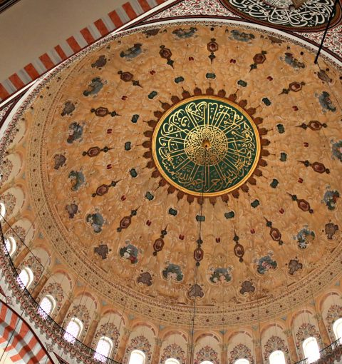

# Cami Mimarisi

**Tarih:** 26/11/2018  
**Orijinal Kaynak:** /sdmimproje/cami-mimarisi.html  
**Arşiv Zaman Damgası:** 20190302175539  
**Etiketler:** İslam & Medeniyet Tasavvuru, Müstakil Yaşam & Hürriyet, Şehir Hukuku & Şehircilik, Cami Mimarisi & Kubbe, Postmodernizm & Tüketim Eleştirisi, Kırsal Mimari, Köy & Kaçış  
**Atlas Düğümleri:** medeniyet, mustakil_yasam, sehir_hukuku, goruntu_hakikat, kirsal_koy  

---

Ne zaman göz önünde olan bir yere cami projesi yapılsa aynı tartışmalar başlar. Eğer cami geleneksel tipte yapılmışsa, “neden günümüz mimarisine uygun değil?”, modern tipte ise “bu yapı camiye benzemiyor” eleştirileri gelir. İşin ilginç tarafı ise, iki taraflı eleştiri de haklı gibi görünür. Aslında mimari eleştiriden tek nasibini alan camiler değildir, özellikle son yıllarda popüler olan bütün yapılar eleştirilmektedir. Ortaya çıkan mimari genel olarak memnuniyetsizlikle karşı karşıya kalır. Yine de nedense eleştrilerin tavan yaptığı alan cami mimarisidir.

Cami tasarımı, Türkiye’nin mimari kilidinin şifresi gibi duruyor. Sanki toplumun büyük kesiminin üstünde uzlaştığı bir dini mimari, genel şehircilik konusunu da çözecekmiş gibi bir hava var. Buradan meselenin sadece mimari olmadığı da ortaya çıkıyor aslında. Cami ideolojik bakışın bir tür göstergesi gibi. Caminin tasarımı, genel ülke kurgusunun da açıklayıcısı oluyor. Değişen veya aynen kalan cami biçimi, sizin dünyaya olan bakışınızı belirliyor sanki.

Cami mimarisinin bu kadar kolay eleştiriliyor oluşunun bir nedeni de, dini mimarinin dışında kalan alanlarda zorunlulukların hakim olduğunun ancak cami tasarımının bir tür lastik gibi kişinin keyfince çekiştirilebilecek rahatlıkta olduğu düşünülmesi. En nihayetinde içinde namaz kılınacak bir boşluk olarak düşünüldüğünde, cami istenilen şekilde inşa edilebilir(!). İşte bu noktada cami mimarisi ile ilgili olan herkes, tasarımın kendi ideolojisi doğrultusunda şekillenmesini bekliyor.

Türkiye toplumunun, caminin biçimine bu kadar önem vermesi enteresandır. Bu, İslam’ın hala ülkede başat konumda olduğunun bir sağlamasıdır aslında. İslam’ın bu kadar önemli oluşu Türkiyede’ki büyük çoğunluğun dindar oluşu ile ilgili değil. Toplum, dinin kendisinden çok, etkisi ve durumu ile ilgili. Ve her ne kadar seküler bir ülke olsak da, İslam salt dini olarak olmasada her alanda etkisini hissettirmektedir.

Tıpkı dinin merkezde oluşu gibi, cami de İslam mimarisinin merkezindedir. İslam peygamberinin Medine’ye hicret ettikten sonra, ona evi ile bütünleşik bir cami inşa edilmesi, mimari gelişim açısından bir orjindir. Yani cami bütün bir İslam yapıcılığının kodlarında başat biçimde gömülüdür. Bir bakıma caminin değişimi bütün yapının değişimiyle doğrudan ilintilidir.

–

Modern çağ gelişen teknoloji ve teknolojiyi geliştiren ülkerin kültürel anlayışı ile görüntü hakim bir çağ. Kavramlardan ziyade şekiller ve biçimler hakim. Hal böyle olunca şeylerin görüntüsü daha önemli hale geliyor. Görüntücülük, yüzeyselliğe de kapı aralayan bir anlayış. Mefhumdan ziyade, plastik kalıbın öne çıktığı bir davranış biçimi. Bir caminin salt tipinin konuşulması da bu anlayışın bir ürünü. Yani caminin geleneksel ya da modern tipte olmasını beklemek aynı yerden çıkan iki bakış aslında.

Caminin geleneksel biçimde olmasını bekleyenlerde bir tür bugünü reddetme hali var. Bununla birlikte caminin “cami” gibi görünmesini istiyorlar. Modern tip beklentileri olanlar ise geçmişe takılınıp kalınmaması gerektiğinin, hatta belki de geçmişin reddedilmesinin taraftarı. Ayrıca camilerin inşa edildiği tekniklerin modern olduğunu bu sebeple de camilerin modern görünümlü olması gerektiğini savunuyorlar.

Sorunun çözülebilmesi öncelikle “tip” sarmalından çıkmakta yatıyor. Cami tipi ile değil cami oluşuyla var olabilmelidir. Her çağın anlayışı farklıdır bu açıktır. Zaten yüzyıllar içinde sürekli değişen cami mimarisi bunun bir kanıtıdır. Ancak günümüzdeki değişim salt teknolojik de değildir. Bir mimarın sırf yapı teknoljisi değişti diye cami mimarisini değiştirmesi beklenmemelidir. Eğer bu teknolojik değişimden kasıt beton ve çelik gibi başat strüktürel malzemelerse unutulmamalıdır ki, beton ve çelik 19.yüzyıldan beri kullanılmaktadır. İki yüzyıllık bir meseleyi bugün olmuş gibi konuşmak başka türden bir gericiliktir aslında. Her alandaki teknolojik değişim, insanı değiştirmiştir. Mevzuya böyle bakmak gerekiyor. Cami mimarisi ile ilgili olanların kendisine, “ben camiden ne bekliyorum?” diye sorması gerekiyor.

–

Teknolojinin ve kapitalist anlayışın bir getirisi olan tüketim sonuç olarak dünyanın da tükenmesine yol açtı. Cami örneğin bu olumsuz duruma  bir cevap olarak beliremez mi? İsrafın ve haksızlığın karşısında olan bir dinin ibadethanesi böyle oluşturulamaz mı? Bu kadar olumsuzluğun içinde kemerin, kubbenin veya modern kutuların konuşulması ne kadar doğru? Dünyayı tüketen malzemelerin hangi biçimde şekillendiği neden bu kadar önemli? Eğer cami mimarisi bu kadar merkezde ve ışınsal bir özellikte ise camiyi tabiata dost olarak konumlandırmak önemli bir söz değil midir?

İşin bir de kalbi ve ruhi boyutu var. Her türlü konforumuz var evet peki huzur? Cami içe dönmenin ve içinde yaşadığımız çağın sorgulanması olarak de belirebilir. Ancak unutulmamalıdır ki, tek bir mimarın heykel yapıyormuşçasına ekspresyonist tavrı buna yeterli olmadığı gibi yanlıştır da. “İnsanlar camide şöyle davransın, şunu hissetsin” demek baskıcılık olacaktır. İşte bu noktada devreye gelenek girer. Gelenek yüzyıllardan süzülmüş bir genel tavırdır. Geleneğin kodları doğru okunarak bir yerlere varılabilir. Artık anlaşılmış olmalıdır ki, burada bahsedilen geleneksel cami tipi değil, bir tavırdır.

.
