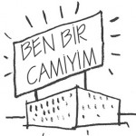

# çamlıca cami postmodernizmin mezarıdır belki :) (postmodernizmindibinevurmak.com)

**Tarih:** 16/11/2012  
**Orijinal Kaynak:** /sdmimproje/camlica-cami-postmodernizmin-mezaridir-belki.html  
**Arşiv Zaman Damgası:** 20190101202118  
**Etiketler:** Çamlıca, Cami Mimarisi & Kubbe, Postmodernizm & Tüketim Eleştirisi  
**Atlas Düğümleri:** medeniyet, goruntu_hakikat  

---

Charles Jencks ödül almış bir sosyal konut projesinin, devlet kararı ile yıkılma anını modernizmin bittiği an olarak saptamış ve modernizmin ölümünün gününü ve saatini duyurmuştu.

Geç modernleşip hatta bir bakıma modernleşmeden postmodernleşen Türkiye’de yapılan bir cami yarışması ve sonucu belki de postodernizmin öldüğünü haber veriyor.

**sdmimproje**