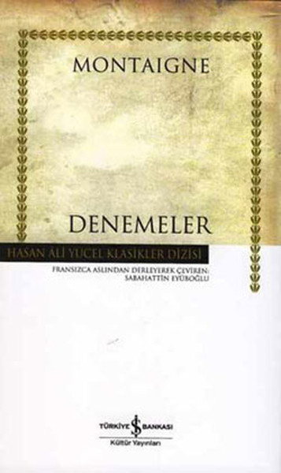

# Denemeler

**Tarih:** 24/04/2018  
**Orijinal Kaynak:** http://sdmimproje.com/denemeler/  
**Arşiv Zaman Damgası:** 20190101164604  
**Etiketler:** Doğu-Batı Ayrımı, İslam & Medeniyet Tasavvuru  
**Atlas Düğümleri:** dogu_bati, medeniyet  

---

**Denemeler** – Montaigne
