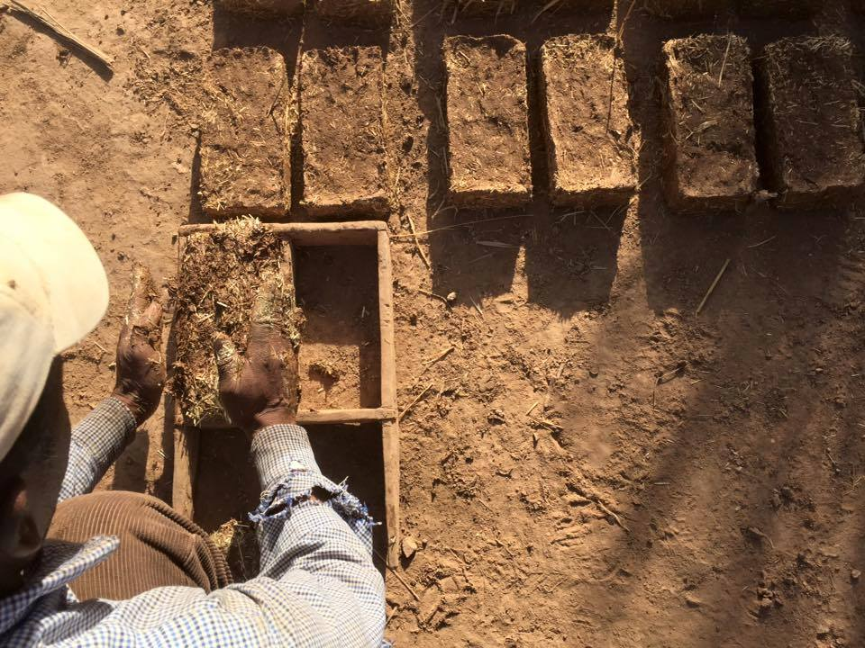
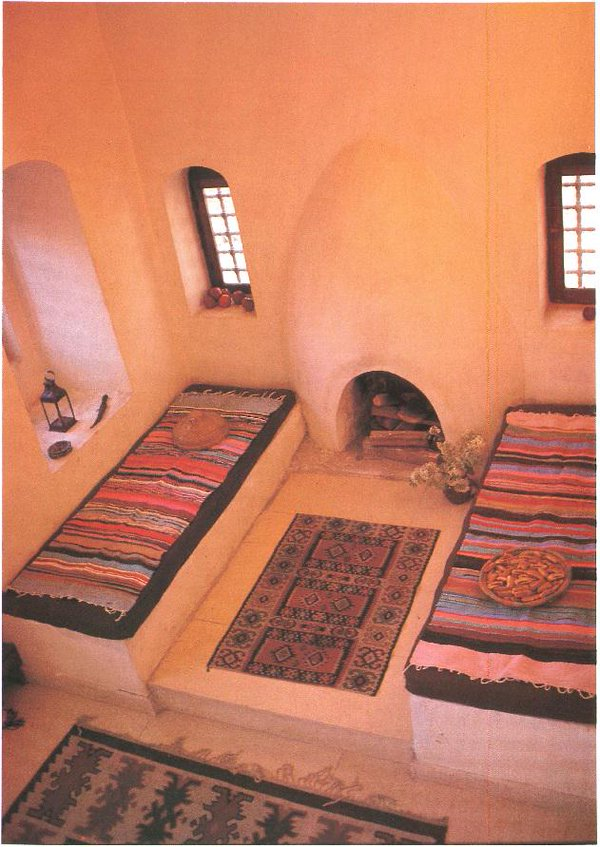
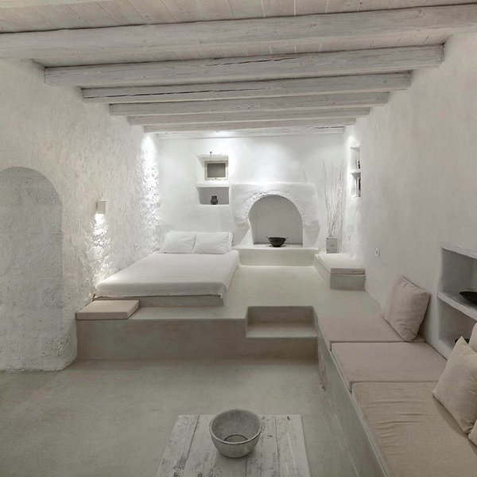

# Doğal Kerpiç Evler

**Tarih:**   
**Orijinal Kaynak:** /sdmimproje/dogal-kerpic-ev.html  
**Arşiv Zaman Damgası:** 20190119135257  
**Etiketler:** Yahya Kemal Beyatlı, Kerpiç, Geleneksel Ahşap & Hımış, Kendi Evini Yapmak, Doğal Yapı Rehberi, Müstakil Yaşam & Hürriyet, Apartman & Dikey Şehirleşme Eleştirisi, Katılımcı Mimarlık & İmece  
**Atlas Düğümleri:** felsefe_sanat, toprak_yapi, geleneksel_ahsap, kendieviniyapmak, dogal_yapi_rehberi, mustakil_yasam, apartman_elestirisi, katilimci_mimarlik  

---

Doğal Yapılar ve kerpiç ev, çiftlik gibi projeleriniz için [SDMIM Mimarlık](http://www.sdmim.com)‘a başvurabilirsiniz.

SDMIM MİMARLIK RESMİ WEB SİTESİ:[ www.sdmim.com](http://www.sdmim.com)

> 

“Bu vatandaş biraz ahşapla biraz kerpiçten

Yapabilmiş bu güzellikleri birkaç hiçten.”

**Yahya Kemal BEYATLI**

Betondan ve sağlıksız yapılaşmadan bıktığınızı biliyoruz. Bu sebeple size tamamen doğal yöntemlerle inşa edilecek kerpiç, taş ve ahşap karışımı evler öneriyoruz. Kerpicin ne kadar güzel ve sağlıklı olduğunu bildiğinizi de biliyoruz. Çünkü bir şekilde o güzelim ve huzurlu eski evlerle, hemen herkesin bir bağı ya da hatırası var.

Tamamen doğal yöntemlerle ev yapmanın birkaç önemli püf noktası var. Bunlar yerine getirildiğinde eviniz gerektiği kadar sağlam ve konforlu olacaktır. Biz mimar olarak kendimizi bu konuya adadık. Amacımız, yüz binlerce lira ödeyip, yine de parasının karşılığını alamayan insanımızın, bir apartmanın bilmem kaçıncı katındaki bir kutuya sıkışması yerine; bahçeye, doğaya, estetiğe ve huzura kapı aralayan evlere kavuşmasıdır. Üstelik kerpicin ana malzemesi toprak olduğu için de oldukça ucuz maliyetlerle bu evlere sahip olunabilir.

Çalışma sistemimiz şöyle işliyor. Önce bize ulaşın : sdmimmimarlik@gmail.com İki tip çalışma şeklimizden birine karar verelim. Ya evinizi ustalarımızla beraber gelip biz inşa edelim. Ya da siz evinizi daha da ucuza inşa etmek istiyorsanız, bizden sadece proje ve yerinde danışmanlık hizmeti alın. Ailenizle, komşularınızla beraber çalışıp kendi evinizi kendiniz inşa edebilirsiniz. Bu inşaya biz de katılarak size doğal yolla inşa etmenin püf noktalarını göstereceğiz. Hep birlikte evinizi inşa edeceğiz.

Her türlü sorunuzun cevabı ve doğal kerpiç ev talebiniz için bize ulaşın:

[sdmim.com](http://www.sdmim.com)

[http://www.sdmim.com/dogal-yapilar](http://www.sdmim.com/dogal-yapilar)

sdmimmimarlik@gmail.com

