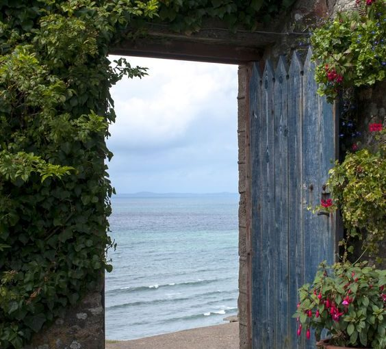

# Düş yolları temizlenmeli.

**Tarih:** 28/02/2015  
**Orijinal Kaynak:** http://sdmimproje.com/dus-yollari-temizlenmeli/  
**Arşiv Zaman Damgası:** 20190102042341  
**Etiketler:** Abdel-Wahed El-Wakil, Mimar Sinan, Walter Benjamin, İslam & Medeniyet Tasavvuru, Fıtrî Mesken & Ev Felsefesi, Cami Mimarisi & Kubbe, Sinema & Mekân İdrakı, Kırsal Mimari, Köy & Kaçış  
**Atlas Düğümleri:** cansever, medeniyet, apartman_elestirisi, ev_felsefesi, goruntu_hakikat, kirsal_koy  

---

İBRÂHÎM

ibrâhîm

içimdeki putları devir

elindeki baltayla

Kırılan putların yerine

yenilerini koyan kim

güneş buzdan evimi yıktı

koca buzlar düştü

putların boyunları kırıldı

ibrâhîm

güneşi evime sokan kim

asma bahçelerinde dolaşan güzelleri

buhtunnasır put yaptı

ben ki zemansız bağçeleri kucakladım

güzeller bende kaldı

ibrâhîm

gönlümü put sanıp da kıran kim

**Asaf Halet Çelebi**

[“Müslüman sinema yapabilir mi?” Dediğimizde](/sdmimproje/musluman-sinema-yapabilir-mi.html) insanlar dehşete düşüyor. Dehşete düşüyor çünkü içinde yaşadığımız sistemin dışına çıkabileceğimize dair düşünemiyor dolayısıyla da hayal bile kuramıyoruz. [Oysa yanlış olduğuna inandığınızda alışkanlıklarınızı ve inandıklarınızı bırakmak onları yenileriyle yer değiştirmek veya zihni nadasa bırakmakla güzellikler yetişebilir. Yeni dünyalar kurulabilir.](/sdmimproje/uyanin-isa-carmiha-gerilmedi.html)

Sinemanın yapılamayacağını düşünmek sinemayla birlikte birçok farklı alanı da etkiliyor. İster sinemadan bütüne gidin veya tersini yapıp bütünden sinemaya gidin mevzunun geniş olduğu anlaşılır. Başat olarak mesela şehir nasıl kurulur sorusunu bile etkileyen bir hale bürünür sinema meselesini sorgulamaya başlamak.

[Yıldızlara baktığınızda kurabileceğiniz hayallerinizin genişliği bile değişecektir.](/sdmimproje/mimar-sinan-modern-anlamda-cizim-yapacak-kadar-gerici-degildi.html) Başkalarının hayalleriyle oynaşmayı bırakıp kendi iç dünyanıza giden yolları kısaltan bir dünya kuracaktır sinemayı sorgulamak.

[Sinemayı sorgulamak ve örneğin yapılamayacağına karar vermek şehri nasıl farklılaştırır?](/sdmimproje/dovus-kulubu-ve-mesk-ayini-yasama-mimariye-ya-da-sehircilige-dair-neler-anlatir.html) Şöyle ki, sinema pasif sanatlardan biridir. Tıpkı tiyatro, opera, klasik müzik konseri gibi. Sinemayı sorgulamak bu pasifizasyonu sorgulamaktır. [Pasifliği reddettiğinizde insanların dahil olabildiği eğlenme biçimleri meydana getirirsiniz.](/sdmimproje/fazla-bati-bati-dememeli-adami-hadim-ederler-maazallah-18.html) Tıpkı atalarımızın yakın zamana kadar yaptıkları gibi.Tekkede zikir yaparsınız, musiki söylersiniz yahut meşk geceleri düzenler, onlara uygun mekanlar meydana getirirsiniz.

[Sinemayı reddetmek televizyonu reddetmektir. Televizyonu reddetmek yaşayış biçimini farklılaştırmaktır.](/sdmimproje/matrixte-olursem-kabrime-gelme.html) Televizyon uyuşukluğundan boşalan vakti faklı yollarla doldurmak için arayışa girmektir. Camilerin ve mescitlerin öz kullanılış biçimleri ne idiyse ona yeniden ulaşmaktır.

Sinemayı reddetmek mesela medeniyet kurmaya açılan kapıdır. [Perspektifi sorgulamaktır.](/sdmimproje/mimar-sinan-modern-anlamda-cizim-yapacak-kadar-gerici-degildi.html) Gözetlemeyi eleştirmektir.[ Ferd olmayı anlamaya çalışmaktır](/sdmimproje.html?filter=+Ferd+olmay%C4%B1+anlamaya+%C3%A7al%C4%B1%C5%9Fmakt%C4%B1r). İmanın ne demek olduğunu kavramaktır.

[Sinemayı sorgulamak onu doğuran nedenleri eleştirmektir.](/sdmimproje/uyanin-isa-carmiha-gerilmedi.html) O nedenlerin bize uyup uymadığını araştırmaktır.

En azından bir müslümanın sinema yapamayacağını bilen müslüman, mutmain olmak için iyice araştırıp öğrendiği[ “neden sinema yapamam” bilgisiyle artık izlese de daha az etkilenecektir filmlerden](/sdmimproje/matrixte-olursem-kabrime-gelme.html).

Sinemayı bırakmak zor ama hakikatlı bir yoldur. Yalanlar söylemeyi, inanmadığımızın dışında konuşmayı bırakmaktır. [Kamera önünde anadan üryan sevişen kadın ve erkekleri put etmeyi, onlara özenmeyi bırakmaktır.](/sdmimproje/gunese-bakmak-gunah-mi.html)

Sinemayı terk etmek dünyanın sonu değil aksine yepyeni ve kadim bir dünyaya kanat çırpmaya başlamaktır. Özgürlüğe açılan kapıyı tıklatmaktır. Sinemayı terk etmek kabeyi putlardan temizlemektir.

Sinemayı konuşmak içinde yaşadığımız ve bize dayatılan küresel oyunun propagandasını etkisiz hale getirmektir. Tek tipleştirilen kültürler ve insanlar olmaktan kaçmaktır. Başkalarının hayatlarını yaşamamaktır. [Her türden vahşetin, pornografinin ve küfürün tertemiz yuvalarımıza ve zihinlerimize olan saldırısını bertaraf etmektir.](/sdmimproje/mvrdv-mimari-bir-grup-ak-parti-ise-siyasi-bir-parti-oyle-ise.html)

Ekranda gördüğümüz hayatları yaşamak arzusunu dindirir sinemayı sorgulamak. Evlerin mimarisi üzerine yeniden düşündürtür. Kadim şehirlerimiz ve yaşantımız daha kolay kavranır. [Görüntüler ve bedenden yorulmamış zihinler ortaya çıkarır.](/sdmimproje/beden-kusmak.html) Hayal gücü geniş bireyler doğar. [O bireyler yeni bir sistem kurar Google Glass gibi bir dikizleme aracını yahut atom bombasını teknolojik ilerlemeden saymayan](/sdmimproje/agzina-saglik-benjamin-konut-hakkinda.html), kendi teknolojik ilerlemesini meydana getirecek bireyleri…

[Doğanın emrine verilmediğini bilen, tabiata saygılı, kubbenin kozmik sırrına ulaşan ferdler meydana gelince “sürdürülebilir high teck yeşilci” saçmalıklar rafa kalkar.](/sdmimproje/el-wakil-ve-projeleri-uzerine-1-evler.html)  Mephistolar Faustları kolay kandıramazlar. Bir kültür diğer bir kültüre buldozerle girer gibi giremez.

[Söylediklerimiz modernist bir proje olarak algılanmasın. Domuz eti yenemez diyen birisi ne diyorsa belki biz biraz onu diyoruz aslında.](/sdmimproje/turkiyede-din-kaynakli-sizofreninin-yansimalari.html)

[Sinema? Demek korkutmamalı bizi…](/sdmimproje/musluman-sinema-yapabilir-mi.html)

** sdmimproje**
