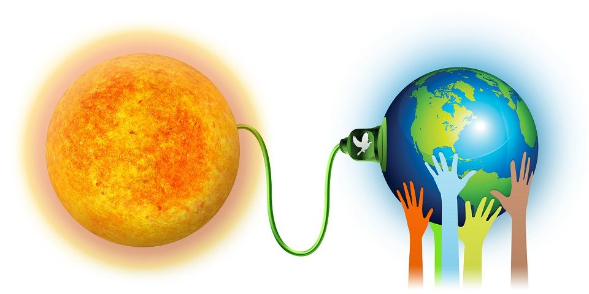
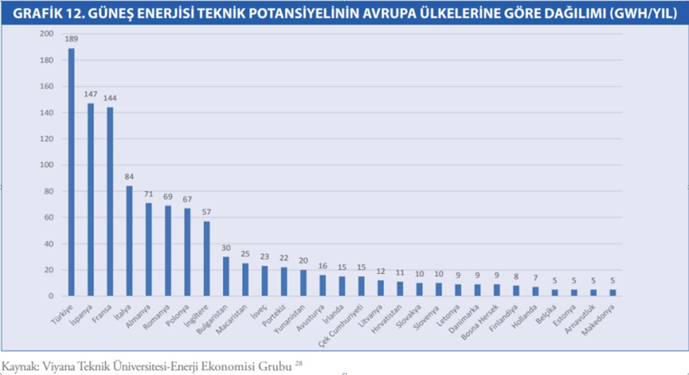
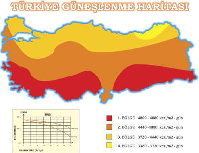
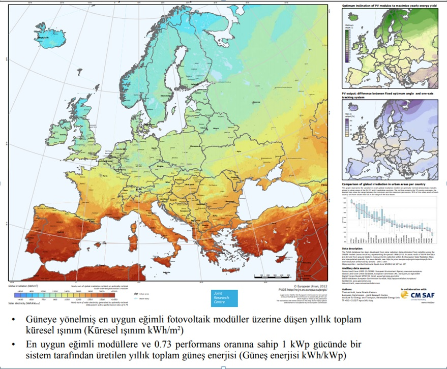
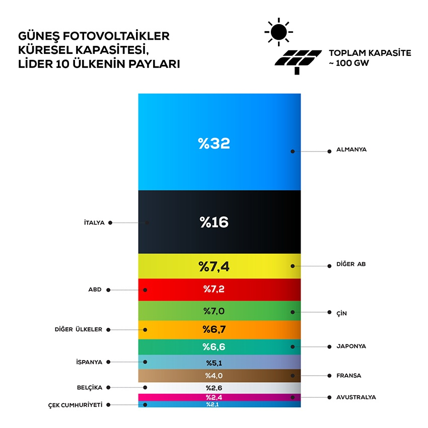
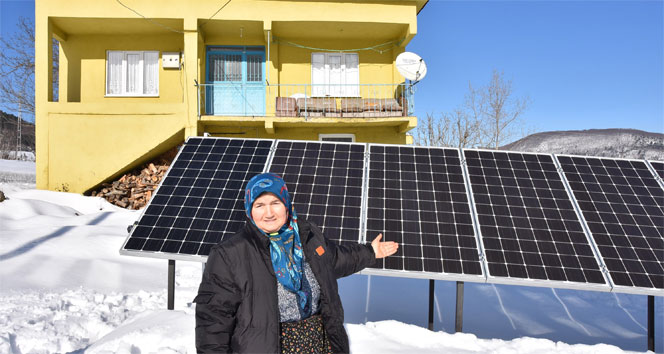
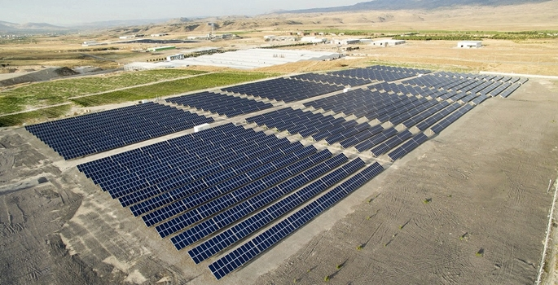
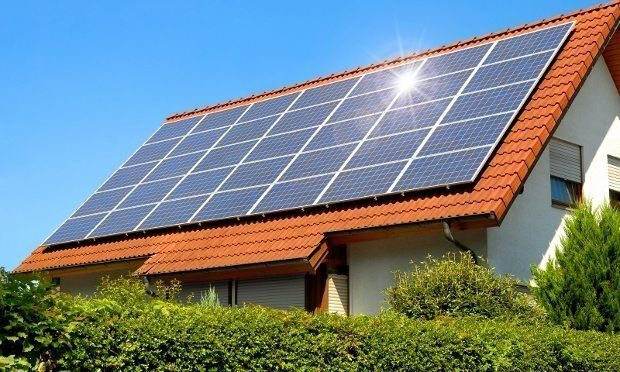

# EN BÜYÜK ENERJİ KAYNAĞI: GÜNEŞ

**Tarih:** 09/07/2018  
**Orijinal Kaynak:** /sdmimproje/en-buyuk-enerji-kaynagi-gunes.html  
**Arşiv Zaman Damgası:** 20190825024201  
**Etiketler:** Güneş Enerjisi, Kapitalizm & Çevre, Kırsal Mimari, Köy & Kaçış  
**Atlas Düğümleri:** pasif_iklim, kapitalizm_mulkiyet, kirsal_koy  

---

Derdim aslında çok basit.

Her sabah doğan güneş, aslında dünya üzerinde elde edebileceğimiz en büyük enerji kaynağıdır. Öyle bir enerji düşünelim ki, dünya varlığını koruduğu sürece, bizlere hiçbir zaman nankörlük etmeyen ve daima varlığını istikrarlı bir şekilde koruyabilecek güce sahip. Bu enerjinin çevreye hiç zarar vermemesi, bedava olması ve bir uğraş gerektirmeden üretilebilmesi de işin cabası. Peki durum böyleyken, bir gün bitecek olan ve çevreye zararlı kaynakları kullanma isteğimiz niye?

Ülkemiz güneşlenme süresi bakımından dünyadaki diğer ülkelere göre yüksek bir potansiyele sahiptir. Enerji ve Tabii Kaynaklar Bakanlığı’na göre, Türkiye’nin güneşlenme süresi yıllık olarak yaklaşık 2 bin 741 saattir. Ortalama olarak günlük 7,5 saat güneşlenme süresine sahip olan ülkemizin, Almanya’dan yüzde 60 daha fazla güneş ışınlarından yararlanma imkanı vardır. Daha farklı bir örnek vermek gerekirse Almanya’nın en iyi güneş alan yeri Türkiye’deki en az güneşlenme oranına sahip şehrimizden bile düşüktür. Mevcut durumda, Türkiye tükettiği enerjinin %72’sini ithal etmektedir. 2012 yılında Türkiye enerji piyasasının toplam parasal büyüklüğü 84 milyar dolar civarındadır. Bu tutarın 60,1 milyar doları ithal edilmiştir. Bu cari açığın kapanması için yapılması gereken, yenilenebilir enerji kaynaklarına gereken önemin verilmesidir. Eğer bu sistemi uygulayabilirsek dışa bağımlı olma sorunu azalacak ve elimizde bulunan kaynaklar ile kalkınma oranımız hızla artış gösterecektir. Bu gelişmeleri birey ölçeğinde de  ele alacak bir toplumsal reforma ihtiyacımız olduğuna inanıyorum.

Araştırma yaparken gördüğüm ve çok etkilendiğim bir haberi sizinle paylaşmak isterim. Sinop’un Gürsökü köyünde yaşayan Kezban Hanım hepimizin ders alacağı önemli bir yeniliğe imza atmış. Kendisi işçi emeklisi olup, çocukluğunda 7 yıl Almanya’da kalmış. Orada bulunduğu süre zarfında güneş enerjisini elektrik enerjisine çeviren paneller ilgisini çekmiş ve ülkesine döndüğünde aynı sistemi evinde de uygulamış. Türkiye’nin özel olarak güneş enerji sistemini kuran ilk insanlardan olarak bir bakıma tüm Türkiye’ye örnek olmuştur. Kendi söylemine göre: ‘Ben bunu ilk gördüğüm zaman, Avrupalılar yapmış biz niye yapmayalım diye düşündüm. Çünkü onlar zor olanı yapmış, teknolojisini bulmuşlar. Bize kolayı kalmış. Bu kolayı da biz yapalım artık, yani biz Avrupa ile yarışalım bizim onlardan ne eksiğimiz var. Bir gün param olursa bunu yaptıracağım’ demiş, yapmış. İşte hepimiz Kezban Hanım, güneş enerjisi ile ilgili olarak bir uzmanlığı bulunmamasına rağmen, sistemini kendi başına kurabilmiş ise, herkes bunu yapabilir demektir.

Şöyle ki herkes yaşadığı evin çatısına güneş enerjisini elektrik enerjisine çeviren paneller kurmalı, bu teknolojileri yapan birçok yerli sermayeye başvurulabilir. Hali hazırda kullanılan enerji kaynakları yenilenemez enerji kaynaklarıdır, yani sınırlı oldukları için bir zaman sonra yok olamaya mahkûmdur. Petrol ve türevi yakıtlar, zehirli gaz salınımı yapmasından ötürü küresel ısınmayı tetiklemekte, çevreye zarar vermekte, insan sağlığını olumsuz etkilemekte, asit yağmurlarına neden olmaktadır. Güneş enerjisi temizdir, koku veya ses gibi rahatsız edici öğeleri de yoktur. Enerji üretimi için kullanılan panellerin ömrü uzundur (25 yıl). Hem elektriğin olmadığı bölgelerde elektrik üretimini sağlar hem de süreksizliği sayesinde ülkelerin enerji güvenliği konusunda güvence sunar.

 Günden güne artan talep ve azalan kaynağımız, kullandığımız kaynakların da maliyetinin zamanla ne denli arttığını ve daha da artacağını bize göstermektedir. Güneş enerjisi maliyetli olmamakla beraber, çevreye karşı hiçbir zararı yoktur, yenilenebilir bir enerji kaynağıdır. Sizlere bu konunun başka cazip yönlerinden de bahsetmek isterim. Evlerimize, iş yerlerimize, kısacası tüm binaların üstüne ya da, tarım arazisi olmayan arazilere kuracağımız bu sistem, kendisini 6-7 senede amorti etmektedir. Geriye kalan 18 yılda, rutin bakımları dışında sisteme herhangi bir ücret ödemeyeceksiniz.

Yazdıklarımı hem kendimi hem de sizleri bilinçlendirmek için yazdım. Artık daha fazla okumalı bilgi sahibi olmalı ve kendi kendimize yetebilmeyi, üstümüze sorumluluk olarak almalıyız. Sizleri yormadan klasik ve banal makale sözcüklerinin arkasına saklanmadan hazırladığım okuma metinini sizlere sunmaya çalıştım. Dünya hepimizin, yeter ki bazı şeylerin nasıl doğru kullanılmasını bilelim. Eğer hepimiz bu sistemi uygularsak, dünyadaki enerji sorunlarının büyük çoğunluğunu bitirmiş ve küresel ısınmayı büyük ölçüde durdurmuş olacağımıza inanıyorum.

**Muhammed Ebrar Sağlam – SDMIM PROJE**
