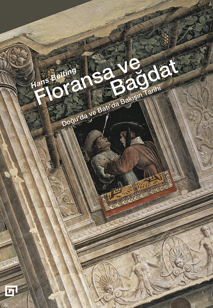

# Floransa ve Bağdat – Doğu’da ve Batı’da Bakışın Tarihi

**Tarih:** 19/09/2015  
**Orijinal Kaynak:** /sdmimproje/floransa-ve-bagdat-doguda-ve-batida-bakisin-tarihi.html  
**Arşiv Zaman Damgası:** 20190101220908  
**Etiketler:** Doğu-Batı Ayrımı, İslam & Medeniyet Tasavvuru  
**Atlas Düğümleri:** dogu_bati, medeniyet  

---

Hans Belting – Floransa ve Bağdat – Doğu’da ve Batı’da Bakışın Tarihi

**sdmimproje**
