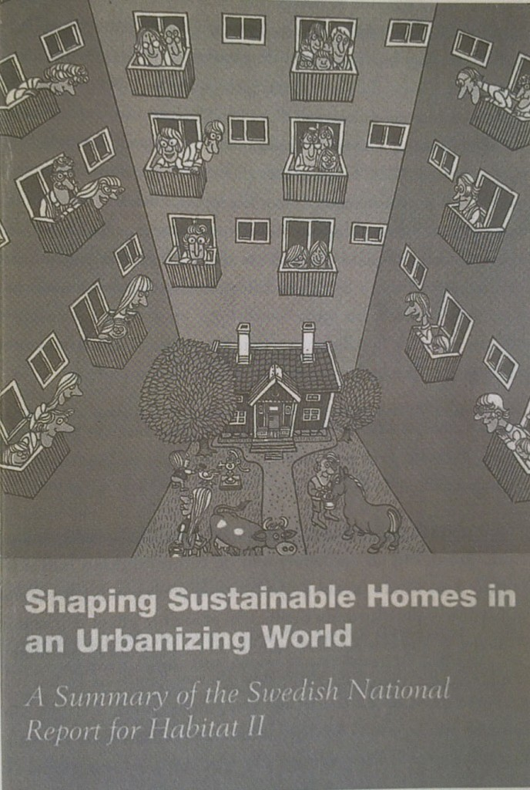

# Hacı Amcalar Duyduk Duymadık

**Tarih:** 23/05/2013  
**Orijinal Kaynak:** /sdmimproje/haci-amcalar-duyduk-duymadik.html  
**Arşiv Zaman Damgası:** 20190101235140  
**Etiketler:** İstanbul, Tarihi Yarımada, Fatih, Müstakil Yaşam & Hürriyet, Apartman & Dikey Şehirleşme Eleştirisi, Cami Mimarisi & Kubbe, Postmodernizm & Tüketim Eleştirisi  
**Atlas Düğümleri:** sehir_hukuku, mustakil_yasam, apartman_elestirisi, medeniyet, goruntu_hakikat  

---

Genel durumlar vardır. Türkiye için bunlardan birisi, hacca giderek hacı ünvanı alan amcaların (Not: Şimdilerde değişmeye başlamış olsa da,Türkiye’de hacılar yaşlı olur imajı vardır.) hayatlarının son baharında ahir ömürleri için bir hayır olsun diye cami yaptırmalarıdır.  Bu hacı amcalar cami yaptırmak için gerçekten canla başla çalışırlar.

Yazdıklarımız cepte dursun şimdi başka bir şeyden bahsedeceğiz: Fatih, İstanbul’un tarihi yarımadası içerisinde kalan güzide bir ilçemizdir. Fatih içinde bulundurduğu tarih ve kültür kadar sahip olduğu yaşayan nüfus olarak da oldukça yoğundur. Dar sokaklar 4-5-6 katlı apartmanlarla sarmalanmıştır. Kısacası her yer binadır.

İşte bu Fatih’in içinde, apartmanlarla dolu  bir yerinde o dar sokaklardan geçerken burnunuza dut ve iğde kokuları, kulağınıza da kuş cıvıltıları gelmeye başlar. Biraz sonra sebebini anlarsınız. Yaklaşık 12 metreye 12 metrelik, içinde tek katlı küçük bir kulubesi olan boş bir arsadır burası. Çok şükür ki ne belediye uğramıştır ne de bir düzenleme yapılmıştır. Toprağıyla, ağacıyla böceğiyle doğadan küçücük bir parçadır burası.

Bu küçücük alan, belediyenin o taşla kaplı bir kaç parkının yapamadığını yapar ve ağaç ve toprak kokusunu unutanlara hatırlatma bilmeyenlere de öğretme vazifesi görür. Kısacası insana insanlığını hatırlatır.

Lafı uzatmadan sadede gelelim. Saygıdeğer ve sevgili cami yapan hacı amcalarımız. Biliniz ki tek hayır cami yapmak değildir. Hatta belki de -özellikle çok yoğun alanlar için- bir arsa alıp oraya bir kaç ağaç dikip kıyamete kadar böyle kalmasını sağlamak cami yaptırmaktan bile daha hayırlı olabilir. Sözümüze kulak verin.

Not: Fatih’teki o arsanın tam yerini söylemek istemedik, sebebi malum.

Habitat II Konferansı’nda İsveç Hükümetinin Sunduğu Rapor Kapağı

**sdmimproje**
