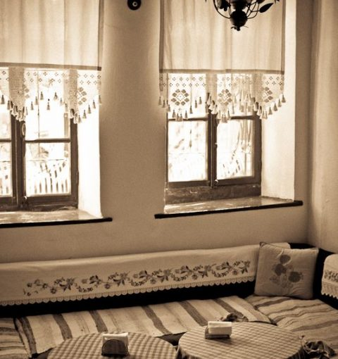

# Hadi Gel Evimize Geri Dönelim

**Tarih:** 29/03/2018  
**Orijinal Kaynak:** /sdmimproje/hadi-gel-evimize-geri-donelim.html  
**Arşiv Zaman Damgası:** 20190101092739  
**Etiketler:** Turgut Cansever, Le Corbusier, Kerpiç, Geleneksel Ahşap & Hımış, Pasif İklimlendirme, Depreme Dayanıklı Yapı, Çorlu & Trakya, Auroville (Hindistan), Mısır & Kahire, Paris, İslam & Medeniyet Tasavvuru, Müstakil Yaşam & Hürriyet, Apartman & Dikey Şehirleşme Eleştirisi, Cami Mimarisi & Kubbe, Sinema & Mekân İdrakı, Katılımcı Mimarlık & İmece, Kapitalizm & Çevre, Kırsal Mimari, Köy & Kaçış  
**Atlas Düğümleri:** cansever, apartman_elestirisi, toprak_yapi, geleneksel_ahsap, pasif_iklim, afet_deprem, yerel_yonetimler, auroville_ornegi, hassan_fathy, medeniyet, mustakil_yasam, goruntu_hakikat, katilimci_mimarlik, kapitalizm_mulkiyet, kirsal_koy  

---

[Hadi Gel Evimize Geri Dönelim – Türkiye Gazetesi](http://www.turkiyegazetesi.com.tr/yazarlar/irfan-ozfatura/601312.aspx)

Mimar Serkan Duman mesleğe başka pencerelerden bakmayı başaran bir sanatkâr. Alışveriş merkezleri, rezidanslar, siteler peşinde koşmuyor. Kerpiç gibi geleneksel bir malzemeyi hayata geçirebilmenin yollarını arıyor.

**Soruyoruz “Niye?”**

Bir kere ucuz, çok da sıhhi, üstelik Anadolu kokuyor. Beton ülkemize ölçüsüz girdi ve bu da beni korkutuyor. Yeryüzünde beton kullanan ilk üç ülke: Çin, Hindistan ve Türkiye. Şehirlere beton boca ediyoruz, tepeleme. Evlerimiz, bir yabancının sığınsınlar diye “lütfettiği” kutucuklar. Müteahhit satıyor, ayrıca da aidata bağlıyor, paraya para demiyor.

**Ne olabilirdi başka?**

Evet ne olabilirdi? Bu konuda çok okudum, araştırdım. Anadolu’yu gezdim, sonra Asya ve Afrika. Dönüp dolaşıp kerpiçe geldim sonunda. Kerpiç emsalsiz bir malzeme, en iyi yalıtım malzemesi; mekânın nemini ayarlar, yazın serin, kışın sıcak tutar. Tamam betona da yalıtım yapılabilir ama o maddeler kimyasal. Hem toprak kadar kolay bulunan bir şey var mı? Temeli kazdın diyelim, çıkanı kullanabilirsin duvarlarda. Kerpiç denince aklınıza harabeler gelmesin, günümüzde “Aaa bu toprak mı inanmam” dedirtecek teknikler var. Ne yazık ki ben bu teknikleri kerpicin ana vatanı olan Anadolu’da değil de Avrupalılardan öğrendim.

**Peki sağlam mı?**

Bunu sorarken zelzeleyi düşünüyor olmalısın. Evet sağlam, tabii doğru tekniklerle inşa edilmek kaydıyla. Bir kere duvarları kalın, yüksekliği az, nereye yıkılacak? Gölcük depreminde bir fotoğraf gördüm betonlar paramparça, geleneksel evler dimdik ayakta. O zaman beton kötü diyebilir miyiz. Hayır hata malzemede değil, yapanda. Kerpiç bizde köklü bir sanat, ancak Osmanlı usulü unutulmuş, yine yapılıyor ama el yordamıyla.

****

Peki ya dünyada?

Hindistan’a gittim. Fransızların inşa ettiği yapıları inceledim. Muson mevsimiydi, şiddetli yağmurlara bile dayanıyordu toprak. Sonra ABD’li bir grupla Gana’da klinik yaptık. Güvenim iyice arttı, taş ve ahşap desteği ile büyük mekânlar da planlanabilirdi pekâlâ. Yemen Sana’da “çölün gökdelenleri” 500 yıldır ayakta. Afrika’da toprak bir cami gördüm hayran oldum. Seksenli yıllarda yapılmış ama bin yıllık havası veriyor. Mısırlı Abdülvahid el-Vekil (hocamdır) Hac yolundaki camileri yığma tekniğiyle tekrar yaptı. Keşke biz de Afrika’ya oranın tarzıyla anlayışıyla camiler yapsak. Rumeli’deki mimariyi niye götürüyor, neden beton dayatıyoruz insanlara? Onlara alıştıklarını yapalım. Zaten iş gücü ucuz, birlikte çalışalım hatta. Kardeşlik böyle büyür, yan yana. Mahalleye mescit lazım biri arsayı verir, biri saman. Biri emeği ile katılır, ortaya çıkar. Efendim zenginleri ikna edelim en büyük camiyi köyümüze kasabamıza… Bu büyüklük sevdası nereden geliyor anlamıyorum. Bırakın padişahlık padişahlarda kalsın.

**Mescid-i nebi de topraktı.**

Toprağın sağlıklı, ucuz ve pratik olmasını bir yana, sadece mümin olarak Peygamber Efendimiz gibi yapmamız icap etmiyor mu? Eğer isteseler taş ustası bulamazlar mıydı? Ayasofya ve Panteon İslam’dan önce yapıldığına göre, kolay.

**Çimentoya niye kızıyorsun bu kadar**

Çimento ilk safhasından son safhasına kadar çevre felaketi. Siz fark etmeseniz de gaz salıyor. Bina terk ediliyor çürümüyor, yıkıyorsun iğrenç bir moloz çıkıyor.

**Müstakilden yanasınız o zaman**

Diyelim savaş oldu, elektrik, su, gaz kesildi, asansörler, klimalar çalışmıyor. O kulelerde nasıl yaşayacaksınız acaba? Beton mu yiyeceksiniz acıkınca? Bahçeli evin olsa, suyunu kuyudan çeker, domates biber eker, tavuk, keçi beslerdin icabında. Otel odalarında banyodan çıkarsınız bir koku gelir ardınız sıra. Hâlbuki kerpiç nefes alır emer bitirir anında. Modernite geleneksel olan ne varsa reddetti, hatırlarsınız yumurtaya, kundağa, anne sütüne de karşıydı bir ara, sonra özür dilediler o başka.

**Kerpiç yapmak zor mu?**

Yoo aksine çok kolay. Zaten şenlik gibi oluyor, kadınlar bizden iyi kerpiç kesiyor, çocuklara bile iş düşüyor. Çaylar demleniyor sohbetler ediliyor, duvarlar neşe içinde yükseliyor. Akran, akraba çalışınca masraf azalıyor. Eğer bir kenarda kavakların varsa bedavaya bile çıkar. Buradan kerpicin ancak köylerde yapılabileceği anlamı çıkmasın bence en yakışanı villa. Zengine de hitap ediyor fukaraya da. Yeter ki talep olsun, ben projelerini çizer, bizzat gelir danışmanlık yaparım onlara. Topraklarımız umumiyetle kerpice müsait. UNESCO’nun kurduğu bir merkez var, Tekirdağ toprağı götürmüştüm, mükemmel buldular.

**Peki ömrü?**

Betonun ömrü biliniyor mu? Bilinmiyor. 50 yıllık binaların demirleri çürüdü kopuyor, çekme ve gerilmeye ne kadar dayanacaklar daha? Ama Mısır’da (Ramesseum) firavunun toprak tahıl depoları 3.400 yıldır ayakta. Diyelim öldün gittin, kerpicin üzerinde ot biter, bir kazmayla  ufalanıp karıştırılabilir toprağa. Ecdat evini fâni malzemelerden yapmış, bir ömür dayansın yeter demiş, kazık çakmamış dünyaya. Eğer ufak bakımlarını aksatmazsanız asırlarca yaşar.

**Maliyete gelirsek?**

Kerpiçte iki kalem gider var: Biri usta ve işçi parası, öbürü ahşap. Eğer mekânı çatıyla değil de kubbeyle kapatırsan ahşap masrafı da olmaz. Düşünün kubbeli bir evde yaşıyorsunuz, kemerli kemerli kapılar. Binbir gece masalları gibi âdeta. Kubbeli mekanın akustiği de hoştur. Zaten ev dediğin duygulara hitap etmeli, şiir yazdırmalı insana. Eskiden bina ustanın el kol ölçülerine göre yapılırdı. Şimdi cüzdanın kalınlığına göre, ya da vincin boyuna. Komşunun rüzgârı güneşi kesilecek diye ödümüz kopardı. Kul hakkı gibi bir derdimiz vardı zira.

**Hayalinizdeki ev?**

Çocuk resimlerindeki evler nasıl olur? Tek katlı, yanında meyve ağaçları ve bacası tüter mutlaka. İşte onu sunmalıyız insanlara. Türk filmlerinde garip âşık, nişanlısını alır bir arsaya götürür “evimizi buraya kuracağız Leylâ!” Mutfak şu yanda mı olsun bu yanda mı? İnsanın kendi evi üzerinde sözü olmalı. Apartmanları değiştiremezsin ama, Edirneli de aynı kutuya, Vanlı da… Binayı yapan senin hayat tarzını, alışkanlıklarını sormaz. Meşhur mimar Le Corbusier yolcu gemilerini çok severmiş, üst üste dizilmiş kamaralar, ufak ufak lombozlar ve hepsinde aynı manzara. Kampana çaldı “Girin!”, çaldı “Çıkın dışarıya!” Tasarladığı mekânlar da öyle, şimdi apartman diyoruz onlara.

**Paris’i beğenirler oysa**

Turgut Cansever Paris’e şehir diyen ahmaktır der. Caddeler cetvel gibi, ortada meydan. Adam onu muhtemel isyanları bastırmak için planlamış, bataryayı merkeze kur, bütün şehir namlunun ucunda. Gelişmekte olan ülkeler Paris’i taklit ettilkleri için bocaladılar. Doğu şehirlerinde iç içe evler, eğri büğrü sokaklar vardır. Komşuluk, esnaflık vardır, kahve kıraathane, sokak muhabbeti vardır. Cami, mektep, sebil, han, hamam, şadırvan… Sanat tarihçi Titus Burchardt Fez şehrine uzaktan bakar, sanki bütün evler aynı, mahalleye girer hepsi başka başka. Düzen kışlada lazım, şehirler insana göre olmalı ve insanca. Medeniyeti prensipler belirler, prensip ise neyi yapacağınızdan ziyade neyi yapmayacağınızdır. Avrupalıyı apartmanda oturtamazsın, Amerikalı ahşap sever betona yanaşmaz. Kerpiç Fransa ve İspanya’da çok yaygın. Avusturya’lı bir mimar biliyorum, gökdelen içinde kerpiç kullanıyor adam.

**Örnek evler yapsanız da görsek ya**

Rönesans denilen şeyi Medici ailesi başlatmış, eğer masraf karşılanmasa Mikelanj ne yapabilirdi kendi başına? Benim de bunları cebimden gerçekleştirecek hâlim yok. Kahramanmaraş’ta yaptım ziyadesiyle memnun kaldılar, yine yaparız talep olursa.

** Son bir mesaj**

Malum, mimarlık fakültelerinde öğrencilerden otel, hastane, site, alışveriş merkezi projelendirmeleri istenir. Ben olsam “Âşık olduğun insan için bir ev tasarla” derdim onlara. Belki sevdiğini duvar içine hapsetmek bile zül gelecek, gidip dağları delecek.

Ferhatlar nerden çıktı sanıyorsunuz?

Anadolu değil mi bura?