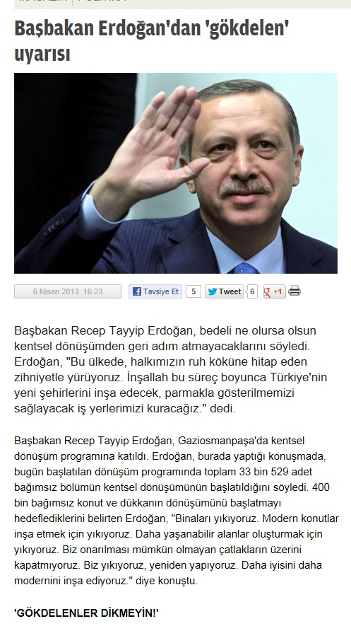
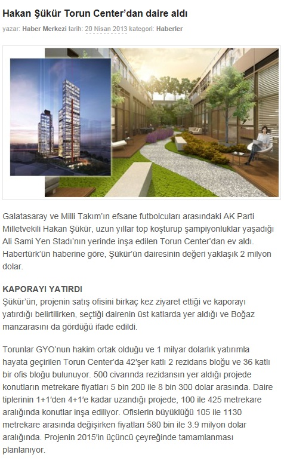
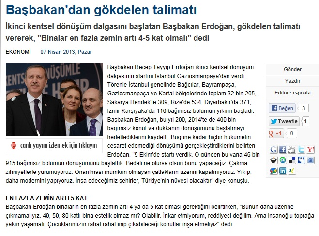

# Hakan Şükür Gökdelenden Ev Almış

**Tarih:** 2013-04-20T21:40:24+00:00  
**Orijinal Kaynak:** http://sdmimproje.com/hakan-sukur-gokdelenden-ev-almis/  
**Arşiv Zaman Damgası:** 20140101072245  
**Etiketler:** Apartman & Dikey Şehirleşme Eleştirisi, Doğu-Batı Ayrımı, İslam & Medeniyet Tasavvuru  
**Atlas Düğümleri:** apartman_elestirisi, dogu_bati, medeniyet  

---

****

**[@sdmimproje](https://twitter.com/sdmimproje) : [@hakansukur](http://twitter.com/hakansukur) **Başbakan’ın gökdelen açıklamalarından sonra, gökdelenden ev alıp, bunun sayesinde de bina reklamının yapılması sizce doğru mu?

**  **

**sdmimproje**
