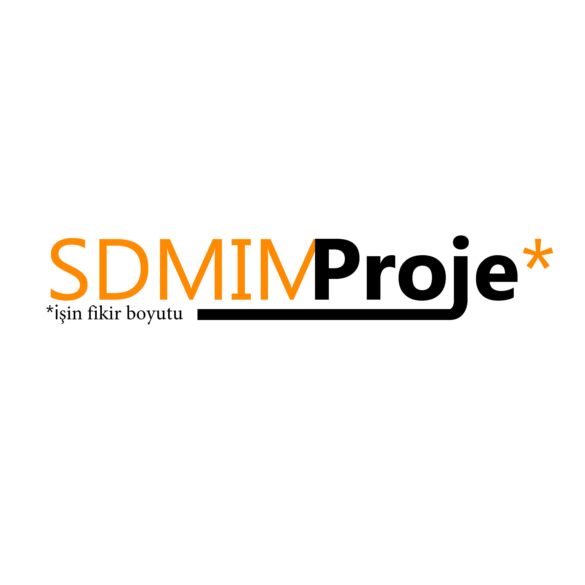

# HAKKINDA

**Tarih:**   
**Orijinal Kaynak:** /sdmimproje/hakkinda.html  
**Arşiv Zaman Damgası:** 20190123030111  
**Etiketler:** Şehir Hukuku & Şehircilik, Kapitalizm & Çevre  
**Atlas Düğümleri:** sehir_hukuku, kapitalizm_mulkiyet  

---

# HAKKINDA

SDMIM PROJE, [SDMIM MİMARLIK | ARHITECTURE](http://www.sdmim.com) bünyesinde; mimari, şehircilik, çevre, sürdürülebilir enerji, tarih, popüler kültür ve sanat gibi konularda çalışan ve fikir üreten bir proje ekibidir.