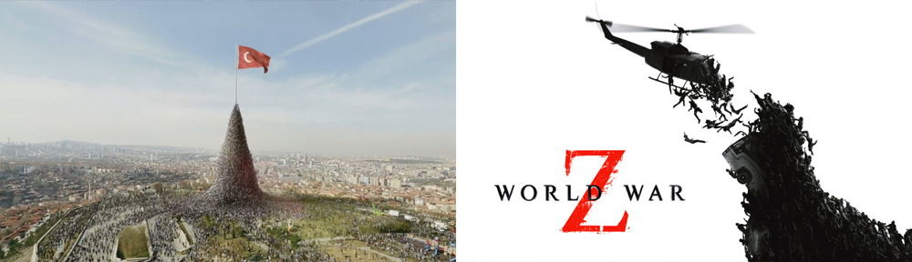
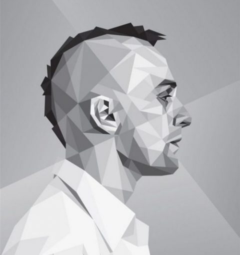
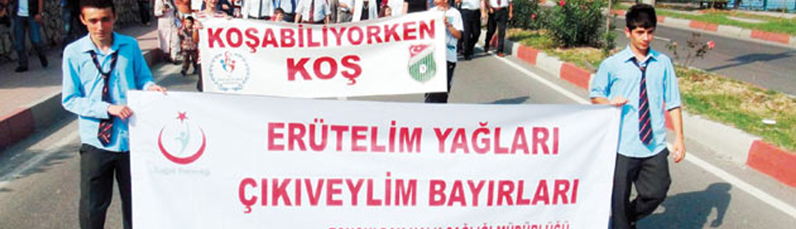

# “halden hale” girerken

**Tarih:** 2019  
**Orijinal Kaynak:** http://sdmimproje.com/halden-hale-girerken/  
**Arşiv Zaman Damgası:** 20190000000000  
**Etiketler:** Depreme Dayanıklı Yapı, İslam & Medeniyet Tasavvuru, Cami Mimarisi & Kubbe, Sinema & Mekân İdrakı, Mimarlık Ortamı & Akademi Tenkidi  
**Atlas Düğümleri:** afet_deprem, medeniyet, goruntu_hakikat, mimarlik_egitimi  

---

# “halden hale” girerken

				** sdmimproje
				** 21/12/2014
				** 102
				** [0](/sdmimproje.html?filter=0)

Uzun zamandır aklımızı meşgul eden bir takım meseleler üzerine yazmak istiyorduk. Nasip bugüneymiş. Bizi yazmaya iten sebep ise bir tv programı oldu: “Halden Hale.”

Programda üç kişi tasavvuf sohbeti yapıyorlar. Mekan ise muhtemeldir ki bir mevlevihane hatta Bahariye Mevlevihanesi olmalı.

Bu program üzerinden tamamen şekle dayalı birkaç söz edeceğiz. “Hep eleştiri hep eleştiri…” diyenler kusurumuza bakmasınlar. Hele ki pek kimseyi eleştirmeyi sevmeyen ehl-i tasavvuf zatlar hakkında konuşmak hassas bir işken. Onların tahammülüne sığınıyor ve bu programa özelde bir lafımızın olmadığını meselemizin Türkiye ve hatta müslümanlar genelinde olduğunu belirtmek istiyoruz.

Gelelim meselelere.

Baştan söyleyelim. Ayrıntılı yazmayacağız. Sadece düşüncelerimizi kısaca yazıp anlayışı ilgili zihinlerin takdirine bırakacağız.

1) Dini bir program, dini bir mekanda yapılıyor (Böyle çok fazla tv programı var şu sıralar). Böylesine mekanlara getirip masa ve sandalye koymak ve ortasında oturmak bize pek hoş görünmüyor. Bu hem dini açıdan böyle hem de edep açısından. Zira islam yer ile ilişkili olan bir din. Bu anlamda başta hristiyanlık olmak üzere birçok dinden ayrışır.

Bakınız bu “yer” meselesi üzerinde hiç durulmayan bir mesele. Modern zamanlara kadar müslümanlar yerde yaşıyorlardı. Yani yere yakın… Yerde oturuyorlar, yerde yemek yiyorlar, yerde secdeye varıyorlar ve yerde yatıyorlardı. Ancak modernite ile birlikte hemen herşeyin altüst oluşuyla bu durum da bozuldu. Gelişmek adına birçok güzel alışkanlık ve haslet terkedildi.

Şimdilerde zaman zaman gündemi meşgul eden [“camiler kiliseye benziyor”](/sdmimproje/kiliseler-mi-camiye-benzesin.html) yakınmaları da yerde yaşamaktan kopmakla doğrudan ilişkili. Yerde yaşama alışkanlığını kaybeden müslümanlar ne yazık ki camide de yerde oturmaktan kopmaya başladıklarının sinyalini veriyorlar aslında.

Yere yakın yaşamak, kıyafetleri de etkiler. Yerde oturmak daha rahat kıyafetler gerektirir. Dar ve sıkı (modern) kıyafetler  kişinin yerle olan ilişkisini sınırlar.

“Yer” meselesi çok daha geniş bir konu aslında. Öyle ki islam mimarisinin insanı sınırlamama ve zapturapt altına almama özelliği ile doğrudan ilişkili. Ancak şimdilik bu kadar açıklama kafi.

– Hadi hepsini geçelim. Bizce her mekanın bir adabı vardır. Ve cami ve tekkeler masa sandalye kabul etmez. Hele ki bizden çok daha hassas olduklarını tahmin ettiğimiz program konuşmacıları bunu daha iyi bileceklerdir.

# [Martin Lings 2005′te ne dedi?](/sdmimproje/martin-lings-2005te-ne-dedi.html)

# 

2) Kadın erkek ilişkisi meselesi… Şuna bir açıklama getirilmeli; islamda kadın erkek bir arada, karşılıklı sohbet edebilir mi? Hele ki sohbet dini ise bu yakışık alır mı? Hemen gerici diye yaftalamayınız lütfen. Demek istiyoruz ki islamda bu hoş karşılanmaz deniyor. Öyle ise?..

“Halden hale” programından önce yine aynı kanalda olmalı (ya da bir başka TRT kanalı), ekolojik mimariye dair bir belgesel vardı. Kore’deki bir üniversite yapısı tanıtıldı. Tanıtılan bina sadece kadınlara ait bir üniversite yapısıydı.

Ne kadar da güzel değil mi? Biliyoruz ki Türkiye’de de erkeklerin olmadığı ortamlarda okumak, çalışmak, spor yapmak isteyen kadınlar var. Onların da hakları düşünülemez mi?

Bizce elbette düşünülebilir. Ama sormak istiyorum bu kadınlar isteklerinde haklılar mı? Yani islam yabancı erkek ve kadınların birarada olmasını hoş karşılamıyor mu? Eğer öyle ise kadınlı erkekli dini programlar biraz ironik mi?

Not: Mezkur açıklamalar sorulardır. Kimseyi yanlış ya da doğru yapıyorlar diye yermiyoruz. Sadece zihnimizden geçenleri paylaşıyoruz.

Neyse efendim. Bu da böyle…

**[bkz. Türkiye’de din kaynaklı şizofreninin yansımaları](/sdmimproje/turkiyede-din-kaynakli-sizofreninin-yansimalari.html)**

# **[bkz. İmamın Kayığı Yok ki…](/sdmimproje/imamin-kayigi-yok-ki.html)**

***sdmimproje***

				[edeb](/sdmimproje.html?filter=edeb) [halden hale](/sdmimproje.html?filter=halden-hale) [islami](/sdmimproje.html?filter=islami) [mimari](/sdmimproje.html?filter=mimari) [tasavvuf](/sdmimproje.html?filter=tasavvuf) [tekke](/sdmimproje.html?filter=tekke) [yerde yaşamak](/sdmimproje.html?filter=yerde-yasamak)			

## Related Posts

												

									sdmimproje								

## [MVRDV mimari bir grup, AK Parti ise siyasi bir parti. Öyle ise…](/sdmimproje/mvrdv-mimari-bir-grup-ak-parti-ise-siyasi-bir-parti-oyle-ise.html)

								19/03/2014							

												

									sdmimproje								

## [Mimarlık Eğitimi Üzerine Kendimle Söyleşi](/sdmimproje/mimarlik-egitimi-uzerine-kendimle-soylesi.html)

								25/07/2018							

												

									sdmimproje								

## [Türkiye Sağlıklı Kentler Birliği – DUR YAPMA Sinemalarda](/sdmimproje/turkiye-saglikli-kentler-birligi-dur-yapma-sinemalarda.html)

								16/02/2013