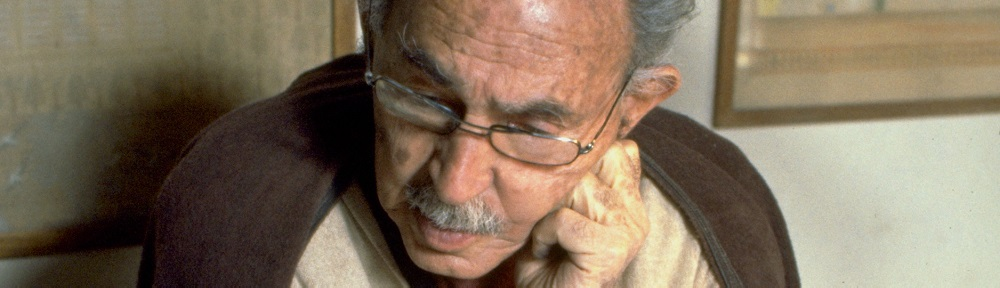

# Hasan Fethi 1969’da ne dedi?

**Tarih:** 02/12/2015  
**Orijinal Kaynak:** http://sdmimproje.com/hasan-fethi-1969da-ne-dedi/  
**Arşiv Zaman Damgası:** 20190101122654  
**Etiketler:** Hasan Fethi, Kendi Evini Yapmak, Fas & Mağrip, Mısır & Kahire, Paris, Atina, İslam & Medeniyet Tasavvuru, Fıtrî Mesken & Ev Felsefesi, Cami Mimarisi & Kubbe, Katılımcı Mimarlık & İmece, Kapitalizm & Çevre, Kırsal Mimari, Köy & Kaçış, Mimarlık Ortamı & Akademi Tenkidi  
**Atlas Düğümleri:** hassan_fathy, kendieviniyapmak, dogu_bati, cansever, felsefe_sanat, medeniyet, ev_felsefesi, katilimci_mimarlik, kapitalizm_mulkiyet, kirsal_koy, mimarlik_egitimi  

---

Hasan Fethi’nin Türkçe’ye Katılımcı Mimarlık (İngilizce adı: Architecture for the Poor) adıyla çevrilen kitabından alıntılanan bazı bölümler:

> 

* Mimarlık hâlâ en geleneksel sanatlardan biridir. Mimari bir yapıt kullanılmak içindir, biçimi büyük ölçüde kendinden önce gelenler tarafından belirlenir ve kendisini her gün gören bir insan topluluğunun önünde bulunur. Mimar, kendinden önce gelenlerin yapıt­larına ve kamuoyunun duyarlılığına, mimarisini kişisel reklam aracı yapmayarak saygı göstermek zorundadır. Aslında hiçbir mimar, kendinden önce gelen mimarların yapıtla­rını kullanmaktan kaçınamaz. Özgün bir mimari oluşturmaya kendini ne kadar zorlarsa zorlasın, yapıtının büyük bir bölümü mutlaka şu veya bu geleneğinin, izlerini taşıyacaktır. O zaman niçin kendi ülkesinin veya bölgesinin geleneğini hor görmeli, yabancı gelenek­lerin yapay ve beceriksiz sentezlerini sunmalı, niçin kendinden önce gelenlerin düşün­celerini çarpıtıp yanlış uygulayarak onlara saygısızlık etmelidir! Bu saygısızlık, örneğin, sırf ünlü biri olma duygusunu tatmak isteyen bencil mimarın, yıllar boyunca kullanımı sırasında geliştirilerek yetkin boyutlara, biçime ve işleve erişmiş mimari bir öğeyi alıp, işlevini yerine getirmesini engelleyene ve tanınmaz hale getirene kadar düşüncesizce büyütmesi, tutup başaşağı kullanmasıyla olur.

* Örneğin, insanlığın, farklı mimari gelenekler içerisinde, doğru pencere oranlarına ulaşması yıllar almıştır; eğer bir mimar büyük bir hata yapıp pencereyi duvarın tümünü kaplayana dek genişletirse hemen bir sorunla karşı karşıya kalır. Cam duvar radyasyonu alışılagelmiş duvardan on misli daha fazla geçirecektir. Eğer bunu denetlemek ister de pencereye, genişletilmiş Venedik panjurundan başka bir şey olmayan güneş kırıcıları ek­lerse, odası hâlâ duvarlı bir odadan %300 oranında daha fazla radyasyon alacaktır. Bir de bunun üzerine panjur tirizlerinin/latalarının genişliğini, cam duvarın ölçeğine zarar vermemek için 4 cm’den 40 cm’ye çıkarırsa sonuç ne olur? Bir kepenkten veya Venedik panjurundan yayılan yumuşak ışık yerine parlak ışığa karşı konan geniş şeritlerin yarattığı koyu gölgeyle çiğ ışığın karşıtlığı odada bulunan herkesin gözlerini kamaştırır.

Hepsi bununla bitmez, cam duvarın kullanılmasının asıl nedenlerinden biri olan manzara da geniş şeritlerle sürekli kesilerek seyredilemez olur; güneş kırıcılarının bir kepenk veya Venedik panjuru gibi katlanabilme özelliği bile yoktur. Paris gibi serin bir iklimi olan yer­lerde bile cam duvarın başa çıkılamaz bir saçmalık olduğu ortaya çıkmıştır. 1959 yılında sıcak geçen yaz aylarında Birleşmiş Milletler binasının içerisinde ısı, cam duvarların ya­rattığı “sera” etkisiyle iklimlendirme sistemine karşın, öylesine yükselmiştir ki, çalışanların çoğu sıcaktan bayılmıştır. Sanırım cam duvarların ve güneş kırıcıların tropikal ülkelerde kullanılması konusunda yorum yapmaya gerek yoktur. Bununla birlikte modern tropikal mimaride bu öğeleri kullanmayan örneklere rastlamak hemen hemen olanaksızdır.

* İnsanoğlunun ortak zayıf yönleriyle oynayan reklamcı, ortak zevkleri hoşnut kılan ima­latçı, alışılagelmiş tepkilere göre eğitim yapan öğretmen, her biri kendi yöntemiyle insan ruhunu öldürür. Yani her biri ortak özelliklere aşırı değer vererek kişiyi dışlar. Bir noktaya kadar kişi kitle için kurban edilmelidir; yoksa toplumlar oluşamaz ve insan tek başına kalıp ölür. Ama herkes kendi kendine insanın kişiliğindeki özel ve genel etkenler nasıl dengelenir diye sormalıdır. Kendilerine çoğunlukla karşı çıkılmayan tek biçimciliğin savu­nucuları, davalarını kazanıp modern yaşamdan bireylik geleneğini sildiler.

* Bir zamanlar ev inşa ettirmek isteyen biri yaşamının en karmaşık ve uzun süreli karar verme dönemine girerdi. Düşüncenin ilk defa aile içinde tartışılmasından en son işçi evi terk edene kadar yapımcılarla birlikte çalışır -elleriyle değil belki, fakat önererek, ısrar ederek, reddederek çalışır- onlara sürekli danışmanlık eder ve evin alacağı en son biçimden kendini sorumlu tutardı. Aslında mal sahibinin evine olan bu ilgisi inşaattan sonra da hep sürerdi, çünkü eski bir inanışa göre evin tümüyle bittiği gün onun da öleceği gün demekti. Tedbirli ev sahibi de evini değiştirmeye, eklemeler yapmaya devam eder, ölümüne yol açacak en son tuğlayı koymayı sürekli geciktirirdi.

* Eğer mal sahibiyle zanaatkar arasına mimar girseydi hiçbirinin anlayamayacağı planlar çizecek ve çizim masasından uzaklaşamadığı için de iyi bir evle kötüsü arasındaki tüm farkı yaratan ayrıntıdaki çeşitlemelerden asla haberi olmayacak.

* Bir gün, sıva içerisine yerleştirilen vitray pencere yapan ustabaşı Muhammed İsmail ile konuştum. Bu pencereler, bir zamanlar kent evlerinde çok rastlanan bir süsleme yön­temiydi. Fakat ona kendinden başka kaç kişinin bu işle uğraştığını sorduğumda ancak bir kişinin, Lütfi Usta’nın adını verebildi. İsmail’e zanaatını çocuklarına öğretip öğretmediğin sordum. “Büyük oğlum makine ustası, küçüğünü de okula gönderdim” dedi. “O zaman senin neslinden sonra geleneği sürdürecek kimse kalmayacak?” “Benim ne yapmamı istiyorsun? Çoğu zaman yiyecek bir şeyimiz bile olmadığını biliyor musun? Bugün artık kimse benim işimi istemiyor. Sizin yeni mimarinizde vitray pencerelere yer yok. Bir düşün, bir zamanlar su taşıyıcısı bile evini süslemek için beni tutardı. Bugün kaç tane mimarın bizim ve bu zanaatın varlığından haberi var?” “Eğer sana on tane öğrenci getirirsem onlara zanaatı öğretir misin?” diye sordum. İsmail kafasını salladı. “Bana bunu okulda öğretmediler. Eğer mesleği yaşatmak istiyorsan bize iş ver. Eğer çalışabilirsek o zaman burada on tane okul öğrencisi değil yirmi çırak görürsün” dedi. (Ona bir iş ve­rebildim. Çalışması diğer mimarların da dikkatini çekti ve böylece makine ustası olan büyük oğlu zanaata geri dönüp ustalıkta babasını bile geçti.)

* Mimar teknik bilgisinden -gerilme ve basınç kuvvetlerinden ve eğilme momentlerinden konuşabilmesinden- ötürü kendini müşterisinden daha üst düzeyde hisseder; ondan gözü korkan müşteri de görevden alınmayı kabul eder, ironik olarak da çok az sayıda mimar yeni biçimleri gerçek bir sanatçı gibi kullanabilir ve kenti ve kırsal alanı gitgide çirkinleştiren basit mühendislik mimarinin yerini alır.

* Bugün mimar tutabilen varlıklı biri, kendisi hakkında karar verme konusunda eskiden sahip olduğu gücün büyük bir bölümünü kaybetmiştir. Yoksul olan belki de daha şanslıdır, diye düşünebilirsiniz. Belki de, kendi kendine bırakıldığında, bu doğrudur; ama eğer hükümet onun için inşa etmeye karar verirse, o zaman durumu, mimarın zorbalık yaptığı zenginden çok daha kötü demektir. Çünkü devletin mimarları, yoksulları düşünceleri sorulmayacak denli cahil bulmasalar da, her aileyle ayrı ayrı görüşmek için zamanlarının olmadığını söy­lerler. “Bir milyon adet konut inşa etmemiz gerekiyor, ama hem paramız, hem de zama­nımız kısıtlı. Lütfen gerçekçi olunuz. Mimarları bir milyon aileyle çekişmeleri için nasıl gönderebiliriz? Bu ütopyadır. Konut politikası oluşturmak zor bir iştir. Üstesinden gelmek için epey iyi şeyler yaptık. Ailelerimizi büyüklüklerine, yapılarına, gelirlerine ve tahmini değişikliklere göre sınıfladık. Istatiksel çözümlemeyle beş çeşit aile olduğunu öğrendik her biri için en uygun konutu tasarladık. Şimdi de her çeşitten 200.000’er adet inşa edeceğiz. Daha başka ne yapabiliriz?” Hükümetin mimarları çürütülemez savlarını işte böyle oluş­tururlar ve bir birinin tıpatıp aynı bir milyon ev inşa ederler. Sonuç korkunç derecede kötü ve insanlık dışıdır. Bir milyon aile, tasarım hakkında bir söz bile söyleyemeden bu yetersiz hücrelere tıkılırlar ve aileleri sınıflamak ve onları konutlara uydurmak için bilimsel yöntem­ler ne denli kullanılırsa kullanılsın sonuçta çoğunluk hoşnutsuzluğa mahkum edilir.

* Kişiliğin katledilmesi görevini üstlenen bir mimardan yüz özel müşteri için bir ayda yüz ayrı tasarım yapması istenirse öfkelenecektir. Yalnızca öfkelenmeyecek, hastalanacaktır da; yirmi tanesini yaptıktan sonra düşüp bayılacaktır. Ama yoksullar için bir milyon ev tasarlarken bayılmak bir yana, gelecek ay bir milyon tane daha yapmak için hazırdır bile: Çünkü yaptığı bir konut tasarlayıp yanına altı sıfır eklemektir.

* Doğruyu söylemek gerekirse, yöneticilerin hatası teknisyenlerinki kadar fazla değildir; tıpta kimse doktordan, yoksul hastalarına seri üretim ameliyatlar yapmasını beklemez. O zaman niçin apandisit gibi geçerli bir hastalık dikkatli ve kişisel bir ilgi görürken, aile konutu gibi sürekli bir gereksinim böyle bir ilgiden yoksun kalsın? Eğer bir makineyle binlerce apandisit keserseniz hastalarınız ölür ve eğer aileleri birbirinin avm sıra konutlara yerleştirirseniz o zaman da bu ailelerde mutlaka bir şeylerin ölümüne yol açarsınız. Kişiler evleri gibi donuklaşıp ruhsuzlaşır. Hayal güçlerini kaybederler.

* Çünkü her insanın kendine ait bir aklı ve onun dediklerini yerine getiren iki eli var. İnsan etken bir varlıktır, iş yapar, girişkendir ve ona kuşlara yuva yapar gibi ev yapmak zorun­da değilsiniz. Ona küçücük bir şans verin, konut sorununun kendine düşen bölümünü, mimarların, müteahhitlerin ve teknik ressamların yardımı olmadan, herhangi bir hükü­met yetkilisinden çok daha iyi bir biçimde çözecektir. Bir mimarın bütün gece işyerinde oturup, her boyuttan kaç konutun kitleleri barındırmak için en uygun olacağını bulmaya çalışması yerine, her aile kendi evini kendi gereksinimlerine göre inşa edecek ve onu kaçınılmaz olarak yaşayan bir sanat haline getirecektir, işte hükümetin yaptığı kötü toplu konut projelerine seçenek, herkesin bir ev sahibi olmayı düşünmesi ve onu kendisinin inşa etmesi konusundaki kişisel isteğinde yatar.

* Mimara gelince, eğer kişilere ayrı ayrı danışmanlık edecek kadar zamanı yoksa, eğer zamanı ona yapılacak ödemeden çok daha değerliyse, o zaman bu iş onun için değildir. Bırakın gitsin. Uzmanlığını, karşılığını ödeyebilecek kişilere satsın ve yoksulları kendi ev­lerini tasarlamaları için serbest bıraksın. Diğer seçeneği, yani bir yol mühendisinin yolun bir bölümünü tasarlayıp onu binlerce kilometreye uygulaması gibi bir ev tasarlayıp yanı­na üç sıfır koymayı benimsemek demek, kendi mesleğine ihanet etmek, konutun sanatsal boyutunu paraya kurban etmek ve dürüstlüğü bir yana bırakmak demektir.

* Bunların üstesinden herhangi bir hükümet gelebilir. İş yalnızca konut sorununa yaklaşı­mını değiştirmesine kalıyor. Eğer konutun ailenin kişiliğinin görünür simgesi, bir insanın sahip olabileceği en önemli maddi nesne ve varlığının kalıcı şahidi olduğunu göz önüne alırsa; yokluğunun toplumdaki genel hoşnutsuzluğu doğuracak en önemli nedenlerden biri olduğunu, varlığının toplumsal dengeyi sağladığını hatırlarsa; o zaman kişinin içinde yaşayacağı evi yapmak için tüm düşüncesini özenini ve zamanını vereceğini anlayacak­tır. Bir Hükümetin halkına verebileceği en büyük hizmetlerden biri, her aileye kendi evini yapma ve bitmiş yapının ailenin kişiliğim temsil edebilmesi için ona yapının her aşama­sında karar verme olanağını sağlamaktadır.

* Eğer biri bunun olabilirliğinden kuşkuya düşerse gidip Nübye’yi görsün. Orada her tür­lü eğitimden yoksun köylülerin yeterli deneyimi kazandıktan sonra bu işi, herhangi bir hükümetten çok daha iyi başardıklarını somut kanıtlarıyla görecektir. Aslında aynı tür imgeleme yetisinin, becerinin ve coşkunun örneklerine evsiz ailelerin yapılarını kasalar­dan, gaz tenekelerinden ve bunun gibi diğer atık malzemelerden inşa ettiği gecekondu semtlerinde de rastlanabilir. Kuşkusuz bu semtlerin ne kanalizasyonu, ne de kaldırımlı yolları vardır. Yapıların çatıları akıtır, gürültülü ve aşırı kalabalıktırlar; yangına da son de­rece elverişlidirler. Fakat göze hoş görünürler, çünkü bastırılamayan sanatsal yönleriyle bu insanlar her birini diğerinden değişik yapıp tek süsleme olanağından yararlanırlar: parlak renkler ve çiçekler. Ayrıca kullanılan malzeme de genel bir uyumu beraberinde getirir. Ürdün’e sığınan Filistinliler kendilerine böyle bir kent inşa ettiler; Atina’da yine mülteciler, bugün kentin düzgün görünen konut mimarisine örnek yarattılar. Peru’daki deneyimden ise tüm şehircilerin ders çıkarması gerekir. 1959 yılında, Lima’nın çöküntü semtlerinde yaşayan yüzbin kişi, kentin dışında boş bir alana kendileri için yeni bir yörekent inşa etmeye karar verdiler. Yetkililerin böyle bir şeyden hoşlanmayacaklarını bildikleri için her şeyi, sanki askeri bir manevra gibi, gizlice tasarlayıp örgütlediler. Dört gruba ayrıldılar. Her grubun kendi lideri ve yeni yörekentte kendi semti vardı. Yolları, meydanları, okulları ve kiliseleriyle planlarını çizdiler ve 25 Aralık gecesi, malzemeleriy­le birlikte yola düştüler. Arazilerine ulaşıp gece saat 10 ile gece yarısı arasında, bin adet geçici ev ve her mahalleyi kilisesiyle birlikte, planlara uygun olarak inşa ettiler. Geceyarısı yetkililer işin farkına varıp yerleşimi durdurtmak için acele polis gönderdiler. Buna karşın 100.000 kişiden 5000’i orada, Lima’ya 17 km uzaklıkta Ciudid de Dois’te kaldılar ve hâlâ aynı yerde yaşamaktalar. Bundan çıkan ders ortadadır: Eğer 5000 kişi, kendine bir gecede, kendi tasarımlarına göre, kendilerine karşı çıkan yetkililerin burnunun dibinde ev yapabiliyorsa, yetkililerin desteğiyle kim bilir nelerin üstesinden gelirler.

* Tüm bunlar can sıkıcı sorulardan kaçınabilmek ve çoğu mimarın yalnızca sanayi ürünlerini tanıyıp yerel zanaatkârların kullandıkları malzemeyi onlar kadar iyi işleyemedikleri gerçeğini saklamak için edilen boş sözlerdir.

* Gurna’da bin aile yeni bir eve sahip olmak için bu adımı atacaktı. Her ailenin evini ala­bildiğince güzel ve verimli yapmaya ve tasarım üzerine söz söylemeye hakkı vardı. Her aile diğerinden farklı olduğundan her konutu ayrı ayrı tasarlamak gerekecekti.

* Böylesine basma kalıp olmayan, özgün ve plastik nitelikli bir tasarımı çizim masasında üretemezsiniz. Bu kilden model yapar gibi inşa ettikçe yaratılır ve iki boyutlu çizimin bu Surecin içinde hiçbir yeri yoktur, böyle bir konutun sahibi tarafından inşa edilmesi gere­kir, çünkü her türlü kuralsızlık ve eğri onun kişiliğinin yansımasıdır. İşte tam da taşıdığı bu kişisel damgadan ötürü ancak, inşaatın boş zamanlarda ve karmaşık olmayan bir süreç izlenerek yapıldığı köyde var olabilir. Bizimki gibi bir projeye başlanıldığında ise yapım sureci oldukça farklı bir düzeye sıçrar, örgütlenir, zamana göre ayarlanır, kısacası daha meslekî bir nitelik kazanır. “Kilden yontu yapar gibi yapılan” konuttan “teknik” konuta öylesine bir geçiş köylülerin varsıllaşmasını izleyen yapım sürecindeki gelişmenin do­ğa bir aşamasıdır. Eğer bu değişim doğalsa, yeni mimarlık yeni bir geleneğin içerisinde gelişecektir. Aslında Gurnalılara sahip olmaları gereken geleneği yaratmak bana düşmez­di. Çünkü kişinin kendisi için yapması gereken şeyi bir başkasının onun için yapması, derisinin altına nüfuz edip onun sanat bilinci olması mümkün bile olsa, böyle bir şeye cesaret etmek demek, onun sanatçı girişimciliğine ve bütünlüğüne zarar vermek, kendi amacında da başarısızlığa uğramak demektir.

* Bir seferinde, camilerin inşasından ve bakımından sorumlu Vakıflar Bakanlığı baş mimarının bazı planlarla birlikte geleneksel Arap motiflerini kullanarak sarkıtlı bir sütun başlığı hazırlaması gerekiyordu. Fakat sütun başlığının taş sarkıtlarının karmaşık görünüşünü çizmek çok zordu. Mimar günlerdir karamsarlık içinde bu çizimle boğuşmaktaydı. Derken bir gün, sıvacılardan biri gelip plana şöyle bir göz attı ve mimara ne yaptığını sordu. Öğrenince de, “Ama bunu yapmak çok kolay. Ben size bu başlıklardan birini alçıdan yapıp yarın getireyim” dedi.

Getirdi de. Mimar, bu ustaca yapılmış modelden planlarını çizebildi ve sonra, büyük bir ciddiyetle aynı sıvacıya sütun başlıklarını yapması için çizimlerini verdi. 

Aslında bir mimari güzelliğin birçok öğesi, plan üzerine çizilen geometrik iz düşümlerle anlatılamaz, aynı iyi bir heykelin geometrik iz düşümlerle anlatılamayacağı gibi.

* Mimarın planları da çizgilerden oluştuğu için tasarımlarıma bölgenin bitki ve hayvanlarının resimlerini eski Mısırlıların çizimleri gibi, basitçe çizerek ekleyebileceğini düşündüm. Böylece, soyluların mezarlarında görüldüğü gibi palmiye veya inek resimleri, yapıların dürüstlüğünü veya yapmacıklığını ortaya çıkaracaktı. Tüm planlarımı böyle çizdim; birçok mimarın çizimlerinde rastlanan, çevreyi yapılara uydurmak için doğal biçimleri genellikle çarpıtan planların kusursuzluğundan özenle kaçındım.

Ne derinlik etkisi yaratmaya ne de bir kütleyi dengelemek için uygun meşe ağaçları çizmeye yeltendim. Tasarımlarımı yalın çizgilerle çizip etraflarını Gurna’ nın hayvanlarının, ağaçlarının ve doğal özelliklerinin eskizleriyle çevirdim. Bunlar: Tepesindeki doğal piramitle her zaman kutsal kaya olarak kabul edilen Gurna’ nın üzerindeki tepe; genellikle inke olarak temsil edilen ve Gurna mezarlığının koruyucusu olan tanrıça Hathor nedeniyle ve Mısır’ ın her yerine bol bol bulunan sığıra burada hiç rastlanmadığı, fakat çok sayıda ineğe rastlandığı için inek; Yukarı Mısır’ ın ağaçları olan hurma ağacı ve palmiye; üst katlarında bulunan localarıyla Eski Gurna’ nın bazı konut gruplarının özellikleri…

**Hasan Fethi**

**sdmimproje**