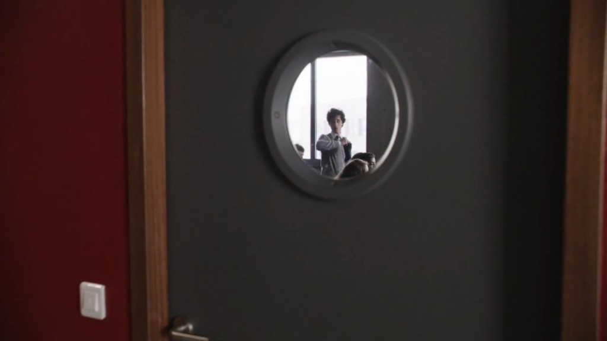
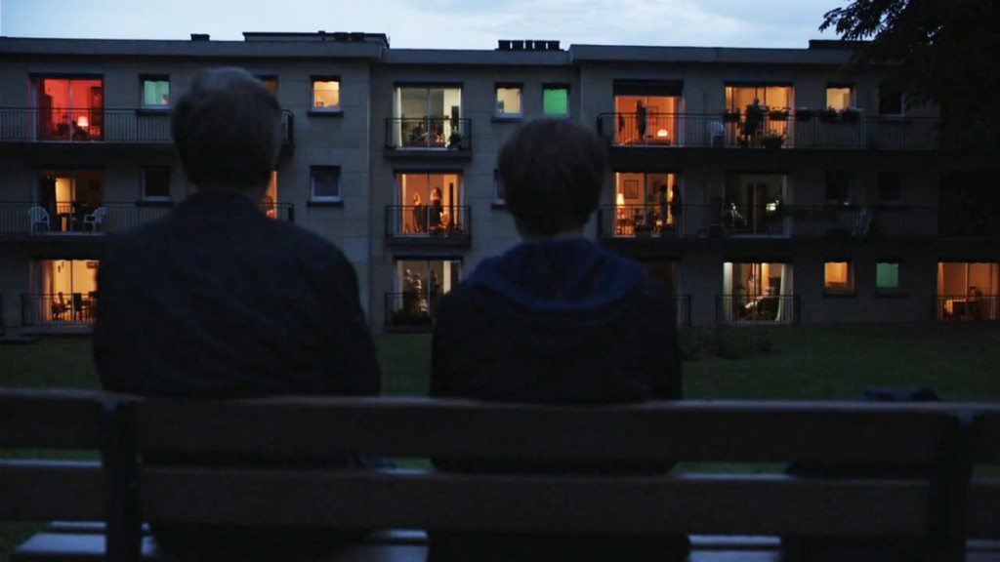

# Herhangi bir eve her zaman girebilirsin.

**Tarih:** 18/02/2015  
**Orijinal Kaynak:** http://sdmimproje.com/herhangi-bir-eve-her-zaman-girebilirsin/  
**Arşiv Zaman Damgası:** 20190102060435  
**Etiketler:** Cemil Meriç, Walter Benjamin, Fas & Mağrip, Paris, İslam & Medeniyet Tasavvuru, Cami Mimarisi & Kubbe, Sinema & Mekân İdrakı  
**Atlas Düğümleri:** felsefe_sanat, apartman_elestirisi, dogu_bati, cansever, medeniyet, goruntu_hakikat  

---

> 
“Divan edebiyatında roman yok. Niçin olsun?

Batı’nın ilk romanlarından biri Topal Şeytan. Kahraman evlerin damını açar, bizi yatak odalarına sokar. Roman başlangıcından itibaren bir ifşadır. Osmanlı’nın ne yaraları vardır, ne yaralarını teşhir etmek hastalığı. Hikâyeleri ya bir cengâveri ebedîleştirir, ya ‘hisse alınacak bir kıssa’ dır.

Romanın burjuvaziyle doğduğunu söylerler. Burjuvazi Avrupa’nın imtiyazı, daha doğrusu yüz karası. Bir kelimeyle roman, başka bir dünyanın, başka bir ruh ikliminin, başka bir toplumun eseri. Daha zavallı bir dünya daha dişi bir manevî iklim, daha geveze bir toplum.

Başka bir tâbirle, bu edebî nevi bir buhranın, bir uyuşmazlığın, reel ile ideal arasındaki bir nisbetsizliğin çocuğu. İçtimaî bir sıhhatsizlik, hiç değilse bir tedirginlik alâmeti. Sınıf kavgalarıyla sahneye çıkışı bundan. İnanan bir toplumda, pürüzlerini yok etmiş bir toplumda, hayalî çözüm yolları aramaya ihtiyaç duymayan bir toplumda romanın ne işi var?”

**Bu Ülke** adlı kitabında **Cemil Meriç** işte bunları söylüyor. Cesaretle hem de… 70’lerde söylenmiş olmasına rağmen ise hala yabancı gelen düşünceler bunlar. Bir anlamda üzerine düşünülmemiş hatta inanılmamış gibi duran sözler. Osmanlı’nın torunlarının roman, tiyatro ya da sinemayı eleştirecek halleri yok. Üzerlerinden geçen Batı denen dev makinanın bıraktığı izlerin ortasında, yattıkları yerden kafalarını çevirip, “beni bekle” diyerek ellerini uzatırken “bir makina daha olsa da ben binsem” diye hayaller kuruyor gibi duruyorlar…

“Herhangi bir eve her zaman girebilirsin.”  Dans le maison isimli filmin kapanış cümlelerinden biri… Roman yazarak başka evlerin içine girebileceğini keşfeden ve yazdıklarıyla zihninde canlandırdığı ergen hayallerini başkalarının üzerine boşaltabileceğini öğrenen liseli bir gence ait bir söz.

Film romanın bir gözetleme olduğunu ifşa ediyor adeta. Bu arada sinemanın da aynısını yaptığını ustaca fark ettiriyor. Ustaca diyoruz çünkü ancak gözetleme kültürünün içinde yetişmiş birisi gözetleyerek gözetlemeyi eleştirebilir. Bir Batılı yapabilir bunu, Doğulu değil. Tıpkı çatal bıçak kullanmayı, masada yemek yemeyi henüz öğrenmiş bir toplumun Batı sofra adabında söz sahibi olamayacağı gibi.

Filmdeki “Sanat bir şey öğretmez.” cümlesi de oldukça dikkat çekici. Bununla birlikte çağdaş sanat ile inceden geçilen dalga da hoş. Yazın soğuk, kışın sıcak lüks dev boşluklardan oluşan sanat galerilerinin ne işe yaradığını biz de bir türlü çözemiyorduk doğrusu.

Osmanlı’daki sınıf mevzusu ile ilgili olarak Said Halim Paşa ve İdris Küçükömer’in Cemil Meriç ile düşünceleri uyuşuyor. Başka sınıfların hayatlarını hayaline yerleştirecek bir toplum değildi Müslüman Doğu. Çünkü “sınıf”lardan oluşmuyordu. Ağır trajedileri yoktu. Vahşi sanayi devrimini de yaşamadı zaten. Charles Baudelaire’in Paris’teki yol açma çalışmaları sonrasında, birbiriyle karşılaşan farklı sınıftan insanlar hakkında anlattıkları okunursa mesele biraz daha iyi anlaşılabilir. Anlatılanların Osmanlı dünyasına ne kadar yabancı olduğu görülecektir.

Bugün Türkiye’de İslamcıların edebiyata neden bu kadar sarıldıkları da incelenmelidir. İslam’ın sonuna eklenen “cı” ekinin bir toplumsal sınıfa işaret ettiği sonucu mu çıkıyor acaba?

İslam mimarlığının ana unsurlarından birinin neden duvar olduğu da sorgulanmalıdır. Zira o duvarlar İslam toplumunun mahremiyet algısını çok net yansıtır. Zamanında Fas’ta minareden bir evin avlusu göründüğü için şerefenin avluyu gören tarafının kapatılması kararı güzel bir örnektir.

Daha fazla ne diyebiliriz ki? Bir gözetleme ile gözetlemenin bizim kültürümüzle uyuşmadığını anlatmaya çalışıyoruz. Bu ironiyi bizlere yaşatan sistemi değiştirmek cesaret ister doğrusu. Batı’nın kulesinin bizi gören tarafını kapatabilecek miyiz?

# [**bkz.** Türkiye’de din kaynaklı şizofreninin yansımaları](/sdmimproje/turkiyede-din-kaynakli-sizofreninin-yansimalari.html)

# [**bkz.** Ağzına sağlık Benjamin (Konut Hakkında)](/sdmimproje/agzina-saglik-benjamin-konut-hakkinda.html)

# [**bkz.** Tanrım youtube’da bir klip izleyelim.](/sdmimproje/tanrim-youtubeda-bir-klip-izleyelim.html)

**sdmimproje**
