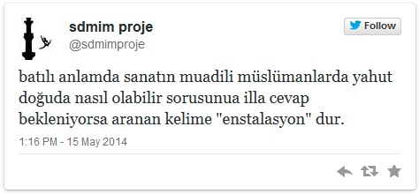
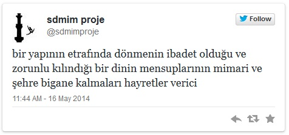
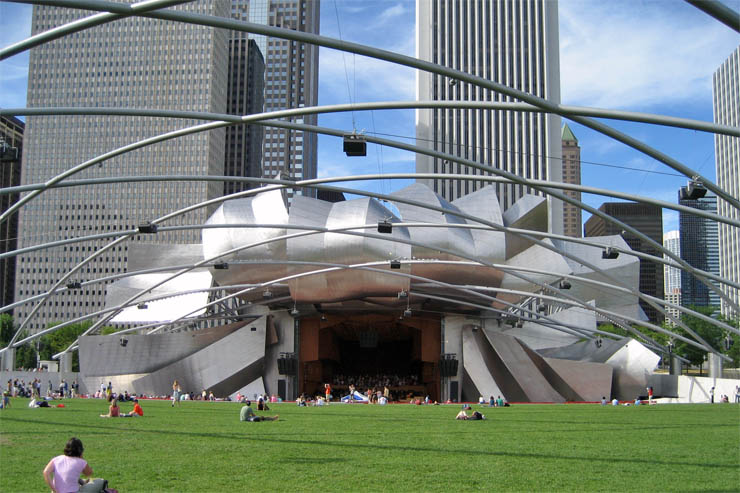
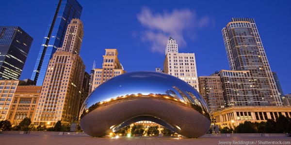

# İhsan Bilgin’in Millenium Park İle İmtihanı

**Tarih:** 05/04/2015  
**Orijinal Kaynak:** http://sdmimproje.com/ihsan-bilginin-millenium-parkl-imtihani/  
**Arşiv Zaman Damgası:** 20190419115854  
**Etiketler:** Turgut Cansever, Cengiz Bektaş, İhsan Bilgin, Enstalasyon & Mekân Sanatı, İslam & Medeniyet Tasavvuru, Apartman & Dikey Şehirleşme Eleştirisi, Cami Mimarisi & Kubbe, Sinema & Mekân İdrakı, Kapitalizm & Çevre, Mimarlık Ortamı & Akademi Tenkidi  
**Atlas Düğümleri:** cansever, mimarlik_egitimi, felsefe_sanat, medeniyet, apartman_elestirisi, goruntu_hakikat, kapitalizm_mulkiyet  

---

Akademik bir makale yazsaydık, İhsan Bilgin’in hayatı ve düşünceleri ile ilgili bir giriş yapmamız gerekiyordu. Neredeyse St. Aquinas’tan beri durum böyle. Nitekim bu yazıyı yazıyor olma sebebimiz olan İhsan Bilgin’in makalesi, Chicago’daki Millenium Park ile ilgili ve Sayın Bilgin tabi ki öncelikle bir Chicago ve Chicago şehirciliği girizgahı yapmış. Ancak az önce de belirttiğimiz gibi Akademik bir makale yazmıyor oluşumuzun ve Skolastikler’in zorunlu kurallarını çiğniyor oluşumuzun verdiği dayanılmaz hafiflikle bu metni kaleme alıyoruz.

İhsan Bilgin hakkında bir girizgah yapmamızın gereksizliğinin bir diğer nedeni olarak İhsan Bilgin Bey’in şahsı ile doğrudan bir fikir ilişkisi içerisine girmeyecek oluşumuzu söyleyebiliriz. Yani Sayın Bilgin’in makalesi bu yazının sadece bir kıvılcımı oldu. İhsan Bey, genel bir olguyu anlatırken bahsedeceğimiz müşahhas bir isim sadece… Bu arada kendisinin kıymetli bir insan olduğunu da belirtmeliyiz.

Şimdi yapacağımız benzetmeyi sıradan bir Blog’taki sıradan bir teşbih olarak almayınız ve dikkatlice okuyunuz lütfen. Bu yazı* “Türkiye’den alınmış bir kilimi, gittiği Batı memlektindeki Batılı arkadaşının evinde acemilikten ters serilmiş olarak gören ve o kilimin bir Türk Kilimi olduğunu bilmeden, tersine hayran olan Türkler”* hakkında. Bir daha okumanızı tavsiye ediyoruz. Bu yazı…

**bkz. [matrix’te ölürsem kabrime gelme](/sdmimproje/matrixte-olursem-kabrime-gelme.html)**

Chicago… Kapitalizm ile mimarlığın mutlu evliliğinden doğan, modern yapı tasarımının ve gökdelen mimarisinin baş şehirlerinden biri olarak kabul edilen şehir. Bu modernliği gereği de her yeri detaylı çizilmiş yıllar sonra ne kadar ve ne noktaya kadar gelişeceği belli bir kent… Hani akademik makalelerdeki gibi keskin, sınırları çizilmiş bir keskinlik… Bu keskinlik içinde kendisine park olarak yer bulmuş Millenium Park…

Üç noktanın (…)  bitimsizliğinin zar zor uğradığı bu net şehrin içindeki Millenium Park Sayın İhsan bilgin tarafından şöyle tarifleniyor: *“Akış şeması, devre sistemi gibi metaforlarla betimlenen bu metropolün en beklenmedik yerinde, oyuna, aylâklığa, salınmaya, hesaplanmamış karşılaşmalara yer açmış radikal bir müdaheleye dönüşmüştür kısa zamanda.”*

Evet Sayın Bilgin Millenium Park’ı sevmiş. Buradan ve yazısının devamından net bir biçimde bu anlaşılıyor…  Millenium Park üç farklı alandan oluşuyor. Frank Gehry’nin çim konser alanı, Anish Kapoor’un enstelasyonu ve Jaume Plansa’nın ikiz çeşmeleri. Şimdi dilerseniz ardı ardına İhsan Bilgin’in bu  farklı tasarımlar hakkında yazdıklarına bir göz atalım.

> 
“Frank Gehry tarafından tasarlanan en büyük dilim, donanımlı bir konser sahnesine yönelmiş elips formunda dev bir çim anfi. Konserleri çimlere serilerek ve getirdikleri kumanyayı yiyip-içerek izliyor gelenler. Bir kontrast var sahnenin tam teşekküllü donatısı ve konserin profesyonelliği ile  izleyenlerin serbestliği arasında: Çalanların sterilliği izleyenlere sirayet etmiyor; izleyenlerin gevşeme serbestisi de çalanlara.”

Belli ki İhsan Bey koltuksuz olan ve izleyicinin adeta zincirlenmişçesine koltuğa mahkum edildiği konser salonlarının aksi doğrultusunda gelişen bu tasarımı pek ilgi çekici bulmuş. Sayın Bilgin’in bu manzarayı olumluyor oluşunu takdir ediyoruz. Tabi Batı’da gördüğü her şeyi beğenen aydın modunda olmaması kaydıyla… Jarmusch’un filminde, Amerika’ya giden iki Amerikan hayranı Japon’un, elindeki oltayla sokağın ortasında ne yaptığı belli olmayan Amerikalı berberle karşılaştıklarında, onun balık tuttuyor olduğuna kanaat getirmeleri tehlikesi ne yazık ki buradakiler için hala geçerli…

** bkz. [Türk Mimarlarının Kutsal Kitabı](/sdmimproje/turk-mimarlarinin-kutsal-kitabi.html)   **

Bizim hala tam anlamıyla kavrayamadığımız tiyatro, opera ve konser salonu mimarilerini Batılılar’ın sorguluyor oluşu bir gerçek. Nitekim bu durumu hemen aşağıda linklerini verdiğimiz yazılarda daha önce de belirtmiştik. İşin garibi bizim örneğin koltuksuzluğu garipsiyor oluşumuz… Serbestiyet ve insanı özgür bırakan mimari öğeler kültürümüzün dolayısıyla da dinimizin bir gereği iken hala Batı’da gördüğümüz bilinçsiz ve acemice Doğu arayışlarından etkilenebiliyoruz.

Cami, tekke, sınıf vb. yapıların geleneğimizdeki örneklerini üstün körü incelemek bile sahnenin, koltukların, keskin düzenlemelerin ne kadar sorgulamaya açık olduğu kolaylıkla anlaşılacaktır.

İhsan Bilgin’den sahnede smokinleriye müzik icra eden orkestra ile şortuyla uzanarak onları dinleyen seyirci görüntüsü karşısında şiirsel bir devriklikle gerçekleştirilmiş bir yüceltme yerine şöyle okkalı bir kahkaha beklerdim doğrusu. Zira ortada dahiyane bir fikirle gerçekleştirilmiş bir “kontrast” yerine, acemilikle ortaya çıkmış bir karşılaşma var.

Bu noktada Türkiye’de mimarların ekseriyetinin, kamusal alanı sandviç yenebilen yer olarak gördüklerini ve kalitesini de hangi çıplaklık oranıyla ne kadar rahat güneşlenilebildiğiyle ölçtüklerini hatırda tutmak gerekiyor.

**bkz. [Dövüş Kulübü ve Meşk Ayini; Yaşama, Mimariye ya da Şehirciliğe Dair Neler Anlatır?](/sdmimproje/dovus-kulubu-ve-mesk-ayini-yasama-mimariye-ya-da-sehircilige-dair-neler-anlatir.html)**

**bkz. [Fazla Batı Batı Diye İnlememeli Adamı Hadım Ederler Maazallah (+18)](/sdmimproje/fazla-bati-bati-dememeli-adami-hadim-ederler-maazallah-18.html)**

Sayın Bilgin’in metni ile devam edelim…

> 

“…Anish Capoor’un Cloud Gate’i (“Bulut Kapısı”). Bu işin sergi fotoğrafı için yazdığım metni alıntılıyorum: ‘… **Kapıdan çok bulut. Altından geçiliyor ama eşik değil. Bir yerden gelinmiyor, bir yere gidilmiyor. Buluttan çok ayna. Koordinatlarını ve açılarını tekrarlamayan yekpare bir yansıtıcı. Lunaparkların ayna odalarını bünyesinde toplamış iri bir nesne. Şekilden şekile sokuyor insanları, şehri ve gökyüzünü. Her hareket, her açı her ışık değiştiriyor algılanan dünyayı. Aynadan çok çiçek dürbünü. Birbirinden çıkan, birbirinin içinde kaybolan şekiller, renkler eşikler beliriyor kıpırdadıkça. Dijital çağın imkanlarına burun kıvırıyor Capoor. Lunaparkların ve çiçekdürbünlerinin o kâdim esrarı ve oyuna çağıran cazibesi ile bir kez daha baş başa bırakıyor Millenium Park’ın aylâklarını.’ **Bu işin kritik noktası insanı kendi gövdesiyle, hareketiyle ve algısıyla başbaşa bırakma kapasitesinde. Çiçek dürbünü gibi de işlev gören bir yansıtıcıdan başka bir müdahele dolayım komplo yok işin içinde. “

İnsan okuyunca “Vay bee!” diyor doğrusu. Sen neymişsin be abi aa!

Şaka bir yana İhsan Bey’in ifade biçimi bize aynı zamanda şair olan Cengiz Bektaş’ın özellikle geleneksel ve kendi tasarımı yapıları tarifleme şeklini çağrıştırdı. Bu kadar şairane ifade etme arzusu duyması Kapoor’un eserine olan fazla sevgisi hatta “hayranlığı” ile açıklanabilir sanıyoruz.

Bu hayranlık şüphesiz “çok iyi fikir” ayırdından kaynaklanıyor. Batılı manada çok iyi fikir nedir? Bakir olan denenmemiş olan…

Daha önce enstalasyon hakkında şöyle aforizmalar dillendirmiştik:

batılı anlamda sanatın muadili müslümanlarda yahut doğuda nasıl olabilir sorusunua illa cevap bekleniyorsa aranan kelime “enstalasyon” dur.

bir yapının etrafında dönmenin ibadet olduğu ve zorunlu kılındığı bir dinin mensuplarının mimari ve şehre bigane kalmaları hayretler verici

.

.

.

.

.

.

.

.

İslam’ın hem coğrafi hem de hareket olarak merkezinde bulunan yapı olan Kâbe ve Hacc’ın bu kadar anlaşılamamış oluşu İhsan Bilgin’in şaşkınlığı ile doğru orantılı.

Ayna olmak metaforunun da Doğu’nun “sanatsal ürün atıkları” ile kirletmeme alışkanlığı ile olan benzerliğini ve kişiye ya da güzelliğe ayna tutma düstürünun inceliği ile olan yakınlığı ve etkileyiciliği fark edilmeli.

Kapoor’un enstalasyonunun Kâbe tavafına olan kıblevi yönünü algılayamamak “kendimizi bile tanımak” için daha kaç fırın ekmek yememiz gerektiğinin bir göstergesi.

Yine Sayın Bilgin’in övdüğü “insanı kendiyle başbaşa bırakma” mevzusu da İslâm-sinema ilişkisinden bahsederken kullandığımız argümanlarla daha net anlaşılabilecektir. Skolastik alışkanlıkla moden Hristiyanlığın bir despotizmi olan ferdi zincirlemenin tersi olan İslam anlayışı dolayısıyla da mimarlığına bigane kalışımız “özgürlüğü” anlayamamızla doğrudan ilişkili. Turgut cansever’in tektoniklerin oluşturduğu ve ferdin kendi kararlarıyla hareket ettiği yapılar topluluğundan oluştuğunu söylediği İslam şehirleri henüz fikrimizden çok uzak…

İslam kültürünün ve şehirciliğinin tamamen tasarlanmış ve geleceği belirlenmiş şehri reddettiğini anlamak da zor olmayacaktır. Halife Mansur’un dairevi şehrinin ancak bir kere denendiğini ve bu “tamamen tasarlanmış” anlayıştan vazgeçildiğini hatırda tutmak gerekiyor. Bu sebeple ileride “tasarlanmamış şehir” diye heyecanla, buldum buldum diyerek hamamdan çıplak vaziyette çıkan bir mimar görürseniz şaşırmayın.

**bkz. [Müslüman sinema yapabilir mi?](/sdmimproje/musluman-sinema-yapabilir-mi.html)**

İhsan Bilgin’in üçüncü alana ilişkin ifadeleri üzerine söyleyecek sözümüz yok. Ancak metnin son kısmını yorumsuz olarak paylaşmak istiyoruz.

> 

“Millenium Park’ta sunulan deneyimlerin ortak yanı, kültür endüstrisinin önceden kurgulanarak, paketlenerek sunulan standartlarıyla, müze dükkanlarıyla, cafe’leriyle, metalaşmış kültür ürünleriyle ve “event”leriyle, kültür ve sanat merkezleriyle arasına koyduğu mesafede. Herhangi bir şey alınıp satılmıyor burada. İnsanlar, alışverişin ve kurgulanmış boş zaman geçirme ve oyalama tekniklerinin aracılığı olmaksızın kendileriyle, ötekilerle, şehrin ve parkın manzaralarıyla, sesleriyle başbaşa kalabiliyorlar…

…Önceden tasarlanmış ortamlardan ve olaylardan değil, insanların kendi devinimlerinden kentin kritik bir eşiğinde bulunmaktan alıyor gücünü.

…Kültür endüstrisinin hesabının kendi tecrübesi yanında küçük kaldığınıve ona tamah etmektense hesapsız karşılaşmaların oyununa bir kez olsun teslim olmayı denemek istediğini düşündürtüyor insana.”

**İhsan Bilgin – Chicago ve Millenium Park – Viyana Chicago, Metropol ve Mimarlık**

.

.

.

.

.

.

**serkan duman | sdmimproje**

** **

** **