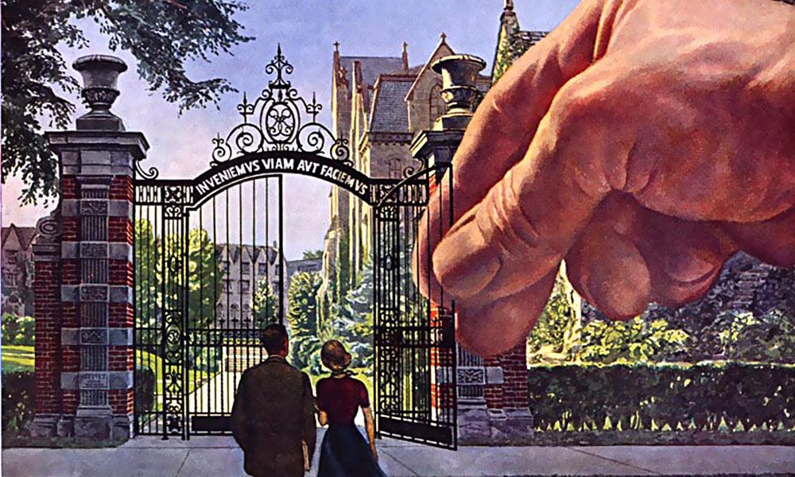

# insanları burada hayvan barınakları bekliyor; cümlesinin düşündüremedikleri

**Tarih:** 2012-05-22T10:59:14+00:00  
**Orijinal Kaynak:** /sdmimproje/insanlari-burada-hayvan-barinaklari-bekliyor-cumlesinin-dusunduremedikleri.html  
**Arşiv Zaman Damgası:** 20120614122030  
**Etiketler:** Müstakil Yaşam & Hürriyet, Doğu-Batı Ayrımı, İslam & Medeniyet Tasavvuru  
**Atlas Düğümleri:** mustakil_yasam, dogu_bati, medeniyet  

---

Türkiye’de inşaat, dolayısıyla da inşaat reklamları gözden kaçamayacak kadar büyüdü ve çoğaldı. Bu sebepten, reklam çeşitleri de arttı. Tv kanallarında konut sitelerini tanıtmak için programlar yapılıyor. Bu programlardan birinde, tanıtılan konut sitesinin müteahhiti ile birlikte gezen güzel spiker: “Peki insanları burada ne bekliyor?” diye sorunca şöyle bir cevap aldı: “İnsanları burada hayvan barınakları bekliyor.” Kısa süren şok anı, beyfendinin, aslında insanların hayvanlarını içine koyabilecekleri barınaklardan bahsettiğinin anlaşılmasıyla sükun buldu.

Bu noktada iki türlü şaşkınlık yaşanabilir: Birincisi, insan hiç kendi satmak istediği eve böyle der mi? İkincisi ise bu korkunç hakikat nasıl böyle kolayca ağızdan çıkabildi?

Bazı insanlar, büyük oranda dev otoyolların yanında konumlanan, yürüyerek girmenin neredeyse imkansız olduğu, arabayla bile girene kadar “boşver bu gece bir otelde kalalım” cümlesiyle son bulabilecek konut siteleri için “barınak” kelimesini doğalca yakıştırabiliyor.

Aynı insanlar; 20. katta otururken cama yapışıp ortadaki boşluğu izleyen çocukların (ki bu boşluklar hiç bir sürprize şans tanımıyor -ne için olduğu belli alanlar- ve 40 cm lik betonun üstündeki 15 cm’lik topraktan oluşuyor) arada sırada o orta boşluğa çıkarılıp yürütülmelerini köpek yavrularına yapılan muamele ile benzeştiriyorlar.

Aynı konutlarda, mahalleye çıkıp gezmek gibi bir olguyu yaşamak mümkün değil. Depodaki benzin miktarı önem arzediyor bir yerlere gidebilmek için. Bunun yanında gün içerisinde herhangi bir yabancının simit satmak için dahi olsa sesini duymak imkansız. Güvenlik uzun telsiz görüşmeleri yapmadan kimseyi içeri almıyor. Tamamen steril bir ortam; tıpkı reklamda çocuğunun bembeyaz mutfak zeminde emeklediğini gören annenin, korkuyla beze sarılıp yeri silmesi gibi. Bezin mercek altına alındığında gördüğümüz envai çeşit mikrop ve bakteri ise nasıl da korkutur insanları değil mi. Oysa herkes bilir ki fazla steril ortam vücut için hiç de iyi değildir. Bağışıklık sisteminin gelişmesi için, mikrop bir ihtiyaçtır.

Günümüz toplu konutları yeri silen bez olmaya çok yakın. “Tertemiz barınaklar” diyen de var…

sdmimproje olarak toplu konut siteleriyle bir alıp veremediğimiz açıkça görülüyor ki var. Ancak yine de isteyen istediği gibi yaşayacaktır, yaşamalıdır da. Buradan hareketle toplu konutlarda yaşamak istemeyenler için de seçme şansı oluşturulmalıdır. Büyük alanları duvarla çevirip konutlar yapmak tek inşai biçim olduğu müddetçe problem devam edecektir, bizce.

bu bizim düşüncemiz…

**sdmimproje**
