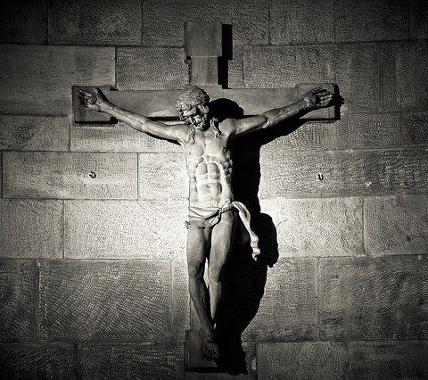

# İsa’yı Aramak – Sanat ve Din

**Tarih:** 12/12/2019  
**Orijinal Kaynak:** http://sdmimproje.com/isayi-aramak-sanat-ve-din/  
**Arşiv Zaman Damgası:** 20191218023431  
**Etiketler:** Datça & Ege, Sinema & Mekân İdrakı, Kapitalizm & Çevre  
**Atlas Düğümleri:** kirsal_koy, goruntu_hakikat, kapitalizm_mulkiyet  

---

Sanatın kökeni. Sanat ile din ilişkisi. Hristiyan sanatı. Sinema ve din. İsa sanatın neresinde? Sinema’da alt metin. Coen Kardeşler, Tarantino, Lars Von Trier ve Paul Thomas Anderson gibi yönetmenlerin filmlerinde İsa’yı aramak.

…..Patreon’dan bize destek olabilirsiniz: [https://www.patreon.com/sdmimproje](https://www.youtube.com/redirect?event=video_description&v=V1-5yZsry88&redir_token=Gt_49--1JjhfHt21ZUvW8lbHCV18MTU3NjIyMTY3OEAxNTc2MTM1Mjc4&q=https%3A%2F%2Fwww.patreon.com%2Fsdmimproje) Resim din ilişkisi. Büyük ressamlar ve İsa. Albrecht Dürer, Peter Brugel, Çarmıha Gidiş, Calvary Alayı, Van Gogh, Goya, Pierro Della Francesca, Cafe Terrace at Night, Rönesans ve daha fazlası… Mimar Serkan Duman anlatıyor.

[#sinema](https://www.youtube.com/results?search_query=%23sinema) [#resim](https://www.youtube.com/results?search_query=%23resim) [#sanat](https://www.youtube.com/results?search_query=%23sanat)

[0:00](https://www.youtube.com/watch?v=V1-5yZsry88&t=0s) Intro [0:12](https://www.youtube.com/watch?v=V1-5yZsry88&t=12s) Papa Gregorius ve resim [0:24](https://www.youtube.com/watch?v=V1-5yZsry88&t=24s) Arras Meclis’i İsa ve resim [0:34](https://www.youtube.com/watch?v=V1-5yZsry88&t=34s) Aziz Boneventure [0:44](https://www.youtube.com/watch?v=V1-5yZsry88&t=44s) Albrecht Dürer [0:54](https://www.youtube.com/watch?v=V1-5yZsry88&t=54s) Görüntü egemen dünya [1:10](https://www.youtube.com/watch?v=V1-5yZsry88&t=70s) Resmin kiliseye girişi [1:16](https://www.youtube.com/watch?v=V1-5yZsry88&t=76s) Rönesans ve resmin gerçekçiliği [1:47](https://www.youtube.com/watch?v=V1-5yZsry88&t=107s) Pagan dünya ve Katolik dünya [2:08](https://www.youtube.com/watch?v=V1-5yZsry88&t=128s) Pieter Bruegel Calvary Alayı ve İsa [2:45](https://www.youtube.com/watch?v=V1-5yZsry88&t=165s) Alt metin nedir? [3:42](https://www.youtube.com/watch?v=V1-5yZsry88&t=222s) Piero Della Francesca Urbino Şapeli ve alt metin [4:43](https://www.youtube.com/watch?v=V1-5yZsry88&t=283s) Van Gogh Cafe Terrace at Night Son Akşam Yemeği [5:20](https://www.youtube.com/watch?v=V1-5yZsry88&t=320s) Goya Mayıs’ın üçü ve çarmıh [5:50](https://www.youtube.com/watch?v=V1-5yZsry88&t=350s) Subliminal mesaj – alt metin farkı [6:10](https://www.youtube.com/watch?v=V1-5yZsry88&t=370s) Albert Camus – Veba ve İsa [6:46](https://www.youtube.com/watch?v=V1-5yZsry88&t=406s) Opera sinema ve televizyonun öncüsü mü? [7:19](https://www.youtube.com/watch?v=V1-5yZsry88&t=439s) Sinemada İsa ve altmetin [7:42](https://www.youtube.com/watch?v=V1-5yZsry88&t=462s) Tarantino Hatefull Eight ve alt metin [8:55](https://www.youtube.com/watch?v=V1-5yZsry88&t=535s) Coen Kardeşler, Inside llewyn Davis [9:51](https://www.youtube.com/watch?v=V1-5yZsry88&t=591s) Burn After Reading – John Malkovich [10:30](https://www.youtube.com/watch?v=V1-5yZsry88&t=630s) No Country for Old Man Üç İsa [11:10](https://www.youtube.com/watch?v=V1-5yZsry88&t=670s) Lars von Trier The House That Jack Built ve Negatif İsa [11:51](https://www.youtube.com/watch?v=V1-5yZsry88&t=711s) Paul Thomas Anderson – Inherent Vice ve Hippiler [12:17](https://www.youtube.com/watch?v=V1-5yZsry88&t=737s) Türkiye’de neden sinema yapılamıyor? [12:45](https://www.youtube.com/watch?v=V1-5yZsry88&t=765s) Batı kültürü ve hegemonik görsellik [13:03](https://www.youtube.com/watch?v=V1-5yZsry88&t=783s) Sinema tiyatro vb. sanatlar seküler mi? [13:27](https://www.youtube.com/watch?v=V1-5yZsry88&t=807s) Semih Kaplanoğlu ve Buğday [14:00](https://www.youtube.com/watch?v=V1-5yZsry88&t=840s) Görsellik cahilleri eğitmek için mi kullanıldı? [14:13](https://www.youtube.com/watch?v=V1-5yZsry88&t=853s) Kapanış