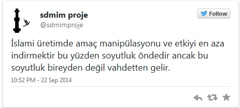

# İslami Üretim

**Tarih:** 22/09/2014  
**Orijinal Kaynak:** http://sdmimproje.com/islamiuretim/  
**Arşiv Zaman Damgası:** 20190101210943  
**Etiketler:** Doğu-Batı Ayrımı, İslam & Medeniyet Tasavvuru  
**Atlas Düğümleri:** dogu_bati, medeniyet  

---

> 
İslami üretimde amaç manipülasyonu ve etkiyi en aza indirmektir bu yüzden soyutluk öndedir ancak bu soyutluk bireyden değil vahdetten gelir.

— sdmim proje (@sdmimproje) [22 Eylül 2014](https://twitter.com/sdmimproje/status/514140313427136512)

**sdmimproje**
