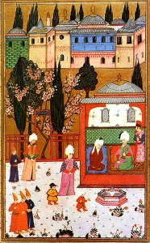

# Jean Chesneau 1547’de ne dedi?

**Tarih:** 13/09/2013  
**Orijinal Kaynak:** http://sdmimproje.com/jean-chesneau-1547de-ne-dedi/  
**Arşiv Zaman Damgası:** 20190102040536  
**Etiketler:** Geleneksel Ahşap & Hımış, Taş Mimari, Cami Mimarisi & Kubbe  
**Atlas Düğümleri:** geleneksel_ahsap, tas_mimari, medeniyet  

---

> 
“Ayasofya’nın yakınında, Sultan Mehmed’in inşa ettirdiği cami vardır. Camiye bağlı bulunan konuk evinde hukuku, dini, milleti ne olursa olsun her türden insan kalabilir. Burada onlara üç gün boyunca bal, pirinç, et, ekmek ve uyumak için oda verilir. Bu da sokaklarda ekmek dilenen çok az yoksul ve sadece birkaç tane sakatın bulunmasının nedenidir. Aynı zamanda güzel hamamlar ve görmeye değer çok hoş çeşmeler vardır. Sultan Selim, Sultan Bâyezid ve diğer efendilere ait birçok başka cami görülür. Bunlar olağanüstü güzellikte, muhteşem ve şatafatlıdır. Sultan Süleymanın yaptırdığı ise diğerlerinden hiçbirinin olmadığı kadar güzel ve çarpıcıdır. Bu şunu gösteriyor ki eğer Osmanlılar saraylar ve evler inşa etmek isteselerdi, bunu gayet güzel becerirlerdi; ancak taş evlerde oturmaya kötü gözle bakarlar ve kiliselerle adı geçen Büyük Efendi (Kanuni) dışında kesinlikle taş kullanmazlar. Bütün evleri toprak yahut ahşaptan yapılmıştır ve oldukça alçaktır ve bu genelde bütün Türkiye’de böyledir.”

**Jean Chesneau / D’Aramon Seyahatnamesi / 1566**

**sdmimproje**
