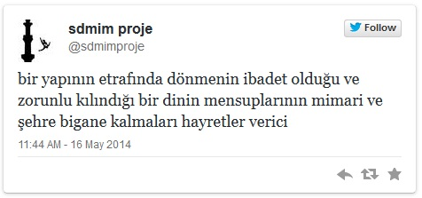

# kâbe bir yapıdır

**Tarih:** 16/05/2014  
**Orijinal Kaynak:** /sdmimproje/kabe-bir-yapidir.html  
**Arşiv Zaman Damgası:** 20190101200748  
**Etiketler:** Doğu-Batı Ayrımı, İslam & Medeniyet Tasavvuru  
**Atlas Düğümleri:** dogu_bati, medeniyet  

---

> 
bir yapının etrafında dönmenin ibadet olduğu ve zorunlu kılındığı bir dinin mensuplarının mimari ve şehre bigane kalmaları hayretler verici

— sdmim proje (@sdmimproje) [16 Mayıs 2014](https://twitter.com/sdmimproje/statuses/467223932961964032)

