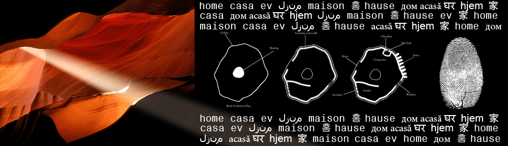

# kaçacak bir yer – 02: Bir Evin Anatomisi

**Tarih:** 2012-05-04T21:56:44+00:00  
**Orijinal Kaynak:** /sdmimproje/kacacak-bir-yer-02-bir-evin-anatomisi.html  
**Arşiv Zaman Damgası:** 20120610235316  
**Etiketler:** Kırsal Mimari, Köy & Kaçış, Mimarlık Ortamı & Akademi Tenkidi  
**Atlas Düğümleri:** kirsal_koy, mimarlik_egitimi  

---

Ahmed İlyiç Ohoff,  köprünün altından çok sular akmasına izin vermeden, Serkan Duman Mimarlık’a yeniden gelir.

Bir önceki bölümde kendine istediği küçük ama “derinlikli” ev için duyduğu arzudan en ufak bir azalma olmadan mimarlarla konuşmaya ve derdini anlatmaya devam eder.

Yanında getirdiği ev örneklerini verir.

Bunlardan bazıları ve mimarları:

* 63.02° Evi

Mimarlar : Jo Nagasaka + Schemata Architecture Office

Tokyo, Japonya

Arsa Alanı : 48,84 m2 Ev Alanı : 71,40 m2

Fotoğraflar : Takumi Oota

* *Gate*

Mimar: mihadesign

Tokyo, Japonya

Arsa Alanı:84.75 m2

Ev Alanı: 88.39 m2

Fotoğraflar: Sadao Hotta

* *Ghent*

Mimarlar: Dierendonck Blancke Architecten

Gelukstraat, Ghent, Belçika

Tasarm Ekibi: Alexander Dierendonck, Isabelle Blancke, Pieter Mouton

Alanı: 89 m2

Fotoğraflar: Filip Dujardin

* *House Contrast*

Mimar: Key Operation Inc / Architects Shinjuku, Tokyo

Lead Architect: Akira Koyama

Ev Alanı: 74.92 m2

Fotoğraflar: Tokyo gumi, KOP

* *House in Hiro*

Mimarlar: Suppose design office Hiro,

Hiroshima, Japan

Ev Alanı: 66.46 m2

Fotoğraflar: Toshiyuki Yano

* *Sunken House*

Mimar: Adjaye Assocates

London, England

Fotoğraflar: Adjaye Assocates

**House Of Ujina*

Mimarlar:  Maker

Hiroshima, Japan

Ev Alanı: 75 m2

Fotoğraflar: Noriyuki Yano

**Urban Hut*

Mimarlar: Takehiko Nez Architects

Tokyo, Japan

Arsa Alan: 30.37 m2 Ev Alan: 44.26 m2

Fotoğraflar: Takumi Ota Photography

* *The Shadow House*

Mimar: Liddicoat & Goldhill

London, İngiltere

Ev Alanı: 77 m2

**sdmimproje**
