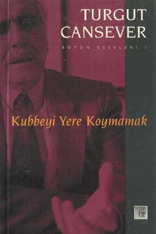

# kaçacak bir yer – 03: Turgut Cansever 1994′te ne dedi?

**Tarih:** 2012-07-12T10:50:02+00:00  
**Orijinal Kaynak:** /sdmimproje/kacacak-bir-yer-03-turgut-cansever-1994te-ne-dedi.html  
**Arşiv Zaman Damgası:** 20140309101933  
**Etiketler:** Turgut Cansever, Cami Mimarisi & Kubbe, Kırsal Mimari, Köy & Kaçış, Mimarlık Ortamı & Akademi Tenkidi  
**Atlas Düğümleri:** cansever, medeniyet, kirsal_koy, mimarlik_egitimi  

---

Ahmet İlyiç Ohoff’un soruları ve istekleriyle açılan yolda mimarlar kafa yormaya devam ediyor. Şimdi ise yıllar öncesinden önemli bir söyleşiyi sizlerle paylaşıyoruz.

> 

# **KONUT GELECEĞİMİZ VE MODERNİZM**

# **“Konut sorununu aşmak, ancak toplumsal bir mutabakatla mümkündür” ***

SÖYLEŞİ : SÖNMEZ TARGAN

*Türkiye’de büyük bir konut açığı yaşanıyor. Bu açığı kapatmak için çeşitli modeller üstünde yoğun tartışmalar var. Bu konuda sizin yaklaşımlarınız ve önerileriniz nelerdir?*

Türkiye’de bugün büyük bir konut sorunu yaşanmaktadır. Ancak konut açığı yaşanırken, bir yandan da inşaat alanları genişlemekte ve bu alanda herhengi bir boyut tasarrufuna gidilmemektedir. Araştırmalarım sonucunda Osmanlı evi konusunda önemli keşiflerim oldu. Osmanlı evinde ev halkının hayatını geçirdiği bir ortak alan bulunuyor. Bunun yanı sıra, kız ve erkek çocukların çalışması ve yatması için ayrı birer odaları bulunuyor. Ebeveynler için de ayrı bir oda. Kalabalık bir aile dahi olsa, kişi başına düşen konut alanı miktarı açısından büyük bir tasarruf söz konusu.

Bugün İmar ve İskân Bakanlığının kişi başına öngördüğü yaşam alanı 25m²’dir. Bu da ortalama bir aile için 100 m²’lik bir konut demektir. Halbuki zaruri olan alan sadece 67 veya bilemediniz 74 m²’dir. İşte Osmanlı evinde kişi başına düşen alan ile bugünkü rayiç alan arasında korkunç bir fark ve fazladan harcama vardır. Buna çok önem vermeliyiz, çünkü konut açığımızı ancak inşaat metrekarelerinden tasarruf yaparak ortadan kaldırabiliriz. Böylece 19. yüzyıl Fransız evi örneğini terk ederek mahallelerin çok maksatlı kullanımın sağlayabilir ve gerçekten büyük tasarrufa gidebiliriz.

Ayrıca dikkatinizi çekmek istediğim bir husus daha var; Osmanlı evi, prefabrikasyon sistemdi. Daha önce bir yerde, 1915 yılında 25 bin nüfusu olan Afyon’da, erkekler silah altına alındığı için sadece kadınlar, çocuklar ve yaşlıların yanan evlerini yeniden, hem de 8 ay gibi kısa bir dönem içerisinde inşa ettiklerinden söz etmiştim. Hem de her yapılan ev, tam bir mimari şaheser. Bunun nedeni, evlerin taşıyıcı sistemlerini oluşturan inşaat elemanlarının Tahtakale’de hazır, kesilmiş olarak bulunması. Dikmeler, pencere, kapı kasaları Tahtakale’den hazır geliyor. Bunları sadece birbirlerine takıyor, bir araya getiriyorlar. Böylece yüksek bir mimari tarz oluşuyor.

İskandinav ülkelerinin de kooperatifçilik kanalıyla sağladıkları başarı buna dayanıyor. Bugün, betonarme ve çok katlı yapı tekniklerini Türkiye’ye getirenler modernleşmeden bahsediyorlar ama bunun gerçekte modenleşmeyle alakası yok. Batılı ülkelerde , Osmanlı’da olan sistemdeki gibi modüler elemanlar öncelikle hazırlanıyor, bu nedenle de müthiş bir endüstri doğmuş durumda. Biz de bu sisteme girmek ve uygulamalarımızı buna göre yapmak durumundayız.

*Türkiye’deki uygulamaları dünya ülkelerindeki uygulamalarla karşılaştırdığımızda hangi sonuçlara ulaşıyoruz?*

Batı Avrupa ülkelerindeki mahalli idarelerde ön plana çıkarılan husus, kullanıcının kararlara katılması. Daha evvel kooperatifler yalnız tek meslek grubuna hitab ediyordu. Buna diğer meslek gruplarını da katmak son derece önemli bir adım. İnsanın, evinin yapımına katılması çok önemli. Amerika ve Japonya’daki konutların bütün malzemesi Osmanlı evlerinde olduğu gibi önceden hazırlanmış vaziyette; yapımcılar bu malzemeleri birleştirerek evleri yapıyorlar. Yapım şeklinde de, yapımcılar kullanıcıyla doğrudan doğruya karşı karşıya geliyorlar.

Devamını “Kubbeyi Yere Koymamak” kitabında okuyabilirsiniz.

> 
* Kubbeyi Yere Koymamak – Turgut Cansever 

**sdmimproje **