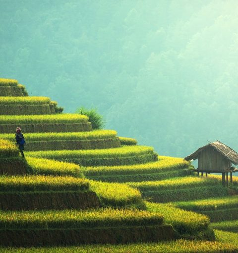

# KAPİTALİZM ve ÇEVRE – Her Çevrecinin Kapitalizm Hakkında Bilmesi Gerekenler

**Tarih:** 11/12/2019  
**Orijinal Kaynak:** http://sdmimproje.com/kapitalizm-ve-cevre-her-cevrecinin-kapitalizm-hakkinda-bilmesi-gerekenler/  
**Arşiv Zaman Damgası:** 20210731143938  
**Etiketler:** İslam & Medeniyet Tasavvuru, Müstakil Yaşam & Hürriyet, Postmodernizm & Tüketim Eleştirisi, Sinema & Mekân İdrakı, Kapitalizm & Çevre, Kırsal Mimari, Köy & Kaçış  
**Atlas Düğümleri:** medeniyet, mustakil_yasam, goruntu_hakikat, kapitalizm_mulkiyet, kirsal_koy  

---

[0:00](https://www.youtube.com/watch?v=HqGwO8tdk0g&t=0s) Açılış [0:30](https://www.youtube.com/watch?v=HqGwO8tdk0g&t=30s) Epikür: “Gem vurulmamış zenginlik, büyük yoksulluktur.” [0:42](https://www.youtube.com/watch?v=HqGwO8tdk0g&t=42s) Kapitalizm, merkantalizm nedir? “Akılda Kalacağına Kayıtta Kalsın” canlı yayın serimizin dördüncüsü. Bu programda Serkan Duman kapitalizm ve çevre üzerine konuşuyor. Podcast havasında aynı zamanda görsellerle desteklenmiş bir söyleşi. Bize destek olabilirsiniz: [https://www.patreon.com/sdmimproje](https://www.youtube.com/redirect?redir_token=9wselWWseyUk7YUv_QKqcEzQjjh8MTU3NjE1NjY3NEAxNTc2MDcwMjc0&event=video_description&v=HqGwO8tdk0g&q=https%3A%2F%2Fwww.patreon.com%2Fsdmimproje) [2:30](https://www.youtube.com/watch?v=HqGwO8tdk0g&t=150s) Kıta Felsefesi ve Analitik Felsefe [3:14](https://www.youtube.com/watch?v=HqGwO8tdk0g&t=194s) Adam Smith ve kapitalizm [4:00](https://www.youtube.com/watch?v=HqGwO8tdk0g&t=240s) Her Çevrecinin Kapitalizm Hakkında Bilmesi Gerekenler [4:26](https://www.youtube.com/watch?v=HqGwO8tdk0g&t=266s) İmkansızlık Teoremi [5:00](https://www.youtube.com/watch?v=HqGwO8tdk0g&t=300s) Çevresel sorunlar Kapitalizm ile çözülebilir mi? [5:56](https://www.youtube.com/watch?v=HqGwO8tdk0g&t=356s) Engels [6:37](https://www.youtube.com/watch?v=HqGwO8tdk0g&t=397s) Tarihte çevresel yıkım yaşandı mı? [7:08](https://www.youtube.com/watch?v=HqGwO8tdk0g&t=428s) Platon ve doğa [8:07](https://www.youtube.com/watch?v=HqGwO8tdk0g&t=487s) 9 önemli ekolojik eşik [9:09](https://www.youtube.com/watch?v=HqGwO8tdk0g&t=549s) Dünya üzerindeki türlerin yok olması ve artan sıcaklıklar [10:02](https://www.youtube.com/watch?v=HqGwO8tdk0g&t=602s) Buzulların yok olması [11:00](https://www.youtube.com/watch?v=HqGwO8tdk0g&t=660s) Ormanların kesilmesi ve tarım alanları açılması [11:22](https://www.youtube.com/watch?v=HqGwO8tdk0g&t=682s) Obruklar ve aşırı su tüketimi [11:38](https://www.youtube.com/watch?v=HqGwO8tdk0g&t=698s) Dünya kaynaklarını yenileyebiliyor mu? [12:52](https://www.youtube.com/watch?v=HqGwO8tdk0g&t=772s) Altıncı Yok Oluş Elizabeth Kolbert [13:30](https://www.youtube.com/watch?v=HqGwO8tdk0g&t=810s) Himalaya Buzulları ve 3 Idıots [14:13](https://www.youtube.com/watch?v=HqGwO8tdk0g&t=853s) 3 Idıots filmi ve turizm [14:27](https://www.youtube.com/watch?v=HqGwO8tdk0g&t=867s) Ladakh ve Turist akını [15:18](https://www.youtube.com/watch?v=HqGwO8tdk0g&t=918s) Salda Gölü ve turizm [15:50](https://www.youtube.com/watch?v=HqGwO8tdk0g&t=950s) Leonardo di Caprio The Beach ve turizm [16:39](https://www.youtube.com/watch?v=HqGwO8tdk0g&t=999s) Sonam Wangchuk ve Ice Stupa [18:11](https://www.youtube.com/watch?v=HqGwO8tdk0g&t=1091s) Okyanus ısınması ve PH seviyesi değişimi [18:30](https://www.youtube.com/watch?v=HqGwO8tdk0g&t=1110s) Mercan resiflerinin ölmesi [19:33](https://www.youtube.com/watch?v=HqGwO8tdk0g&t=1173s) Bitkisel planktonlar ve son 50 yıl [19:52](https://www.youtube.com/watch?v=HqGwO8tdk0g&t=1192s) Kuraklık [20:30](https://www.youtube.com/watch?v=HqGwO8tdk0g&t=1230s) Buzullar ve radyoaktif yansıtıcılık [21:10](https://www.youtube.com/watch?v=HqGwO8tdk0g&t=1270s) Okyanus asitlenmesi değerleri [21:57](https://www.youtube.com/watch?v=HqGwO8tdk0g&t=1317s) Türlerin kaybolma oranı [22:48](https://www.youtube.com/watch?v=HqGwO8tdk0g&t=1368s) Rum Suresi 41. Ayet karada ve denizde bozulma [24:33](https://www.youtube.com/watch?v=HqGwO8tdk0g&t=1473s) 17.000 den fazla hayvan ve bitki türü tehlike altında [25:19](https://www.youtube.com/watch?v=HqGwO8tdk0g&t=1519s) Tatlı su kullanım sınırının aşılması ve istatistikler [26:40](https://www.youtube.com/watch?v=HqGwO8tdk0g&t=1600s) Aerosoller iklim ve sağlık [27:18](https://www.youtube.com/watch?v=HqGwO8tdk0g&t=1638s) Çöp ve plastik [28:07](https://www.youtube.com/watch?v=HqGwO8tdk0g&t=1687s) Tarım ilaçları [29:30](https://www.youtube.com/watch?v=HqGwO8tdk0g&t=1770s) Müzik arası [33:57](https://www.youtube.com/watch?v=HqGwO8tdk0g&t=2037s) İkinci bölüm [34:10](https://www.youtube.com/watch?v=HqGwO8tdk0g&t=2050s) “Eğer çevre kirlenmiş ve ekonomi kötü durumdaysa…” [34:43](https://www.youtube.com/watch?v=HqGwO8tdk0g&t=2083s) Gezen kaynakları ve kişi başı tüketim [35:00](https://www.youtube.com/watch?v=HqGwO8tdk0g&t=2100s) Amerika ve garaj satışları [35:49](https://www.youtube.com/watch?v=HqGwO8tdk0g&t=2149s) Youtube ve ürün kutusu açmak [36:17](https://www.youtube.com/watch?v=HqGwO8tdk0g&t=2177s) Interstellar filminden sahne [37:23](https://www.youtube.com/watch?v=HqGwO8tdk0g&t=2243s) ABD’deki 400 kişinin malvarlığı 150 milyon insana denk [37:58](https://www.youtube.com/watch?v=HqGwO8tdk0g&t=2278s) Tüketim çılgınlığı belgeseli: The True Cost [38:22](https://www.youtube.com/watch?v=HqGwO8tdk0g&t=2302s) İlk 10 zenginin mal varlığı ülkelerden fazla [39:04](https://www.youtube.com/watch?v=HqGwO8tdk0g&t=2344s) “Yeteri kadarın az geldiği insanlar için yeterli olabilecek hiç bir şey yoktur.” Epikür [39:25](https://www.youtube.com/watch?v=HqGwO8tdk0g&t=2365s) Dünya nüfus artışı sanıldığı kadar sorun değil mi? [40:10](https://www.youtube.com/watch?v=HqGwO8tdk0g&t=2410s) Yoksullar ne kadar çevre kirliliğine neden oluyor? [41:18](https://www.youtube.com/watch?v=HqGwO8tdk0g&t=2478s) Elen Musk, Steve Jobs ve ürün saplantılılığı [41:49](https://www.youtube.com/watch?v=HqGwO8tdk0g&t=2509s) Uzay meselesi, “biz başardık” [42:00](https://www.youtube.com/watch?v=HqGwO8tdk0g&t=2520s) Piramitler ve günümüz [43:08](https://www.youtube.com/watch?v=HqGwO8tdk0g&t=2588s) Teknoloji tıp ve porno [43:54](https://www.youtube.com/watch?v=HqGwO8tdk0g&t=2634s) En yüksek gelirliler ve düşük gelirlilerin harcamaları [44:44](https://www.youtube.com/watch?v=HqGwO8tdk0g&t=2684s) Gelir dağılımı ve ekolojik ayak izi [45:28](https://www.youtube.com/watch?v=HqGwO8tdk0g&t=2728s) Kapitalizm ve yeni bir sistem [46:02](https://www.youtube.com/watch?v=HqGwO8tdk0g&t=2762s) SSCB [46:10](https://www.youtube.com/watch?v=HqGwO8tdk0g&t=2770s) Fakirlik ve LGBT [47:12](https://www.youtube.com/watch?v=HqGwO8tdk0g&t=2832s) Zenginlerin karbon ayak izleri [47:34](https://www.youtube.com/watch?v=HqGwO8tdk0g&t=2854s) Kutsal Ganj nehri ve kirlilik [48:20](https://www.youtube.com/watch?v=HqGwO8tdk0g&t=2900s) Mehmet Genç Osmanlı’da devlet ve ekonomi [48:45](https://www.youtube.com/watch?v=HqGwO8tdk0g&t=2925s) Osmalı’da enteresan ekonomik sistem [50:36](https://www.youtube.com/watch?v=HqGwO8tdk0g&t=3036s) Kapitalizme alternatif sistem geliştirme ve Türkiye [51:57](https://www.youtube.com/watch?v=HqGwO8tdk0g&t=3117s) Kapitalist kent ve nüfus [53:51](https://www.youtube.com/watch?v=HqGwO8tdk0g&t=3231s) Vaziyetin tersine çevrilmesi? [54:39](https://www.youtube.com/watch?v=HqGwO8tdk0g&t=3279s) Yeni bir sistem üretmek için çok para mı kazanmak gerekiyor? [56:27](https://www.youtube.com/watch?v=HqGwO8tdk0g&t=3387s) Şehir ve doğa [56:55](https://www.youtube.com/watch?v=HqGwO8tdk0g&t=3415s) Köy, kent ve geri dönüşüm [58:33](https://www.youtube.com/watch?v=HqGwO8tdk0g&t=3513s) Are You Here filmi, Owen Wilson [1:00:52](https://www.youtube.com/watch?v=HqGwO8tdk0g&t=3652s) “Üçüncüyü bilmem ama dördüncü dünya savaşı kılıç kalkanla olacak” [1:01:09](https://www.youtube.com/watch?v=HqGwO8tdk0g&t=3669s) Postman filmi Kevin Costner [1:02:24](https://www.youtube.com/watch?v=HqGwO8tdk0g&t=3744s) Türkiye, İslam ve çevre [1:05:10](https://www.youtube.com/watch?v=HqGwO8tdk0g&t=3910s) Kapanış
