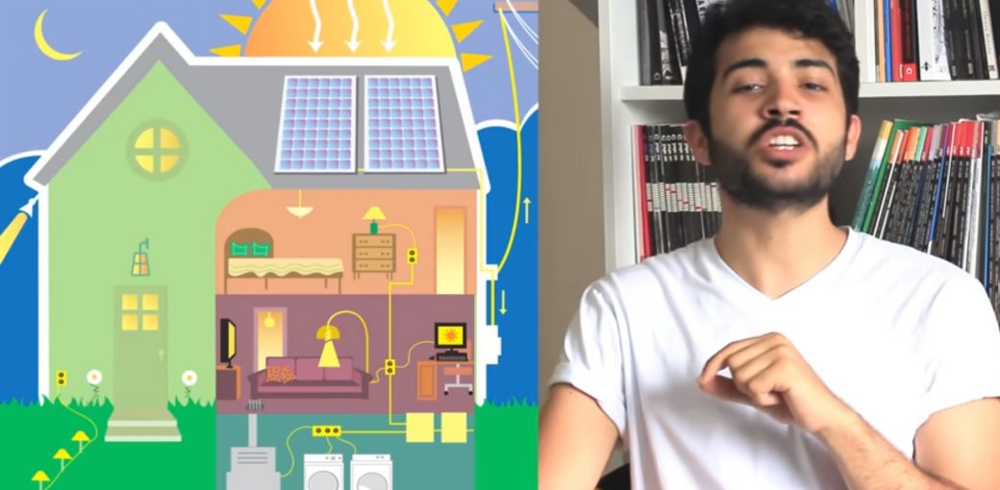

# LET the SUNSHINE IN

**Tarih:** 12/07/2018  
**Orijinal Kaynak:** http://sdmimproje.com/let-the-sunshine-in/  
**Arşiv Zaman Damgası:** 20190825022916  
**Etiketler:** Güneş Enerjisi, Doğu-Batı Ayrımı, İslam & Medeniyet Tasavvuru  
**Atlas Düğümleri:** pasif_iklim, dogu_bati, medeniyet  

---

SDMIM PROJE EKİBİ’nin güneş enerjisinden faydalanma ile ilgili olarak hazırladığı farkındalık videosu. – Güneş dünyanın yaşaması için olmazsa olmaz. Peki biz güneşten yeterince faydalanıyor muyuz?
