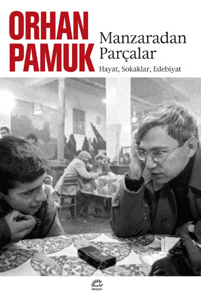

# Manzaradan Parçalar

**Tarih:** 25/04/2016  
**Orijinal Kaynak:** /sdmimproje/manzaradan-parcalar.html  
**Arşiv Zaman Damgası:** 20190102001225  
**Etiketler:** Doğu-Batı Ayrımı, İslam & Medeniyet Tasavvuru  
**Atlas Düğümleri:** dogu_bati, medeniyet  

---

Manzaradan Parçalar – Orhan Pamuk

**sdmimproje**
