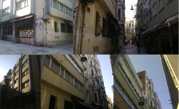
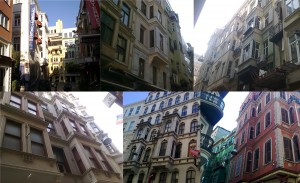
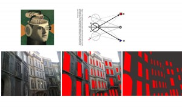
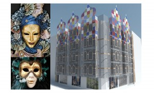
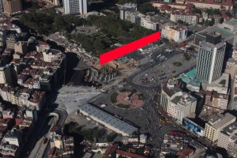
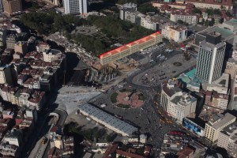

# Maske, Gezi Parkı, Topçu Kışlası, SDMIM Önerisi

**Tarih:** 2013-06-12T11:17:02+00:00  
**Orijinal Kaynak:** /sdmimproje/maske-gezi-parki-topcu-kislasi-sdmim-onerisi.html  
**Arşiv Zaman Damgası:** 20140101061039  
**Etiketler:** Gezi Parkı & Taksim, Kapitalizm & Çevre  
**Atlas Düğümleri:** sehir_hukuku, kapitalizm_mulkiyet  

---

Taksim’deki gezi parkının yerine yapılması planlanan, daha önce aynı yerde yapılmış ve yıkılmış topçu kışlası binası önerisinin sebep olduğu karışıklıkların yaşandığı günler içindeyiz. Bu dönem bir anlamda Türkiye’de özellikle Ak Parti hükümeti dönemi ile birlikte başlayan tarihsecilik akımının ortaya çıkardığı enteresan bir sonuç.

Hükümetin tarihsel bir yapı yapmak arzusu ile göstericilerin parkın yıkılmasını istememeleri arasında bir çözüm önerisi var. Serkan Duman **Mimarlık** üzerine kafa yorduğu tarihselcilik mevzusu yolunda daha önce gerçekleştirdiği bir proje örneği ile gezi parkı için bir öneride bulunuyor.

Öncelikle SDMIM’in örnek projesine bir göz atılırsa:

sdmim.com:

> 
Rusya’da  benzeri bulunan bir kültür merkezinin Türkiye’deki eşinin yapılması kararlaştırılmış, bu doğrultuda da Taksim’de metruk haldeki bir bina kiralanmış. Proje çalışmalarını yürüten mimari ofis çalışmalarını bildiğimiz, bize göre sayılı iyi ofisten biri. Onlar merkezin projesini tamamladıktan sonra önerdikleri cephenin Beyoğlu-Taksim bölgesi karakteristiği için uygun olmadığı! Söylenmiş. Sonrasında bölgenin karakteristiği doğrultusunda günümüzde yaygın olarak kullanılan prekast ürünlerle yapılan “tarihselci” bir cephe yapılacağı ancak iç mekan projesinin aynı kalacağı belirtilmiş. Bunun üzerine proje sahibi ofis bizimle bağlantıya geçerek bahsedilen “tarihselci” cepheyi onaylamadıklarını ve beraber ikinci bir cephe denemesi yapmayı önerdi. Projede dış duvarlar tamamen yıkılmış ve şeffaflaştırılmıştı. Birinci önemli madde buydu. Bunun yanında çevredeki diğer yapılarla  uyumlu olması beklenen bir yapı vardı. İlk olarak yapıyı ve civarını dolaşarak fotoğraflar aldık. Bölge küçük pencereli, çok kırıklı yapılardan ve dar sokaklardan oluşuyor. Bizim yapımızın ise yek pare diyebileceğimiz bir kütlesi var. Fark ettik ki sokakta yürürken küçük pencerelere ve de kıvrımlı yapılara bakmıyor ancak onları hissediyoruz. Göz bütün bir sokağı kavramasa da onların bütünlüğünü algılıyor. Önerilen “tarihselci cephe” aslına bakarsanız bir maske. Yapının içinden haberi olmayan, farklı ve “belirsiz” arzuların sonucu olan eklektik veya imitasyon bile diyemeyeceğimiz bir maske. Bunun yanında iç mekanın geniş pencerelerini daraltan bir eleman. Bütün bunların sonucunda. Hem geniş pencerelere olanak tanıyan, hem kıvrımlı duvarları ve de küçük pencereleri olan bir maske yapalım dedik. Ancak bu maske,  maske olduğunu haber versin. Böylelikle civardaki  eski, gerçek taş vb. malzemelerden büyük uğraşılar sonucu maharetli ellerden çıkmış olan yapılardan biriymiş gibi görünmeye çalışmaktan kurtulur ve kimseyi kandırmaz dedik. Delikli sac kullanarak, arkasını da görünür hale getiren bir tül perde ile istediğimiz maske sonucuna ulaşabileceğimizi düşündük.

[http://www.sdmim.com/MASKE-THE-MASK-pd17-pid14.aspx](http://www.sdmim.com/MASKE-THE-MASK-pd17-pid14.aspx)

**serkan duman mimarlık**

Mevcut yapı.

SDMIM’in yukarıdaki önerisi bir anlamda insanı kandırmayan ama aynı zamanda tarihselcilik arzusunu ve de karakteristiğini göz ardı etmeyen bir yapı. Taş ustalarının büyük emekle yaptıkları binalarla karıştırılmayacak, ne olduğunu belli böylelikle de geçmiştekilerin hakkını yemeyen bir zamane önerisi. SDMIM’in Taksim için önerdiği projeye gelecek olursak:

Bugün Taksim’de illa bir yapı yapılmak isteniyorsa bunun öncelikli sebebinin belirlenmesi gerekiyor. Ve görünen o ki yapıdan ziyade bir “referans” inşa etme arzusu var. Yani bir imge, tarihe ait bir yapı imgesi.İşte bu noktada SDMIM gezi parkı yıkılmadan, Taksim meydanına doğru olan tarafına imge bir duvar yapılmasını öneriyor. Bu duvar üzerine Ak Parti hükümetinin oldukça başarılı olduğu grafik alanında bir bina fotoğrafı ya da illustrasyonu ya da kabartması yapılmasını…

Bu duvar sayesinde hem Meydan çevrelenerek meydanlaşacak hem gezi parkı korunmuş olacak hem de tarihselcilik isteği tatmin olacaktır.

**sdmimproje **
