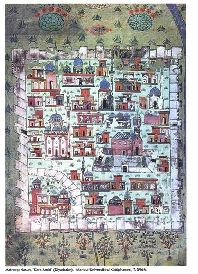
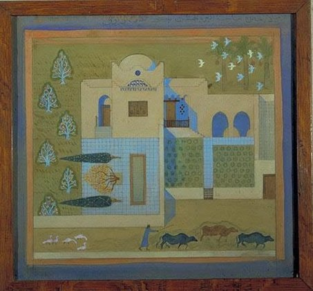
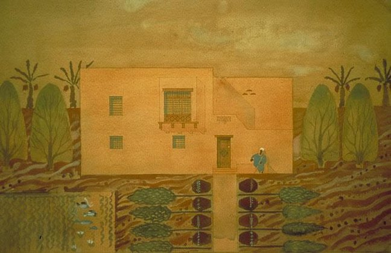
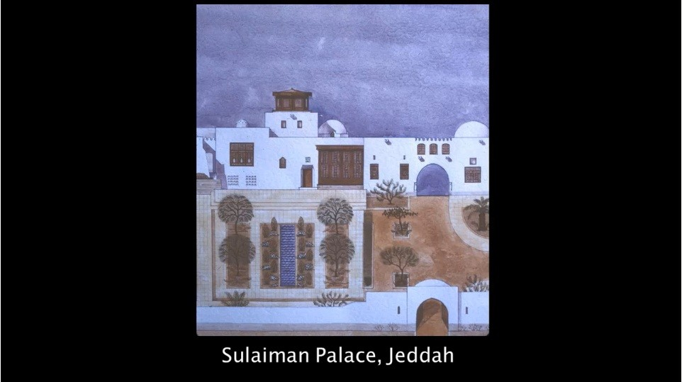

# Mimar Sinan modern anlamda çizim yapacak kadar “gerici” değildi.

**Tarih:** 22/02/2015  
**Orijinal Kaynak:** http://sdmimproje.com/mimar-sinan-modern-anlamda-cizim-yapacak-kadar-gerici-degildi/  
**Arşiv Zaman Damgası:** 20190419123421  
**Etiketler:** Hasan Fethi, Abdel-Wahed El-Wakil, Mimar Sinan, Cami Mimarisi & Kubbe, Sinema & Mekân İdrakı  
**Atlas Düğümleri:** hassan_fathy, cansever, medeniyet, goruntu_hakikat  

---

I.

Küçüktüm ufacıktım. İlkokulun ilk yıllarıydı. Resim dersinde resim yaptım. Kendi okulumu çizdim. Okulun önü ile birlikte arkasını da görüyordum zihnimde. Onu da çizdim. Öğretmenim ve bir arkadaşım güldüler, “okulun arkası görünmez ki” dediler. Ben de utandım. Bana gülen arkadaşıma daha önce okulun arkasının ön yüzüyle birlikte çizilemeyeceği öğretilmişti. “Doğruları” biliyordu yani. Olması gerekenleri…

Bir diğer anım Vikingler çizgi filmi ile ilgili. VHS video oynatıcı almıştık. O video oynatıcı ile birlikte de Vikingler çizgi filminin kasetini almıştı babam. Yüzlerce kez sıkılmadam izledim. Ve her izleyişimde sanki film değişiyor gibi hissediyordum. Çünkü zihnim adeta çizgi filme dahil oluyordu. Çizgi filmin zihnime kısmen de olsa ona katılma ve onu tamamlama izni verme nedeni filmin gerçekçilikten uzak biçimde resmedilmiş olmasıydı diye düşünüyorum.  Böyle olduğundan eksik kalan gerçekliği ben kendi zihnimde tamamlıyordum. Okulu önü ve arkası ile birlikte görebilen bir zihin başka neleri görmez ki? (Çocukların duru zihinleri ve hayal dünyaları yetişkinlerin bozuluma uğramış zihinlerinden farklı çalışır.)

II.

Minyatürler modern zihinler tarafından aşağılanır: *“Bütün o şeyleri tek bir açıdan göremezsin. Ve perspektif denen şeyden haberdar olmalısın. Sen çocuk musun?”* der adeta. Tıpkı benim küçükken yaşadığım resim deneyimi gibi. Oysa minyatürler hem çizenin hem de izleyenin hayal dünyasına ket vurmamak adına yapılmıştır. Çizen gördüklerini kendini tek bir açı ya da zamana (an) hapsetmeden resmederken. İzleyici eksik kalan kısımları kendi zihin dünyası ile doldurma imkanı bulur.

Kanuni’ye çizilip verilen örneğin Diyarbakır şehrini tarifleyen minyatür espri olsun diye verilmemiştir. Neden böyle diyorum? Çünkü minyatürdeki şehir tasvirini bugünün zihinleri olsa olsa komik bulur. Oysa şunu görmek gerek. O günün *“gerçekçi görüntülere” *boğulmamış duru zihinleri bir şehir minyatürüne baktıklarında çizilmiş bilgilerle gerçeğe daha rahat hakim olabilirlerdi. Zira eksiklikleri kendi zihinleriyle doldururlardı. Bir başka deyişle minyatür dünyasına hakim olduklarından gerekli bilgileri kağıttan alır kendi bilgi ve hayal güçleriyle birleştirirlerdi. Tamamen gerçekçi bir resme baktığınızda bunu yaşayamazsınız. Çünkü gerçekçi bir resim size *“olan biten budur kardeşim”* diyecektir.

Mimar Sinan ve çizim meselesine geçmeden önce dilerseniz Richard Sennet’ın CAD (Computer-Assisted Design [bilgisayar destekli tasarım]) programları hakkında Zanaatkâr kitabında yazdıklarını okuyalım:

> 
*“CAD mimari eğitiminde el çizimleri yerine ilk kez kullanılmaya başlandığında MIT’teki genç bir mimar şu gözlemde bulunmuştu: *‘Binalardan oluşan bir site çizdiğinizde, kontur çizgilerini çekip ağaçları yerleştirdiğinizde, bu site sizin zihninize kök salmış demektir. Bu siteyi artık bir bilgisayarın yapamayacağı şekilde canlandırmaya başlamışsınızdır… Üzerinden tekrar tekrar geçtiğiniz için artık bu bölgeyi biliyorsunuzdur, bunu da bilgisayarın onu sizin için -yeniden üretmesine- imkân vermeden yaparsınız.’* Bu nostalji değildir: Genç mimarın gözlemi, elle çizimin yerini ekran çalışması aldığından zihinsel olarak neyin yitirildiğine işaret ediyor. Diğer görsel pratiklerde de olduğu üzere, mimarlık taslakları çoğu kez ihtimal dâhilinde olanların resimleridir; bunları el çizimiyle birleştirip düzeltme sürecinde tasarımcı tıpkı bir tenis oyuncusunun ya da müzisyenin yaptığını tekrarlamaktadır; yaptığı işle derinlemesine ilgilenmekte, onun hakkındakini düşüncesini olgunlaştırmaktadır. Site, bu mimarın da gözlemlediği üzere, ‘zihinde kök salmaktadır’.*

*Mimar Renzo Piano kendi çalışma tarzını şöyle açıklıyor: *‘Taslak çizerek başlarsınız, sonra bir çizim yaparsınız, sonra bir model oluşturursunuz ve ardından gerçekliğe gidersiniz; yani siteye gidersiniz ve ardından çizime geri dönersiniz. Çizim ile yapım arasında bir nevi döngüsellik oluşturursunuz ve bunu tekrar tekrar yaparsınız.’

*Tekrarlama ve uygulama hakkında Piano şu gözlemde bulunuyor:* ‘Böylesi çok tipik bir zanaatkâr yaklaşımıdır. Aynı zamanda hem düşünür hem yaparsınız. Çizersiniz ve yaparsınız. Çizime… hep geri dönülür. Bunu yaparsınız, yeniden yaparsınız ve tekrar bir daha yaparsınız.’* Bu izafe edilmiş döngüsel dönüşüm, CAD ile birlikte terk edilebilir. Ekranda noktalar yerleştirildikten sonra, çizimi artık logaritmalar gerçekleştirir; şayet süreç kapalı bir sistem ise yeni araçlar ile amaç arasında statik bir ilişki varsa, hatalı kullanım ortaya çıkar; Piano’nun sözünü ettiği ‘döngüsellik’ de ortadan kalkar. Bir keresinde fizik uzmanı Victor Weisskopf, tamamen bilgisayarlara dayalı deneylerle çalışan MIT’teki öğrencilerine şöyle demişti:* ‘Bana sonucu gösterdiğinizde, cevabı bilgisayar anlıyor; ancak sizin cevabı anlamış olduğunuzu sanmıyorum.’

*Mekanizmanın anında silme ve yeniden şekillendirme kapasitelerinden dolayı, mimar Elliot Felix şu gözlemlerde bulunuyor: *‘Her hareket, kağıt üzerinde görüneceğinden daha az ölçüde birbirini izler… Her hareket daha az bir dikkatle hesaba katılmış olur.’* El ile çizime geri dönüş sayesinde bu tehlike bertaraf edilebilir; karşı çıkması bundan da zor olan bir konu ise binanın yapımında kullanılan malzemeler hakkındadır. CAD programları, bir binanın ihtiyaç duyduğu çelik ve tuğla miktarını mükemmelliğe yakın bir kesinlikle hesaplayabilse de düz bilgisayar ekranları, farklı malzemelerin dokularını layıkıyla yansıtamaz ya da bunların renklerinin seçiminde yardımcı olamaz. Ne kadar sıkıcı bir süreç olsa da tuğlaları elle çizmek, tasarımcıyı bunların maddiliği hakkında düşünmeye, camlı çizim masası üzerine yerleştirdiği kağıttaki işaretlenmemiş boş bırakılmış bir yer karşısında onların yansıttığı somutlukla ilgilenmeye sevk eder. Bilgisayar destekli tasarım aynı zamanda tasarımcının, ölçek hakkında düşünmesini de önler; ölçek sanki sadece büyüklük karşıtı bir şeymiş gibi gelir. Oysa ölçek oran muhakemelerini içerir; ekran üzerinde yer alan oranlar ise tasarımcıya piksellerin bir yığını olarak görünür. Ekrandaki nesne aslında maniple de edilebilir, örneğin, zeminde duran birisinin bakış noktasından sunulabilir; ancak bu arada CAD de sık sık yanlış kullanılmış olur: Ekranda görünen şeyin bu derece uyumlu olması imkânsızdır; çünkü fiziksel bir bakışın asla göremeyeceği ölçüde düzgün şekilde yapılanmış haldedir.”*

Richard Sennett bilgisayar destekli programların zararlarına dair çok önemli bir tespitte bulunuyor. Ancak bir şeyi atlıyor. O da şu ki; bugün bilgisayar destekli tasarım programları ile kısmen çizim yapılmaya devam edilmektedir. Yani hala tasarımınızı programa çizerek aktarmanız gerekmekte. Ancak teknolojik gelişim artık çizmeye de gerek kalmadan bilgisayarın tasarımı resimleyeceğini ön görüyor. Yani gelecekteki programlar bugünkilerine rahmet okutabilir. Buradan şuna ulaşıyoruz. Mesele bilgisayar değil. Mesele tasarımın tamamen gerçekçi olarak resmedilmesi aslında. Yani kesin bir gerçeklikle kağıda aktarılan tasarımın, kesin bir gerçeklikle bilgisayara aktarılması benzeşmektedir. Evet kişinin bilgisayar yerine kendi eliyle çizmesi de önemlidir. Ama dediğimiz gibi mesele motor nöronların çalıştırılması gerekliliğinden ibaret değil.

Pavel Florenski, Tersten Perspektif isimli kitabında çok çarpıcı bir şeyden bahsediyor. Minyatürlerin (Ya da Ortodoks İkonları) çizim biçiminin (yani bugün hata olarak kabul edilen şeylerin) tamamen bilinçli olduğunu ve kadim dünyanın (bugün gururla kullanılan!) gerçekçi perspektif çizim tekniğine hakim olduğunu ancak kullanmadığını söylüyor Florenski. Tıpkı Tasavvuftaki “aklı terk et” sözü gibi. Yani “önce akla sahip ol ve sonra bırak” gibi. Mimar Abdel Wahed El Wakil’in (Abdulvâhid el-Vekîl) Japonlar’ın tekerleği çok önceden bulduklarını ancak doğa ananın yüzünü çizerim kaygısıyla kullanmadıklarını anlatması gibi.

Bütün bunlardan hareketle, Mimar Sinan’ın resim yaptığını ve örneğin Kanuni Sultan Süleyman’a sunduğunu “Tezkiretü’l Bünyan” kitabından biliyoruz ve bunu da göz önüne alarak diyoruz ki, Sinan minyatür resimler üretti. Ve Kanuni de tıpkı ona sunulan Diyarbakır şehir minyatürü gibi caminin nasıl olabileceğini kendi hayal dünyasında canlandırdı. Peki Sinan neden böyle yaptı? Evvela geleneksel anlamda resim böyle. Saniyen Sinan sonuca ket vurmak istemez zira Cami inşaat halindeyken de (özellikle detaylarda) değişecektir. Salisen keskin bir gerçeklik önerimi yine geleneksel anlamda doğru kabul edilmez.

Aşağıda geleneksel yöntemlerle mimarlık yapmaya çalışan ve çalışmış Hassan Fathy ve Abdel Wahed El Wakil’in proje çizimlerinden örnekler göreceksiniz. Meselenin anlaşılması adına güzel örnekler.

Villa Hasan ‘Abd al-Razik, Hassan Fathy

Villa Ismail ‘Abd al-Razik, Hassan Fathy

sulaiman-palace, Abdel Wahed El Wakil

**bkz**. [Güneşe Bakmak Günah mı?](/sdmimproje/gunese-bakmak-gunah-mi.html)

**Serkan Duman | sdmimproje**
