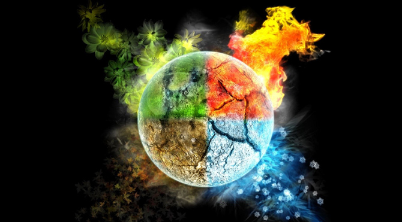

# Mimaride Dört Element

**Tarih:** 01/08/2018  
**Orijinal Kaynak:** /sdmimproje/mimaride-dort-element.html  
**Arşiv Zaman Damgası:** 20190825023910  
**Etiketler:** Depreme Dayanıklı Yapı, Kapitalizm & Çevre, Mimarlık Ortamı & Akademi Tenkidi  
**Atlas Düğümleri:** afet_deprem, kapitalizm_mulkiyet, mimarlik_egitimi  

---

Aristo’ya göre maddeler; su, ateş, toprak ve hava olarak sıralanan dört unsur veya elementin etkileşime girmesiyle meydana gelmekteydi. Şüphesiz ilerleyen bilim, birçok farklı element saptadı ve maddeleri meydana getiren bu elementlerin adı geçen dörtlü olmadığı anlaşıldı. Ancak yine de suyun, ateşin, toprağın ve havanın, hayatın devamı için temel unsurlar olduğu teorisi hala geçerliliğini korumakta.

Biz mimarlar için ise, kimyasal çalışmaların atomizeliğinin ötesinde, üretimlerin merkezinde olan bu dört unsur; yapının yapıldığı yer, malzemelerin üretiliş biçimleri ve binanın inşa edildikten sonra gireceği etkileşimin bir yerinde hep oldu. Yine de, Aristo’dan bu yana teknolojinin büyük gelişimi, insana, doğaya hükmetme ve yine doğayı gözardı etme alışkanlığı aşıladı. Artık insanlık yapılarında toprağın zeminsel problemlerini, iklimin elverişliliğini, depremsel etkileri, susuzluk gibi problemleri daha az hisseder oldu. Çöle de, okyanusa da yapı yapabilen insan için doğa, önem sırasında ikinciliğe gerilemişti.

Dünya ve doğa her ne kadar ikinci sıraya gerilediyse de yakın gelecekte yeniden eski makamına çıkacak gibi. Çünkü kaynaklar tükeniyor, dünyanın dengesi değişiyor. Şüphesiz değişen dengeler, yeni kanunlar da ortaya çıkaracaktır.

Dört temel unsuru yeniden yorumlamaya başlamak için her şeyin altüst olmasını beklemeye gerek yok aslında. Üstelik su, ateş (enerji), toprak ve hava üzerine yeniden düşünmek ve onlarla uyum içerisinde bir mimari üretmek; doğayı, çevreyi veya ekosistemi yormadan, onlarla uyumlu işler çıkarmak bize hiçbir şey kaybettirmeyeceği gibi çok şeyler kazandıracaktır. Bu bağlamda sadece mimarların değil, mimariyi talep eden kullanıcıların da duyarlı ve farkında olması beklenecektir.

Çevre ile ilgili olarak, akademik ve detaylı çalışmalarla birlikte, insanların farkındalığının artırılması, uzmanların, uzman olmayanlara basitçe de olsa bir takım verileri anlatması önemlidir. Bu noktada sizlerle, mimarlar ve mimarlık öğrencilerinin ortak çalışmasıyla SDMIM PROJE Ekibi’nin çevre-mimari ilişkisi üzerine hazırladığı kısa fakat etkili olduğunu düşündüğüm dört videoyu paylaşmak istiyorum.

Bu videolardan ilki su sorunu ile ilgili. Videoda, kuraklık ve sellerle boğuşan bizler için bir takım basit yöntemler önerilerek çözüm yolları gösteriliyor.

İkinci videoda enerjiden (ateş) bahsediliyor. Temiz enerji ve enerji bağımsızlığı üzerinde duruluyor.

Bir diğer videoda toprak mimarlığı ve ekolojik mimari anlatılıyor.

Son hava bükücü pardon son videoda ise hava ile ilişkili olarak pasif soğutma ve havalandırma gibi binaların kendi biçimiyle enerji harcamadan iklimlendirilmesi üzerinde duruluyor.

Şüphesiz bu videolar henüz yeterli genişliğe ve detaylılığa hakim değil ancak henüz emekleme aşamasında olan mimari-ekoloji farkındalığı açısından önemli çalışmalar olarak görülmelidir.

Serkan Duman
