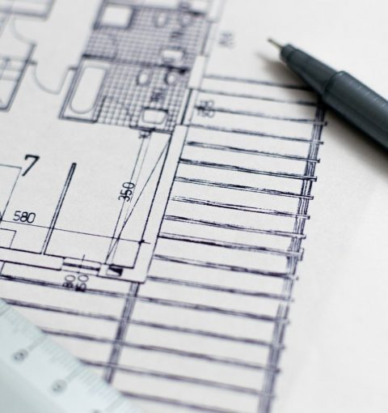

# Mimarlık 1 – Mimari Nedir? Tercih Edilir mi? Mimarlar Nasıl İş Bulur?

**Tarih:** 12/12/2019  
**Orijinal Kaynak:** /sdmimproje/mimarlik-1-mimari-nedir-tercih-edilir-mi-mimarlar-nasil-is-bulur.html  
**Arşiv Zaman Damgası:** 20191218023436  
**Etiketler:** Mimarlık Ortamı & Akademi Tenkidi, Doğu-Batı Ayrımı, İslam & Medeniyet Tasavvuru  
**Atlas Düğümleri:** mimarlik_egitimi, dogu_bati, medeniyet  

---

Mimar Serkan Duman ve Mimar Ahmed Özdemir konuşuyor. Mimarlığı anlattığımız bölümün ilk videosu. Türkiye’de mimarın durumu. Geleneksel mimari ile sosyal medya ilişkisi. Mimar nasıl iş bulur? …..Patreon’dan bize destek olabilirsiniz: [https://www.patreon.com/sdmimproje](https://www.youtube.com/redirect?event=video_description&v=EduaiLbKImA&q=https%3A%2F%2Fwww.patreon.com%2Fsdmimproje&redir_token=7YZfjyLetSGFwCe2Mpb8Yyr8u8l8MTU3NjIyMTI0NkAxNTc2MTM0ODQ2) Starmimarlık ile mimarinin ilişkisi. Müteahhit ile mimarın ilişkisi. Mimarlar işsiz mi? Türkiye’de kaç mimarlık okulu var? Yeni mezun mimarlar. 2000’li yıllardan önce Türkiye’de mimar ne manaya gelirdi? İnşaat piyasasında kriz var mı? Mimarlar nasıl iş bulacaklar? Gelenekten geleceğe nedir? Tarih mimari ilişkisi. Modern mimari nasıl işler? Mimarlık fakültelerinde eğitim nasıl? Dünyada mimarlık ne durumda? İyi mimarlık için ne gerekir? Tasarım mimari ilişkisi. Yeni mezun mimarlar ne iş yapıyor? Piyasa mimarlığı nasıl işler? [#mimar](https://www.youtube.com/results?search_query=%23mimar) [#mimarlık](https://www.youtube.com/results?search_query=%23mimarl%C4%B1k) [#eğitim](https://www.youtube.com/results?search_query=%23e%C4%9Fitim)

[0:00](https://www.youtube.com/watch?v=EduaiLbKImA&t=0s) İçerikten bazı kısa bölümler [0:34](https://www.youtube.com/watch?v=EduaiLbKImA&t=34s) Intro [0:41](https://www.youtube.com/watch?v=EduaiLbKImA&t=41s) Mimarlığı talep eden insan sayısı azalıyor mu? [1:50](https://www.youtube.com/watch?v=EduaiLbKImA&t=110s) Türkiye’de 150’ye yakın mimarlık okulu var [2:21](https://www.youtube.com/watch?v=EduaiLbKImA&t=141s) Türkiye’nin gündemine mimarlık ne zaman girdi? [3:02](https://www.youtube.com/watch?v=EduaiLbKImA&t=182s) Mimarlıkta işsizlik [3:37](https://www.youtube.com/watch?v=EduaiLbKImA&t=217s) Mimarlar kendilerini çok mu önemsiyor? [4:12](https://www.youtube.com/watch?v=EduaiLbKImA&t=252s) Türkiye’de mimarlık [4:26](https://www.youtube.com/watch?v=EduaiLbKImA&t=266s) Türkiye inşaat piyasası [4:54](https://www.youtube.com/watch?v=EduaiLbKImA&t=294s) Mimarlık mezunlarının durumu [5:18](https://www.youtube.com/watch?v=EduaiLbKImA&t=318s) İnşaat sektöründeki kriz [5:32](https://www.youtube.com/watch?v=EduaiLbKImA&t=332s) Sosyal medya ve geleneksel mimari [5:58](https://www.youtube.com/watch?v=EduaiLbKImA&t=358s) Geleneksel mimari [7:44](https://www.youtube.com/watch?v=EduaiLbKImA&t=464s) Gelenekten geleceğe [8:20](https://www.youtube.com/watch?v=EduaiLbKImA&t=500s) İçinde bulunduğumuz durumu netleştirmek [9:00](https://www.youtube.com/watch?v=EduaiLbKImA&t=540s) Türkiye’de mimarlık konuşmak [9:26](https://www.youtube.com/watch?v=EduaiLbKImA&t=566s) Modern mimari [9:57](https://www.youtube.com/watch?v=EduaiLbKImA&t=597s) Mimarlık okullarının durumu [11:00](https://www.youtube.com/watch?v=EduaiLbKImA&t=660s) Mimarlık öğrencilerinin tutumu [11:40](https://www.youtube.com/watch?v=EduaiLbKImA&t=700s) Mimar memur [11:22](https://www.youtube.com/watch?v=EduaiLbKImA&t=682s) İş bulmak [13:44](https://www.youtube.com/watch?v=EduaiLbKImA&t=824s) Star mimarlar [14:18](https://www.youtube.com/watch?v=EduaiLbKImA&t=858s) Piyasa mimarı [15:17](https://www.youtube.com/watch?v=EduaiLbKImA&t=917s) Müteahhitler [16:18](https://www.youtube.com/watch?v=EduaiLbKImA&t=978s) Çok iş yapan mimarlar [16:34](https://www.youtube.com/watch?v=EduaiLbKImA&t=994s) Yıldız mimarlık kurumu [17:00](https://www.youtube.com/watch?v=EduaiLbKImA&t=1020s) Frank Gehry [18:00](https://www.youtube.com/watch?v=EduaiLbKImA&t=1080s) Mimarlık nasıl olmalı? [19:00](https://www.youtube.com/watch?v=EduaiLbKImA&t=1140s) Eski ustalar
