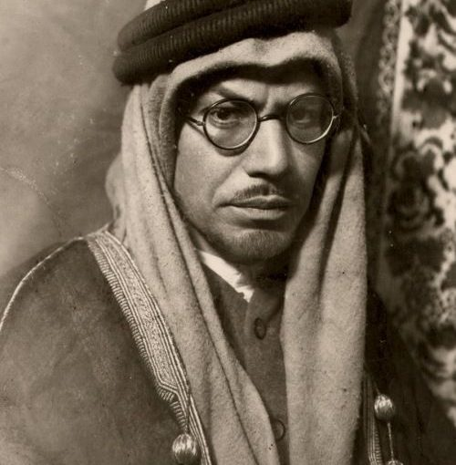

# Muhammed Esed 1954’te ne dedi?

**Tarih:** 15/08/2015  
**Orijinal Kaynak:** /sdmimproje/muhammed-esed-1954te-ne-dedi.html  
**Arşiv Zaman Damgası:** 20190101073939  
**Etiketler:** Muhammed Esed, Fıtrî Mesken & Ev Felsefesi  
**Atlas Düğümleri:** medeniyet, ev_felsefesi  

---

> 
“Dışarısı süssüz ve çıplak, içerisi zengin ve tantanalı böyle bir evi hayatımda ilk kez görüyordum; fakat o zaman öğrendim ki, bu ev yalnız Suriye’de değil, Irak’ta, geleneksel meskenlerin tipik bir örneğiydi. İlk zamanlar Arablar da, İranlılar da oturdukları evlerin dış görünüşüne pek önem vermiyorlardı; ev demek, içinde yaşanılan yer demekti; fonksiyonalizmden apayrı bir şeydi. Kendi duygularına karşı güvensiz ve çarpık bir romantizme düşkün Batılılar, günümüzde ev yerine, insanın ‘evim’, ‘yuvam’ diyebileceği bir yerde barınma zevkini bilim-teknoloji idealinin pençesinde kurban ederek, sanayi kentlerinin varoşlarında işçi siloları inşa ediyorlar. Arablar ve İranlılar ise düpedüz ev inşa ediyorlar; veya en azından düne kadar ev inşa ediyorlardı.”

Muhammed Esed’in, 1920’lerde Suriye’de ziyaret ettiği bir ev üzerine yazdıkları.** – Mekke’ye Giden Yol**

**sdmimproje**