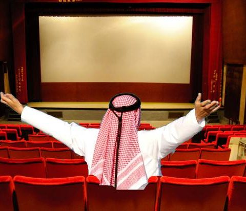

# Müslüman sinema yapabilir mi?

**Tarih:** 12/01/2015  
**Orijinal Kaynak:** /sdmimproje/musluman-sinema-yapabilir-mi.html  
**Arşiv Zaman Damgası:** 20190327054532  
**Etiketler:** Cemil Meriç, Fas & Mağrip, Atina, İslam & Medeniyet Tasavvuru, Cami Mimarisi & Kubbe, Postmodernizm & Tüketim Eleştirisi, Sinema & Mekân İdrakı  
**Atlas Düğümleri:** felsefe_sanat, dogu_bati, medeniyet, goruntu_hakikat  

---

“Müslüman sinema yapabilir mi?” Sorusu içeriği itibariyle birçok alanı ilgilendiriyor. Bununla birlikte cevabı da birden fazla sebep-sonuç ilişkisine bağlı. Bu sebeple anlaşılabilir olması adına metni maddeler halinde toparlayarak yazmaya çalışacağız.

Aşağıda sıralayacağımız maddeler sinemanın İslam ve Doğu ve hatta Kadim gelenekle olan sorunlu yanları olacak.

**1) Sinema Hristiyan Batı’nın bir ürünüdür.**

Sinemanın Hristiyan Batı tarafından üretilmesi ilk bakışta sorunlu görülmez. Oysa Hristiyan Batı’nın, kendi dışında kalan toplumlardan özellikle de Müslüman Doğu’dan dünya görüşü olarak büyük farklılıkları bulunduğunu görmek gerekmektedir. Bunlara değinecek olursak:

**1.1.) Kilise mimarisinin değişen Hristiyanlık algısından etkilenmesi ve Hristiyanları etkilemesi.**

Hristiyanlıkta bir ruhban sınıfı olduğu bilindiği gibi, bu sınıfın da hristiyanlığı her anlamda etkilediği ve bazen de dönüştürdüğü kabul edilmiştir. Özellikle bazı azizlerin yazdıkları Hristiyanlar tarafından neredeyse İncil kadar kutsal kabul edilir.

Hal böyle olunca Skolastik çağla başlatabileceğimiz, ruhbanlar tarafından belirlenen ve son hali verilen bir kilise mimarisinden bahsedebiliriz. Bahsettiğimiz mimari salt kütle ve biçim olarak algılanmamalı daha çok fonksiyona dikkat edilmelidir.

Augustinius’un yazdıklarından anlıyoruz ki onun döneminde Hristiyanlar secde etmektedirler. Fakat bu durum günümüze kadar gelen süreçte değişmiştir. Bahsettiğimiz gibi önemli bir kesinliğe ulaştığı Skolastik ve Gotik çağda kiliselerin biçimi belirlendi ve secdenin olmadığı, koltuklarda oturarak gerçekleştirilen bir ibadet biçimi doğdu.

Kilise mimarisi ve ortaya çıkan Hristiyanlık, Hristiyanları iki anlamda çok etkilemiştir. Bunlardan birincisi (1.1.a.), binanın yapısal özelliklerinden tutun da mimariyi fonksiyonel anlamda oluşturan birimlerin belirlenmesi. (Erwin Panofsky’nin, Skolastiklerin kilisenin hangi tonoz kullanılarak meydana getirileceğini bile belirlediklerini söylemesi dikkate değerdir.) İkincisi (1.1.b.) ise ibadet etmeye gelen kullanıcıların oturarak ibadet etmesidir.

**1.1.a.)** Kiliseye gelen kişinin, kilise tarafından maruz bırakıldığı davranış biçimini görmek gerekir. İnsanın nasıl hareket edeceği önceden belirlenmiştir. Kiliseye (veya katedral) gelen kullanıcı, girişten geçip doğuya doğru ilerleme ihtiyacı duyar. Oysa İslam ibadethanelerinde böyle bir durum yoktur. Caminin tamamı namaz kılma yeridir. Kıbleye döndükten sonra (bu da Vahdet’ten kaynaklanır) istediğiniz yere gitmekte serbestsinizdir.

Bugün Batı medeniyetinin dolayısıyla da Batı sanatının ve mimarisinin etkisi altında olduğu, bireyi yönlendirme arzusu kilisenin bu biçiminden kaynaklanmaktadır. Müslümanlar’da tasvip edilmeyen bu tutum Hristiyanlar’da olağan ve hatta gerekli olarak görülür. Bugün dünya mimarlığı da bu biçimde yapılmakta ve kullanıcı etki altına alınmaktadır. Örneğin “şuradan geçen insanda şu hissi uyandırmak istiyorum” diyen mimar farkında olmadan bir hristiyan alışkanlığı sergilemektedir.

İşte sinema da izleyicinin zihninin yönetmen tarafından istenen yere götürülmesidir. Filmde “yaratılmış” (yaratılmış kelimesine dikkat zira meydana getirilen gerçek benzeri kurmacada bir tür tanrılaşma arzusu vardır) karakter isteğe göre iyi de olabilir kötü de. Yahut bir olay senaristin canının istediği biçimde sonuçlanır. Bu tutum bir başkasının hatta “yaratıcının ya da yaratıcılığa özenenin” kafasının içinde dolaştırılmaktır. Tabi içinde dolaşılan kafanın sahibi dolaşanı istediği yere götürecektir.

Sinemanın propaganda aracı olmak adına uygunluğu buradan kaynaklanır. Heidegger, *“Kamera izleyiciye çevrilmiş bir silahtır”* diye boşuna söylemez. Slavoj Zizek*  *ise* “Sinema sapık sanatın ta kendisidir. Size arzuladığınız şeyi vermez, nasıl arzulayacağınızı söyler.” *demektedir*.*

Kişiyi sanat aracığıyla yönlendirmek Doğu ve İslam sanatlarında kendine yer bulamaz. Başta mimaride olmak üzere durum böyledir. Bu konuyu ilerleyen kısımlarda daha açıklayıcı olarak anlatacağız.   

**1.1.b.)** Oturarak ibadet etme meselesi önemlidir. Zira oturan kişi pasif demektir. Yani izleyici konumundadır. Müdahil değildir. Bugün modern Batı’nın dayattığı sinema, konser, tiyatro gibi toplu izlenen sanatların tamamı pasif izleyicilerle gerçekleştirilmektedir.

Aristo’nun şiir ile birlikte tiyatroyu anlattığı Poetika adlı eseri birçok Müslüman tarafından (bu Müslümanlara İbn-i Sina da dahil) çevrilmesine rağmen Müslümanların inşa ettiği bir tiyatro görmeyiz. Oysa antik dönem de dahil olmak üzere Batı’da yüzlerce büyük tiyatro vardır. Müslümanlar’ın bu noktada bilinçli olarak bir tercihte bulunduğu anlaşılıyor.

Bugün modern bireyin neredeyse tamamen pasifizasyona uğraması ve teknolojinin de bu yönde gelişmesi yabana atılacak bir durum değil. Sadece bir bitki olmaya doğru giden günümüz insanı üzerine giymeye başladığı teknolojik medya araçlarını yakında vücuduna da monte ettirecek gibi durmaktadır. Bu davranış biçimi kilisede Hristiyanlar’a uygulananla benzeşmektedir.

# [bkz. matrix’te ölürsem kabrime gelme](/sdmimproje/matrixte-olursem-kabrime-gelme.html)

**1.2.) Rönesansın bireye ve sanata etkisi.**

**Rönesans ile birlikte perspektifin ve bireyciliğin ortaya çıkışı Batı’yı fevkalade etkilemiştir. Kendini merkeze alan birey de üretimlerini bu doğrultuda yapmıştır. Mimari üretimleri dahi mimar kendi bakış açısına göre şekillendirmiş ve kullanıcıların yapıyı veya yapılar bütününü algılama biçimlerini önceden resmetmeye ve inşa etmeye gayret göstermiştir. Kullanıcıların bakış açıları mimarın kendi bakış açısına göre belirlenmiştir.**

İşte sinema da kameranın dolayısıyla yönetmenin bakış açısıdır. İzleyiciye kendi seçtiği bir noktadan bakma imkânı tanımaz. Bu sebepledir ki Müslüman Doğu’da bazılarınca, etrafında dönülemeyen şeyin sanattan sayılmayacağı söylenir.

** **

**1.3.) Trajediyle yaşama durumu.**

Hrsitiyanlar’da** “cennetten kovulan Adem”in trajedisi vardır. Günahlarla dolu bir aleme düşmüşlerdir. Bununla birlikte onları günahtan kurtarmaya gelen İsa ise işkenceler görmüş çarmıha gerilmiştir. Bu sebepledir ki her bir Hristiyan’ın günah ile doğduğu kabul edilmektedir.**

**Bu trajedik algı kilise mimarisinde de kendini göstermektedir. Kilislerdeki kasvetli hava boşuna değildir. Camilerin aydınlık dünyası düşünüldüğünde fark anlaşılacaktır.**

**Ağlayan çocuğun bile günah işlediğini düşünen **Hristiyanlar’ın en önemli azizlerinden Augustinius’a** bakmak, bir Hristiyanın dünyayı görme biçimini anlamak adına önemlidir.**

**Antik Yunan’da da var olan trajedik algının, Hristiyanlar’ın anlayışıyla birleşmesi zor olmamıştır. Bütün dini sanata yansıyan bu hüzünlü bakış Müslümanlar’da yoktur. **

**Trajedinin Müslümanların kalbinde ve zihninde olmayışı önemlidir çünkü tiyatro ve edebiyat gibi alanlarda çok etken olan trajedi hissiyatı Hristiyan sanatsal üretiminin başat öğesidir. **

** **

**1.4.) Kilise-sanat ilişkisi.**

**Resim ve heykel ile süslenen kiliselerin bu yönüyle cami ile benzeşir yanı yoktur. Bugün Müslümanlarca günah kabul edilen görüntülerle kiliseler donatılır.**

**Aslına bakılırsa eskiden Hristiyanlar tarafından da suret kullanımı kısıtlanmıştı ancak sonradan bu kısıtlama kaldırıldı. Öyle ki pagan çağda tanrılar için yapılan resim ve heykeller Hristiyanlaştırılarak kullanıldı.**

**Hal böyle olunca bir Hristiyan’ın görsel algısı da kutsallıkla iç-içeleşti. Çıplaklık bırakın günah olmayı yeri geldiğinde sevap kabul edildi. **

**Bugün bahsettiğimiz anlamda görsellikle yeni tanışan Müslüman Doğu’nun, kendi kültüründe neredeyse hiç bulunmayan bir olguyu kamera ile ürünselleştirmeye çalışması en basit tabirlerle “komik, basit ve uygunsuz” görünmektedir.**

**2) Şer’i açıdan İslam’da sinema.**

**Bugün içinde yaşadığımız dünyanın İslami bakış açısıyla uyuşmuyor oluşu bizi tutarlı olmaktan ayırmamalıdır. Yani İslami açıdan olması gerekenleri söylemek gereklidir.**

**Öncelikle İslam’ın görüntü ve suret ile olan ilişkisine bakmak gerekiyor. Suretin yasak oluşu bir gerçeklik olarak karşıda durmaktadır. Üstelik bu durum sadece İslam’da değil kadim dünyada da böyledir. Görüneni birebir gerçek olarak resmetmek kadim dünyada hoş karşılanmaz. Bu meseleye daha sonra döneceğiz.**

**Sinema erkek ve kadın ile birlikte yapılan bir sanat. İslam’ın ise bu noktada tesettür hakkındaki tutumu açıktır. Hem erkek hem de kadın için geçerli kurallar vardır. Erkeğin uymasının daha kolay olduğu bu kurallar özellikle kadının görünme biçimini daha fazla sınırlar. Bu noktada şunu sormak gerekiyor. Müslümanlar sürekli erkeklerle mi film çekecek?**

**Tutarlı olmaktan bahsimiz işte bu ve benzeri meseleler. Bugün uyulsa da uyulmasa da İslam’ın emirleri ortadır.**

**Bununla birlikte sinema milyonlarca insana ulaşan bir üründür. Öyle ise devreye kul hakkı da girmektedir. Zira kişinin kendi günahını kabul etmesi karşı tarafı günaha sokuyor oluşunu engellemez. Necip Fazıl’ın *“Bir günahı aleni yapmak o günahın işlenmesinde mahzur görmemenin ilanıdır! Ve o günahtan bir milyon kere fazladır!.. Bunun izahı zor mudur? Ve artık günah değildir o, günahtan başka bir şeydir!” *sözleri dikkate değerdir.**

**İslam ve “mış gibicilik” meselesine bakacak olursak da örneğin film gereği evli görünen iki insanın gerçekte de evli sayılacağı bilinen bir gerçektir.**

**3) Doğu sanatının “kurmaca” ile olan ilişkisi.**

**Bugün bizlere olmayan bir olay veya karakterin varmış gibi gösterilmesi normal gibi gelebilir ancak işin özüne bakıldığında bu anlamda bir “kurmaca” yalandır. Bu sebeple Doğu’da ve İslam dünyasında sureti aynen aktarmaya olan olumsuz bakış “kurmaca”ya da gösterilir. Örneğin Japon Tiyatrosu’nda (bugün ki anlamda bir tiyatro değildir) veya Hacivat Karagöz oyununda izleyicinin izlediğinin gerçek olmadığı sürekli hatırlatılır. Bunu perdenin arkasından yansıyan çubuklarda veya hareketlerin gerçekten uzak oluşunda görebilirsiniz. Oysa sinema izleyicisi film bitene kadar izlediklerinin gerçek olmadığını hatırlamaz. (Bugün postmodern sinemada kişinin izlediğinin bir kurmaca olduğunu hatırlatan bazı örnekler mevcuttur. Ancak bunlar cılız denemelerdir.)**

**4) Görüntünün olumsuz etkileri.**

**Duymak ile görmek arasında büyük fark vardır. Küçükken gördüğü bir görüntünün kişiyi duymaya göre çok daha fazla etkilediği aşikardır. Bu noktada görüntü zihne ket vuran bir hal alır. Çocuğun hayal dünyası düşünüldüğünde hiçbir film o noktaya erişemez. Hem hayal dünyasının genişliği hem de kişiye özel oluşu itibariyle.**

Doğu ve kadim dünya gördüklerinin, görünenden ibaret olmadığını bilir. Bu sebeple çok gerçekçi resmetmek alışkanlığı göstermez. Picasso’nun Afrika maskelerine bakarak yaptığı çalışmalar ve görüneni aynen çizmekten kaçınmaya başlaması Batı’nın da kendi yaptığı hatayı sorguladığını gösterir. Ancak yine de mesele salt birden fazla açıdan bakmak değil bahsettiğimiz gibi işin metafizik boyutuyla da ilgilidir.

Doğu Hristiyanları’nın rönesans döneminde Batı’ya gerçekçi resimle ilgili yaptıkları eleştirileri değerlendirmek önemlidir. Ve Michelangelo’nun yaptığı resimlerden dolayı günaha girdiğini düşünmesi, Raphael tarafından Atina Freski’nde düşünceli ve mahsun olarak çizilmesi enteresan olaylardır.

**5) Görsel sanat kültürü.**

**Sinema her ne kadar yeni bir sanat gibi algılansa da batı için kökü oldukça eskiye uzanan bir alışkanlıktır. Hem tiyatro hem resim hem de opera gibi sanatlar sinema ile çok benzeşir. 18. Yüzyılda gerçekleştirilen bazı operalara bile baktığınızda adeta bir sinema perdesi gibi düzenlenmiş sahneyi filmden neredeyse ayırt edemezsiniz. Buradan hareketle diyebiliriz ki sinema görsel sanatların bir uzantısı olarak, mazisi çok eskiye dayanan bir kültürün parçasıdır. Ve aynı zamanda içinde kutsallık barındıran bir kültürdür. **

**Doğu’ya baktığımızda ise Batı’ya oranla yok denecek kadar az bir görsellik alışkanlığı bulunur. Hele Müslüman Doğu’da sıfıra yakındır. **

**Biraz daha açıklayacak olursak. Batı’lı fertler en basitinden tablo okumayı içselleştirerek büyürler. Çünkü bu onların en başta kutsalıdır. İşte böyle bir alışkanlık Batılılar’ın sinemayı çok daha iyi yapabilmelerine sebep olur. Üstelik cinselliğin de sorun teşkil etmediği düşünüldüğünde hayat her alanıyla sinemada yer bulur.**

**Bugün İslami tarzda sinema yapma iddiasındakiler bu sorunsalı (sinemada çıplaklık) nasıl aşacaklardır merak konusudur. Üstelik Batı’da  tabulaştırılmış (belki görüntü olarak çıplaklık problem olarak görülmez ama cinsellik Batı’nın hoş karşılamadığı ve abarttığı bir eylemdir) olmasına rağmen Doğu’da olumsuz olarak algılanmayan hatta tasavvufta Allah ile bir araya gelme manasını bile taşıyan cinsellik bu kadar hayatın içindeyken, hakiki manada bir Müslüman Sineması cinsellik olmadan nasıl tamamlanır bilinmez.**

**Tablo örneğine devam edecek olursak; Hristiyanlık adına kutsal olan olaylar resmedilirken üst metin ile birlikte bir altmetin katmanını da okumak gerekir. Bu anlamda bir altmetin yüklemesi iyi filmlerde mutlaka yer bulur. Geldiği nokta ise dediğimiz gibi tablolardır. İşte görüldüğü gibi kültürel ve dini anlamda bir görsel alışkanlığın olması sinema adına değerlidir. Bununla birlikte içselleştirilen görsellik kişiyi kitch üretmekten alıkoyar. Bugün özellikle Türkiye sinemasındaki salt olay anlatımı kısırlığı veya “vaaz verme” çabası, kültürel yabancılıktan kaynaklanır.**

**6) Sinema nedir?**

**Bu soru önemlidir. Sinemanın “entertainment” yani eğlence aracı olduğu unutulmamalıdır. Ve eğer ilk film örneklerine bakılacak olursa, Batının “fantazi diyarı” olan Müslüman Doğu’yu görmek istediği doğrultuda yapılmış işler olduğu görülür. Doğrudan nefse hitab eden bir araç olarak kullanılır sinema. Çok benzerini Cemil Meriç de roman için söyler:**

*“Divan edebiyatında roman yok. Niçin olsun?*

*Batı’nın ilk romanlarından biri Topal Şeytan. Kahraman evlerin damını açar, bizi yatak odalarına sokar. Roman başlangıcından itibaren bir ifşadır. Osmanlı’nın ne yaraları vardır, ne yaralarını teşhir etmek hastalığı. Hikâyeleri ya bir cengâveri ebedîleştirir, ya ‘hisse alınacak bir kıssa’ dır.*

*Romanın burjuvaziyle doğduğunu söylerler. Burjuvazi Avrupa’nın imtiyazı, daha doğrusu yüz karası. Bir kelimeyle roman, başka bir dünyanın, başka bir ruh ikliminin, başka bir toplumun eseri. Daha zavallı bir dünya daha dişi bir manevî iklim, daha geveze bir toplum.*

*Başka bir tâbirle, bu edebî nevi bir buhranın, bir uyuşmazlığın, reel ile ideal arasındaki bir nisbetsizliğin çocuğu. İçtimaî bir sıhhatsizlik, hiç değilse bir tedirginlik alâmeti. Sınıf kavgalarıyla sahneye çıkışı bundan. İnanan bir toplumda, pürüzlerini yok etmiş bir toplumda, hayalî çözüm yolları aramaya ihtiyaç duymayan bir toplumda romanın ne işi var?”*

**Sonuç olarak demeliyiz ki Müslümanlar’ın “irfan” kelimesini ısrarla sinemanın yanına getirme çabaları bize sorunlu görünüyor. Anlaşılan Batı sinemanın problemli bir alan olduğunu ilan edinceye kadar buralarda “körebe” oynanmaya devam edilecek.**

serkan duman

**bkz. [Türkiye’de din kaynaklı şizofreninin yansımaları](/sdmimproje/turkiyede-din-kaynakli-sizofreninin-yansimalari.html)**

**bkz. [Uyanın, İsa Çarmıha Gerilmedi!](/sdmimproje/uyanin-isa-carmiha-gerilmedi.html)**

# bkz. [Herhangi bir eve her zaman girebilirsin.](/sdmimproje/herhangi-bir-eve-her-zaman-girebilirsin.html)

**bkz**. **[Şiddetin Estetiği Olur mu?](/sdmimproje/mvrdv-mimari-bir-grup-ak-parti-ise-siyasi-bir-parti-oyle-ise.html)**

