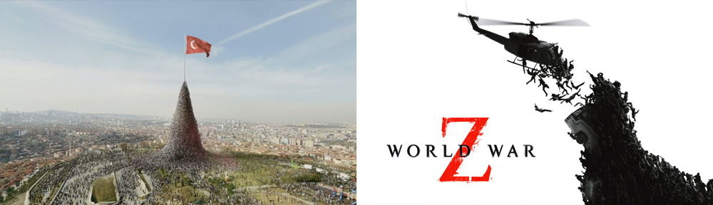
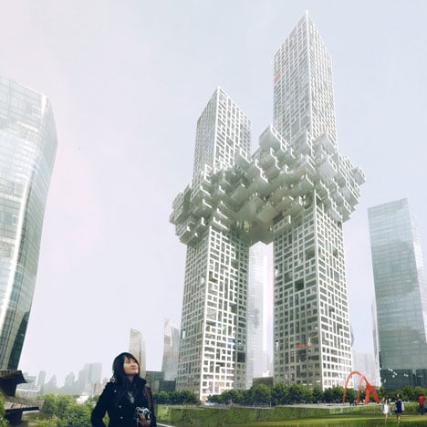
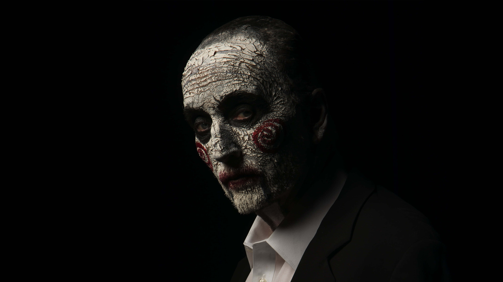
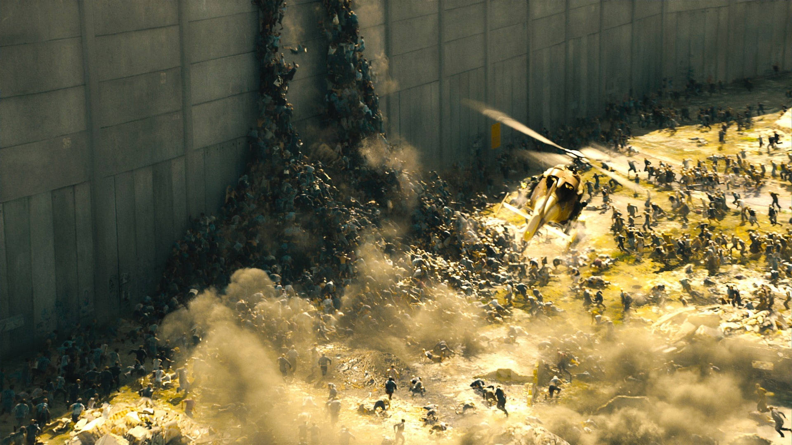
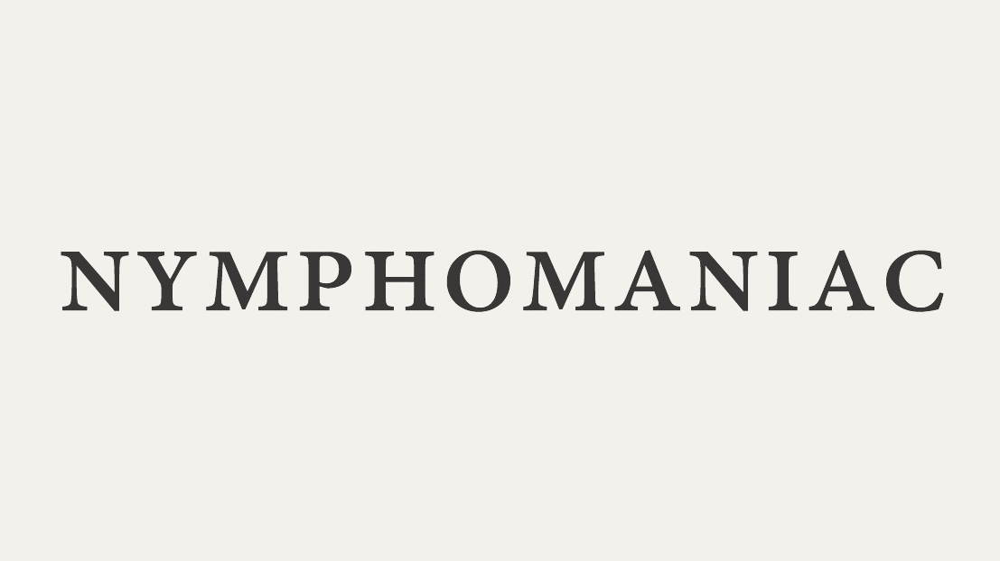

# MVRDV mimari bir grup, AK Parti ise siyasi bir parti. Öyle ise…

**Tarih:** 2014-03-19T12:56:48+00:00  
**Orijinal Kaynak:** http://sdmimproje.com/mvrdv-mimari-bir-grup-ak-parti-ise-siyasi-bir-parti-oyle-ise/  
**Arşiv Zaman Damgası:** 20140424070554  
**Etiketler:** Turgut Cansever, Dücane Cündioğlu, Datça & Ege, Paris, İslam & Medeniyet Tasavvuru, Postmodernizm & Tüketim Eleştirisi, Sinema & Mekân İdrakı  
**Atlas Düğümleri:** cansever, felsefe_sanat, kirsal_koy, medeniyet, goruntu_hakikat  

---

I.

Yazımıza Yapı Kredi Yayınları’ndan çıkmış olan “Bir Mimar ile Bir Yazar Tartışıyor: Görmek ve Yazmak” isimli kitapta söyleşen mimar Christian de Portzamparc ve yazar Philippe Sollers’in 11 Eylül üzerine yaptıkları konuşmanın bir bölümü ile başlayalım:

> 
**Ph.S.:** Gazetecilerin, ceset görüntülerinin ortaya çıkmaması konusundaki yorumları seni etkilemiş miydi?

**C.d.P.:** Tabii ki.

**Ph.S.: **Olan biteni anlatıyordu biri… Koşuyormuş, çabuk çabuk diye bağırmışlar, sola bakma, ama bakmış yine de, Kutsal Kitap‘ta olduğu gibi, ve uzun süre anımsayacağı o görüntülerle karşılaşmış. Ama cesetleri göstermeme konusunda kasıtlı bir eğilim söz konusuydu. Sorunun bu tarafıyla da ilgileniyor musun?

**C.d.P.:** Bu konuyla ilgili daha önce konuşmuştuk seninle, ABD’deki ölüm cezası ve ölümün soyutlanması hakkında. Kameramanlar ölüleri, ölümü filme çekmekten, bu görüntülerle sansasyonel bir şey gerçekleştirmekten kaçındıklarını açıklamışlardı.

**Ph.S.: **Ne bir ceset, ne bir enkaz, ne sergilenen bedenler, ne toplu mezarlar.

**C.d.P.:** Olanaksız bir yas.

**Ph.S.: **Hatta daha da ileri giderek bir tür ölüm tabusundan da söz edilebilir. Sonuçta burada Amerikan ve İslami olmak üzereiki püriten sistem, bedenlerin inkâr edilmesine yönelik şiddette birleşiyorlar.

**C.d.P.:** 11 Eylül’deki dramın asıl imgesi de aslında bu soyut, delinmiş, yıkılmış kulelerin görüntüleriydi. Dışsal imgeyle içsel gerçeklik arasından büyük bir ayrım söz konusu. Sözcüğün tam anlamıyla inanılmaz bir gösteri içinde yıkıldılar, büyüleyiciydi çünkü başka türlüsünü kimse kaldıramazdı, içeride binlerce ölü beden olduğunu biliyorlardı. Gezegenin büyük bir çoğunluğunun canlı olarak izleyebileceği bir saatte gerçekleştirilen olağanüstü etkileyici ve mutlak bir gösteriydi söz konusu olan.

**Ph.S.: **Atlayanlar vardı…

**C.d.P.:** Bir an için, teröristlerin hedeflerini ıskaladıklarını ve uçakların New Jersey’de yere çakıldıklarını düşünelim; kesinlikle çok daha büyük bir zarar ortaya çıkardı, tüm dünyadan televizyoncular ve gazeteciler üşüşürdü, yıkılmış evlerin, parçalanmış bedenlerin görüntüsü çok daha korkunç olurdu, sahne tümüyle filme alınabilir ve ‘her şey’ görüntülenebilirdi, çünkü görsel alan bu iş için çok daha uygundu. Paris Match ceset fotoğraflarını yayınlardı. Gösteri korkunç olurdu, ama kulelere yapılan saldırıdan çok daha önemsiz, çok daha az küçük düşürücü olurdu, aynı dramatik ölü sayısı söz konusu olsa bile. O gün Manhattan’da gerçekleşen olay, kulelerin yıkılması, üzerimizde çok daha farklı bir etki yaptı. Bilimkurgu bunu daha önce hayal etmiş olsa bile, her şey inanılmazdı. Doğal karşıladığımız hemen her şeyi sorgulamamıza yol açan bir olaydı.

İkiz Kuleler’e yapılan saldırı hakkında işte bunları söylüyor konuşmacılar. Özellikle Christian de Portzamparc’ın: *“Sözcüğün tam anlamıyla inanılmaz bir gösteri içinde yıkıldılar, büyüleyiciydi çünkü başka türlüsünü kimse kaldıramazdı, içeride binlerce ölü beden olduğunu biliyorlardı.”* sözü yıkımın içindeki “şiddet estetiğini” ya da “etkileyici vuruculuğu” tanımlıyor.

Şüphesizdir ki dünya 11 Eylül’den sonra başka bir yer halini aldı. Bu denli inanılmaz görüntülerle dolu bir şiddet olayı hafızalara kazındı. Bilinç altlarına işlendi. Peki sonra?

Sonra bir estetik nesnesine dönüştü. MVRDV önerisi bu bina aldığı tepkiler nedeniyle uygulanamadı. Ama artık olan olmuştu 11 Eylül imajı “estetiğe” dahil omuştu.

MVRDV **mimarlık** ofisinin aldığı tepkiler aslında imajın fazlaca belirgin oluşudur. Yoksa günümüzde yapılan üretimlerin büyük çoğunluğunda, bilinç altında yatan şiddet estetiğe dönüşerek ürüne dahil olmaktadır.

Açıkçası bu durum kaçınılmazdır. Her geçen gün “daha fazlası”nı isteyen, gittikçe uyarılamayan insanoğlu, yeni uyarıcılar beklemektedir. Uyarımın olabilmesi için de üretimlerin daha az derinlikli, daha sathi yani daha pornografik hale getirilmesi gerekmektedir.

Örneğin korku filmlerinden yeterince korkmayan ya da uyarılamayan insanoğlu için Saw (Testere) filmleri icat edilmiştir. İçeriğinde, korku üretmesi beklenen aşırı gerçekçi işkence sahneleri barındıran Testere ve Testerevari filmler hızla piyasada boy göstermiş ve önemli gişe başarıları yakalmışlardır.

Tıpkı korku filmlerini testerevari filmlere zorunlu dönüşümü gibi, zombi filmleri de izleyen insanlar da tipik zombi filmlerini ilgi çekici bulmamaya başladı ve bunun üzerine yeni çekilecek zombi filmlerinin nasıl daha “uyarıcı” yapılabileceği araştırıldı. Görüldü ki eski zombi filmlerinde zomiler olduça yavaş ve bireysel hareket ediyorlardı. Yani kısacası insanları kolay yakalayamıyor, kafalarını rahatça kemiremiyorlardı. Daha çok şiddet gerekiyordu. Öyle ise zombiler bir kaplan gibi hızlı çok iyi bir futbol takımı gibi de kolektif hareket edbilmeliydi. Önce Will Smith’in başrolünde oynadığı, Francis Lawrence’ın yönettiği, I Am Legend “Ben Efsaneyim” filminde sonrasında ise çok daha abartılısını Brad Pitt’in başrol, Marc Forster’in ise yönetmen olduğu World War Z “Dünya Savaşı Z” filminde gördük.

Bu inanılmaz şiddetin de estetize edilmesi gecikmedi. Üstelik bu estetikleştirme batı kadar “göz” üzerinden gelişmemiş belki “söz” medeniyeti denebilecek bir yerden Türkiye’den geldi. Ak Parti’nin vatan ve bayrak vurgusu yapan seçim reklamında vücut buldu.

“Bilinç dışı üretim.” Bundan daha önce birçok kez bahsetmiştik. Kişinin bilincini kontrol edemeden üretim yapması durumu.

# bkz.:[ “Postmodernlik” durumu ve bir “birey” olarak mimar.](/sdmimproje/postmodernlik-durumu-ve-bir-birey-olarak-mimar.html)

II.

Yazımızın başında alıntı yaptığımız kaynağa geri dönelim ve bu kez mimar Christian de Portzamparc ve yazar Philippe Sollers’in “Batı”, “Görüntü” ve “Beden” üzerine yaptıkları söyleşinin bir bölümüne göz atalım.

> 
**Ph.S.:** Bu seans için aklımdakileri yazdım bir kenara: ‘Kafe’, ‘Gece Müziği’, ‘Heyecan’ ve ayrıca ‘Gezegen’…

**C.d.P.:** Gezegen, ekran, görüntü… binlerce görüntü. ‘Erotik Gecikme’ adlı metnini düşünüyordum, şöyle bitiriyorsun: ‘Her tür görüntü, en şiddetlisi dahi dindardır.’ Bir görüntüyle tartışamazsın Görüntü akılla hareket etmez. Bugün mimarlıkta, çağrışımlar uyandıran, açığa vuran ama aynı zamanda yerinden oynatılmış, çarpıtılmış bir gerçeklik etkisi içinde, gerçek yerleri, yeni ve bilinmeyen yapıları temsil ettiği düşünülen görüntülerle yolculuk etmek zorundayız, daha önce hiç olmadığı kadar. Kaçınılmaz bu. Dünya çok genişledi, her yerde olup biteni görmeye imkan yok. Şeyler, yerler hep görüntüler aracılığı ile ulaşıyorlar bize, öyle biliniyorlar, aslında seyahat edenler bu görüntülerin kendileri. Üstelik teknoloji sayesinde, varolmayan ya da henüz varolmayan yapıları gösteren yanılsamacı sanal görüntüler üretiyoruz. Oysa mekânın gerçekliğini yalnızca yerinde algılayabilirsiniz. Ama görüntü artık gerçekliğin yerini almış durumda. Gerçekliği belirleyen, seçen, gerçekliğin tini olduğunu iddia eden, görüntünün kendisi. Bir metnin tersine, bir görüntüyle tartışmak olanaksızdır. Bizi ya kendine çeker ya da geçip gider. Bütün kitaplarda görüntülerine rastladığınız bazı mimarlık projelerini yerinde gördüğünüzde, belirsiz bir arazide yer aldıklarını kullanışlı olmadıklarını ve aslında yalnızca fotoğraflamak için yapılmış olduklarını fark edersiniz. Görüntüler böyle göz alıcı, baştan çıkarıcı bir etkiye sahip. Reklamlar da bu etkiyi kullanıyorlar. Görüntü tarafından kışkırtılan bir duraklama söz konusu. Sinema, televizyon, fotoğraf olağan görünür dünya ile olan ilişkimizi dönüştürdü. Sinema, senaristi yalnızca bir mal sağlayıcı gibi gören görüntü yönetmeninin hegomonyasını onayladı. Bir film yönetmeni geldi aklıma, bir basın toplantısında gazetecinin birine sinirli bir biçimde şöyle demişti: ‘Siz hala kitap okunan eski bir dünyaya aitsiniz.’ 19. yüzyılda, bugün gösteriye dönüşen ne varsa hepsi, her tür bilgi, haber, eğlence, öykü, yazı, kitaplar ve yıllık aracılığıyla varoluyordu. Oysa bugün gazeteler bile ekrandaki görüntülere dönüşmüş haldeler. Görüntü de, bir tür görme yasağının kaldırılması gibi bizi her zaman büyülemeyi sürdürüyor.

**Ph.S.:** Yalnızca bir şeye dikkat çekmek istiyorum, biraz çelişkili görünebilir ama ben bu formülü pornografi hakkında kullanmıştım…

**C.d.P.:** Evet, ‘erotik gecikme’…

**Ph.S.:** Günümüzün dini. Saint-Sulpice’ten pornografiye geçiliyor.

**C.d.P.:** İmge konusunda çok büyük tartışmalar yaşanmıştı. Tanrının temsil edilip edilemeyeceği sorgulanmıştı. Sonra, Rönesans’ta, bedenin temsil edilmesi, içinin açılıp incelenmesi, çıplak bedenin gösterilmesi gibi gelişmeler ortaya çıktı. Bir büyülenme ânıydı. Resme, neredeyse bir tür bilimsel otorite kazandıran çok önemli bir tarihsel an. Resimde bir tür gerçeklik etkisi vardı. Ortaçağ’a ait temsil anlayışından Rönesans’a geçildi ve bedenin temsili ‘gerçekçi’ oldu Öncesinde çok fazla çıplak resmi olduğunu sanmıyorum… Bosch’un cennetteki ya da cehennemdeki çıplakları, lanetlenenler ya da soylu çıplaklar vardı hiç kuşkusuz. Bugün, yeni yazılımların sonucu ortaya çıkan görüntülerde bir karışıklık söz konusu. Yapay olarak mı gerçekleştirilmişler yoksa gerçekler mi belli değil. Sen de bu temsil meselesinden söz etmiştin.

**Ph.S.:** Porno endüstrisinin temsil anlayışından.

**C.d.P.:** ‘Herkesin, sözlü bir tahrikin etkisi altından gözünde canlandırdığı şey kesinlikle özneldir. İki insanda bu hiç bir zaman aynı olamaz’, cümlesinin yer aldığı metin.

**Ph.S.:** İki öznelliğin karşılaşması bile bugün için büyük bir şans… Bu çok ender ve hemen her zaman sözel olarak ortaya çıkıyor.

**C.d.P.:** O halde dünyanın iki faklı temsili var karşımızda: bir taraftan, görüntüler bugün birer otorite işareti. Görüntülerden yana ya da onlara karşı olamazsınız, onlardan söz edemezsiniz. Dil ise sürekli tökezliyor, yargıyı veren yine görüntü oluyor. Görüntüler her zaman sözün ötesinde ya da berisinde kalıyorlar.

Reklamların, ticaretin, propogandanın araçlarına dönüşüyorlar. Öte yanda yorumun dili söz konusu. Ama aslında bakışa dikkat çekip görüntüyü ortaya çıkarmaktan başka bir şey yapmıyor. Sürekli bir heryerdelik içinde, görüntüler ve ekran dünyasıyla, gerçek hayatla algıladıklarımız arasında gidip geliyoruz. Bu mesafesizlikten kaynaklanan uyuşturucu bir rahatlık. Burada, fiziksel ve maddesel olan, hiç bir sorun yatmıyor, gösteriye katılmış durumdalar. Ama buna rağmen beden henüz tamamen yitip gitmiş değil.

**Ph.S.:** Hayır ama onu yok etmek, ortadan kaldırmak insanlığın çok eski bir düşü.

**C.d.P.:** Aziz Yuhanna artık şöyle diyemez: ‘Söz, insan olup aramızda yaşadı.’

*“İmge konusunda çok büyük tartışmalar yaşanmıştı. Tanrının temsil edilip edilemeyeceği sorgulanmıştı. Sonra, Rönesans’ta, bedenin temsil edilmesi, içinin açılıp incelenmesi, çıplak bedenin gösterilmesi gibi gelişmeler ortaya çıktı. Bir büyülenme ânıydı. Resme, neredeyse bir tür bilimsel otorite kazandıran çok önemli bir tarihsel an.”*

İşte böyle diyor Christian de Portzamparc. Ait olduğu Batı dünyasının içerisinden hem de. Gözü, resmi, resmetmeyi, bakmayı kutsallaştıran, bu doğrultuda üretimler yapan bir yerden…

Google Glass (Google Gözlük) icat edip, gördüğü herşeyi kaydedibilme arzusu taşıyan. Sokakları Google arabası ile dolaşıp her yeri fotoğraflayarak gözetleyen ve bunu neredeyse tamamen göze hitab eden internet dünyasına aktarmayı kendine hedef seçmiş insanların olduğu bir yerden.

Hakikatı bakmak üzerinden algılamaya çalışıp porno endüstrisi kurmaktan çekinmeyen bir yerden.

> 

Bakışın son haddi pornografidir. Çünkü pornografi akılla olan bağı kesen yegane olgudur. Salt aklı ile düşünen modern Batılı’nın aklından yorulduğunda başvuracağı bir şeydir. Nitekim Lars Von Trier son filmi olan Nymphomaniac’ta bunu denemiş görünür. Blinç dahilinde bir üretim yaparak sinemanın gideceği yönü farketmiştir. Çünkü bakmanın sonu “daha çok” “daha etkileyici” “daha büyük” “en” den başka bir yere götürmeyecektir. En uzun bina ve en büyük yapılar işte bu Batı merkezli modern düşüncenin teknokratik çöplüğüdür.

*Yoksa Batı’ya bu denli maruz kalmak göz kapağını gözden daha mı kıymetli yapıyor bizim için?*

İslam ve Doğu medeniyetlerindeki özellikle İslam medeniyetlerinde “görmek” üzerine çok düşünülmemiştir. Çünkü görme ile ilgili ürünlerin otoriter ve manipülatif zorbalığı yerine, sözler aracılığı ile kişi kendi muhayyilesinde özgür bırakılır. Bir anlamda birey “hayal etme”nin özgürlüğünü yaşar. Bu sebepledir ki mimarlık İslam dünyasında çok gelişkindir. Sonsuz mekana ulaşılmak istenmiş ve kullanıcılar mekanda serbest bırakılmışlardır.

**bkz:** [Fazla Batı Batı Diye İnlememeli Adamı Hadım Ederler Maazallah (+18)](/sdmimproje/fazla-bati-bati-dememeli-adami-hadim-ederler-maazallah-18.html)

**bkz:** [Dövüş Kulübü ve Meşk Ayini; Yaşama, Mimariye ya da Şehirciliğe Dair Neler Anlatır?](/sdmimproje/dovus-kulubu-ve-mesk-ayini-yasama-mimariye-ya-da-sehircilige-dair-neler-anlatir.html)

Turgut Cansever sinemanın sanattan sayılamayacağını çünkü insana 2 boyutlu bir ekrandan başka bir bakış açısı bırakmadığını söyler. Ona göre sanat kişinin zihninde oluşmalı ve fert etki altında bırakılmadan kendi zihninde kendi hayallerini canlandırabilmelidir.

Sonuç olarak Ak Parti’nin reklam filmi de göstermektedir ki Türkiye ontolojik anlamda Batı yolunda ilerlemekte ve bilinç dışı olarak yarım yamalak batı taklitleri üretmektedir. Oysa bizce tarafını seçmelidir. Göz medeniyeti mi? Söz medeniyeti mi?

**bkz:** [Uyanın, İsa Çarmıha Gerilmedi!](/sdmimproje/uyanin-isa-carmiha-gerilmedi.html)

**bkz:** [Dücane Cündioğlu Bir Söz Dedi](/sdmimproje/ducane-cundioglu-bir-soz-dedi.html)

**Serkan DUMAN – sdmimproje**
